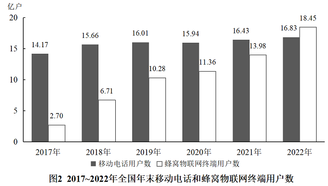

# 现期追赶问题（月均增长量+追赶模型）

考点：[[20-考点/资料分析/增长/现期追赶问题（月均增长量+追赶模型）|增长 / 现期追赶问题（月均增长量+追赶模型）]]
材料：[[15-材料/资料分析/361090 2017~2022年全国电信业发展情|361090 2017~2022年全国电信业发展情]]

**问法模型**：题干出现'每月增量均为固定值''第一次超过''在哪个季度'→ 先用（年末现期-年末基期）/12求两指标月均增长量，再列式 现期量=基期量+增长量×n 解出反超月份数，最后映射到季度

## 推理链
1. 第1步：从图2提取年末时点数：蜂窝物联网终端用户2021年13.98亿户→2022年18.45亿户，移动电话用户2021年16.43亿户→2022年16.83亿户，反超前差距=16.43-13.98=2.45亿户。
2. 第2步：月均增长量=全年增量÷12：蜂窝物联网=(18.45-13.98)/12=4.47/12≈0.37亿户/月，移动电话=(16.83-16.43)/12=0.40/12≈0.033亿户/月，每月差距缩小(4.47-0.40)/12=4.07/12≈0.34亿户。
3. 第3步：设n个月后反超，按现期量=基期量+增长量×n列式：13.98+0.37n>16.43+0.033n，即0.34n>2.45。
4. 第4步：解得n>2.45/0.34≈7.2，n至少取8（第8个月即8月末）。
5. 第5步：验证：n=7时物联网13.98+2.59=16.57<移动电话16.43+0.23=16.66未超；n=8时物联网16.94>16.69已超，确认第8个月首次反超。
6. 第6步：第8个月为8月，8月属第三季度（7~9月），与选项C对照，故选C。

**最快解法**：⚡ 差距均摊法（截位直除）：月初差距2.45亿户÷每月差距缩小量4.07/12≈0.34亿户，即2.45×12/4.07≈29.4/4.07≈7.2个月，进位取8个月→8月→第三季度；无需精确列式，一步除法即锁定季度

## 易错点
- ⚠ 时点数口径：图2为'年末'存量，全年增量必须用相邻两年年末数之差（4.47与0.40亿户），不能把18.45、16.83等年末值当全年均值使用。
- ⚠ n取整方向：解得n≈7.2后若四舍五入取7会误判为7月（第二季度），实际需向上进位取n=8，且8月属第三季度而非第三季度末才反超的模糊判断。
- ⚠ 基期起点用错：追赶起点是2021年末（13.98与16.43），若误以2022年末数据（18.45与16.83）为起点或把差距算反（如用18.45-16.83=1.62），会得出错误月份。

## 母题抽象
> 🧩 当题干出现'每月/每期增量固定，A第一次超过B是在哪个月（或季度）'时，用现期追赶模型：月初差距÷(A的期均增量-B的期均增量)，结果向上进位取整得期数，再映射到月份/季度

**同类特征**：2022年内、每个月增量均为固定值、第一次超过、是在哪个季度、年末用户数、现期追赶

## 相关题
- [[10-真题/资料分析/倍数/18643766 累计倍数（逐年累加构造累计值，比较'中国累计-日本累计×5'首次成立的年份）|18643766]]（天津 2026，相关度1）
- [[10-真题/资料分析/综合/18643852 当月值逐月累加求累计值首次突破阈值|18643852]]（四川 2026，相关度1）
- [[10-真题/资料分析/增长/19283961 增长量不变（等差外推）求首次超过某值的现期计算|19283961]]（国考 2025，相关度1）
- [[10-真题/资料分析/其他/19526449 累计值计算与阈值判断（当月值逐月累加+万亿-亿量级换算）|19526449]]（国考 2026，相关度1）
- [[10-真题/资料分析/增长/5445851 同比增量不变的外推追赶问题（现期追赶模型）|5445851]]（国考 2023，相关度1）

---

### 题干
如2022年内每个月移动电话用户数增量和蜂窝物联网终端用户数增量均为固定值，则2022年蜂窝物联网终端用户数第一次超过移动电话用户数是在哪个季度？

### 选项
- A. 第一季度
- B. 第二季度
- C. 第三季度　✅
- D. 第四季度

### 官方解析

根据题干“······2022年······第一次超过······是在哪个季度”，可判定本题为现期追赶问题。定位图2可得：2021~2022年，蜂窝物联网终端用户数分别为13.98亿户、18.45亿户，移动电话用户数分别为16.43亿户、16.83亿户。根据公式：月均增长量，则2022年蜂窝物联网终端用户数的月均增长量为亿户，2022年移动电话用户数的月均增长量为亿户。根据公式：现期量=基期量+增长量×n，可列式：，解得，则n至少为第8个月，8月在三季度，即2022年蜂窝物联网终端用户数第一次超过移动电话用户数是在第三季度。

故正确答案为C。

### 给定材料

