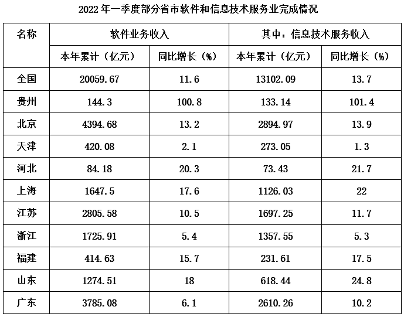

# 增长率读数比较（同表两列增速逐行对比计数）

考点：[[20-考点/资料分析/增长/增长率读数比较（同表两列增速逐行对比计数）|增长 / 增长率读数比较（同表两列增速逐行对比计数）]]
材料：[[15-材料/资料分析/5598820 2022年一季度全国及贵州、北京、上|5598820 2022年一季度全国及贵州、北京、上]]

**问法模型**：题干问'信息技术服务收入增速快于软件业务收入增速的省市有几个'→ 逐行同排比较两列同比增速大小并计数，且须剔除'全国'行只数省市

## 推理链
1. 第1步：从表格提取11行的两列同比增速：①软件业务收入同比增长(%)、②其中信息技术服务收入同比增长(%)，现期均为2022年一季度累计口径
2. 第2步：题干限定'省市'，故先剔除'全国'行——虽然全国满足13.7%＞11.6%，但不得计入计数
3. 第3步：逐行同排比较两列增速：贵州101.4%＞100.8%✓、北京13.9%＞13.2%✓、天津1.3%＜2.1%✗、河北21.7%＞20.3%✓、上海22%＞17.6%✓、江苏11.7%＞10.5%✓、浙江5.3%＜5.4%✗、福建17.5%＞15.7%✓、山东24.8%＞18%✓、广东10.2%＞6.1%✓
4. 第4步：满足条件的省市为贵州、北京、河北、上海、江苏、福建、山东、广东，共8个
5. 第5步：与选项对照，8对应C，故正确答案为C

**最快解法**：⚡ 读数比较+边读边标记法：无需任何计算，先划掉'全国'行，再逐行只比大小、边比边做√/✗标记，最后数√的个数；注意贵州行（100.8% vs 101.4%）三位数与三位数只差0.6个百分点需单独细看，上海'22'、山东'18'等简写仍为百分数按22%、18%处理

## 易错点
- ⚠ 把'全国'行（13.7%＞11.6%）误计入'省市'计数，会数出9个而误选D——全国行与省市行混排是本题最大陷阱
- ⚠ 比较方向颠倒：题干要求'信息技术服务增速＞软件业务收入增速'，若反着比会把天津（2.1%＞1.3%）、浙江（5.4%＞5.3%）算进去且漏掉其他行，个数完全错误
- ⚠ 两列增速量级悬殊易看串行：贵州三位数（100.8%/101.4%）与天津个位数（2.1%/1.3%）混排，逐行横向同排读数、不可竖列扫读，且注意'22''18'省略了%号仍是百分数

## 母题抽象
> 🧩 当题干出现'表中A指标增速快于B指标的地区/年份有几个'特征时，用逐行同排读数比较并计数的方法，先剔除'全国/合计'行，再对量级悬殊行单独核对，验证计数结果对应选项。

**同类特征**：增速快于、信息技术服务收入累计值同比增速、软件业务收入累计值同比增速、省市有几个、同表两列增速比较、计数型读数比较

## 相关题
（暂无）

---

### 题干
2022年一季度，表中信息技术服务收入累计值同比增速快于软件业务收入累计值同比增速的省市有几个？

### 选项
- A. 2
- B. 6
- C. 8　✅
- D. 9

### 官方解析
根据题干“2022年一季度······同比增速······”，可判定本题为一般增长率问题。定位表格材料可得，2022年一季度各省市信息技术服务收入累计值同比增速和软件业务收入累计值同比增速。经比较，符合题意的有贵州（101.4%＞100.8%）、北京（13.9%＞13.2%）、河北（21.7%＞20.3%）、上海（22%＞17.6%）、江苏（11.7%＞10.5%）、福建（17.5%＞15.7%）、山东（24.8%＞18%）、广东（10.2%＞6.1%），共8个。
故正确答案为C。

### 给定材料

