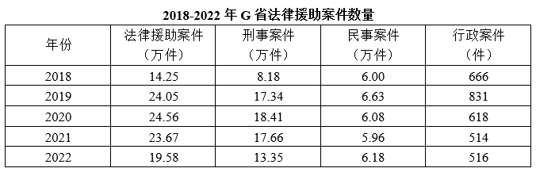

# 现期平均数计算

考点：[[20-考点/资料分析/平均数/现期平均数计算|平均数 / 现期平均数计算]]
材料：[[15-材料/资料分析/7527825 2022年我国及G省法律援助工作情况|7527825 2022年我国及G省法律援助工作情况]]

**问法模型**：题干出现'2022年平均每件法律援助案件帮助受援群众'→ 现期平均数模型，即帮助受援群众总人数÷法律援助案件总件数（总量在前、份数在后）。

## 推理链
1. 第1步：题干含'平均每件'且材料时间为2022年，判定为现期平均数问题，无需任何基期换算。
2. 第2步：从文字材料第二段取数：分子（总量）=帮助受援群众212993人，分母（份数）=G省法律援助案件195779件。
3. 第3步：代入公式：平均数=212993÷195779。
4. 第4步：速算定位商的范围：195779×1.1=215356.9＞212993，而195779×1.05≈205568＜212993，故商约在1.05~1.1之间（约1.088人/件）。
5. 第5步：交叉验证：用折线图口径21.3万人÷19.58万件≈1.088人/件，与精确口径结论一致。
6. 第6步：对照选项：1.088＜1.1，落入A项'小于1.1人'区间，故正确答案为A。

**最快解法**：⚡ 临界值比较法（秒杀区间选项）：不必精算商，直接比较分子与'分母×区间端点'——195779×1.1≈21.54万＞212993（21.3万），说明人均不足1.1人，直接锁定A；若需具体值，截位直除212993÷195779≈1.088即可。

## 易错点
- ⚠ 分子分母放反：应为人÷件（212993÷195779≈1.088），若颠倒成件÷人得0.92，本题碰巧仍小于1.1但模型错误，须牢记'总量÷份数'。
- ⚠ 口径混淆陷阱：不能用全国'1980万余人次法律咨询'当分子，也不能把'值班律师法律帮助案件65647件'（案件量的子集）当分母；跨图表换算时注意'万'与'件/人'之间10^4的量级统一（21.3万人=212993人）。
- ⚠ 时间口径多余动作：材料给出的'同比减少40937件、下降17.29%'是2021年基期信息，本题求2022年现期平均数，若去还原2021年数据属多余且会算错期。

## 母题抽象
> 🧩 当题干出现'平均每+份数单位（件/人/台/亩）'且材料直接给出现期总量与份数时，套'总量÷份数'做除法，用'分母×区间端点值与分子比大小'即可秒杀区间型选项。

**同类特征**：平均每件、帮助受援群众、现期（2022年）、人/件复合单位、区间判断型选项（小于/在…之间/大于）

## 相关题
- [[10-真题/资料分析/平均数/12019703 现期平均数计算|12019703]]（广东 2026，相关度2）
- [[10-真题/资料分析/平均数/19452623 现期平均数计算|19452623]]（上海 2026，相关度2）
- [[10-真题/资料分析/平均数/2434304 现期平均数计算|2434304]]（新疆 2019，相关度2）
- [[10-真题/资料分析/平均数/4737828 平均数增长率|4737828]]（福建 2017，相关度1）
- [[10-真题/资料分析/平均数/17764930 现期平均数计算（分子为隐含部分量，需'整体×比重'先拆出）|17764930]]（湖北 2024，相关度1）

---

### 题干
2022年，G省平均每件法律援助案件帮助受援群众（    ）。

### 选项
- A. 小于1.1人　✅
- B. 在1.1到1.2人之间
- C. 在1.2到1.3人之间
- D. 大于1.3人

### 官方解析
根据题干“2022年······平均每······”，结合材料时间为2022年，可判定本题为现期平均数问题。定位文字材料第二段可得∶2022年，G省法律援助机构共组织办理法律援助案件（以下简称G省法律援助案件）195779件，帮助受援群众212993人。根据平均每件法律援助案件帮助受援群众人数，则题干所求人，在A项范围内。
故正确答案为A。

### 给定材料

        自2022年1月1日《中华人民共和国法律援助法》施行以来，我国法律援助覆盖面不断扩大、服务水平显著提升。据统计，2022年全国法律援助机构共组织办理法律援助案件137万余件，值班律师提供法律帮助95万余件，为1980万余人次提供法律咨询，提供法律咨询人次同比增加约5%。

        2022年，G省法律援助机构共组织办理法律援助案件（以下简称G省法律援助案件）195779件，较2021年减少40937件，同比下降17.29%，其中刑事案件133509件（含值班律师法律帮助案件65647件），民事案件61754件，行政案件516件。帮助受援群众212993人。

