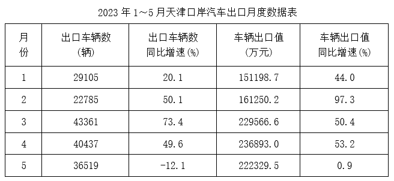

# 平均数增长率（均价=值-量的比值增长率）

考点：[[20-考点/资料分析/平均数/平均数增长率（均价=值-量的比值增长率）|平均数 / 平均数增长率（均价=值/量的比值增长率）]]
材料：[[15-材料/资料分析/4267707 2023年1~5月天津口岸汽车出口情|4267707 2023年1~5月天津口岸汽车出口情]]

**问法模型**：题干问'均价同比上涨为多少（百分数）'→ 套平均数增长率模型 (1+a)/(1+b)-1，a=出口总值增速40.2%，b=出口量增速29.5%

## 推理链
1. 第1步：题干'出口汽车均价同比上涨'且选项为百分数，判定为平均数增长率问题；均价=出口总值÷出口辆数（值/量）
2. 第2步：定位文字材料第一段提取两增速：出口总值100.1亿元、同比+40.2%（a=分子增速）；出口量17.2万辆、同比+29.5%（b=分母增速）
3. 第3步：代入平均数增长率公式：(1+a)/(1+b)-1=(1+40.2%)/(1+29.5%)-1=1.402/1.295-1
4. 第4步：速算：(a-b)/(1+b)=10.7%/1.295≈8.3%，即均价同比上涨约8.3%
5. 第5步：与选项对照：8.3%仅与A项8%吻合（B12%/C16%/D20%均偏差过大），故选A

**最快解法**：⚡ 公式法+定性锁定：平均数增长率=(a-b)/(1+b)=(40.2%-29.5%)/(1+29.5%)=10.7%/1.295≈8.3%；更快的考场技巧——因b>0，答案必小于a-b=10.7%，四个选项中只有A(8%)小于10.7%，直接秒选A，无需精算

## 易错点
- ⚠ 直接把两增速相减得40.2%-29.5%=10.7%，10.7%更靠近B(12%)，会误选B；正确模型是(1+a)/(1+b)-1=(a-b)/(1+b)
- ⚠ a、b对应关系勿颠倒：a=出口值增速40.2%（分子为总值），b=出口量增速29.5%（分母为辆数）；颠倒后符号与数值全错
- ⚠ 取数口径陷阱：文字用'万辆/亿元'、表格用'辆/万元'量级差1万倍，且表格各月增速与累计增速不同（如5月量-12.1%、值+0.9%，2月值+97.3%）；本题只取文字段1~5月累计增速，勿误用表格月度数据

## 母题抽象
> 🧩 当题干出现'均价/单价/平均XX同比上涨（下降）为百分之几'且材料分别给出分子总量增速a与分母个数增速b时，用平均数增长率公式(a-b)/(1+b)：先定性（a>b为涨、a<b为降），再记住当b>0时结果必小于|a-b|，可直接排除选项

**同类特征**：均价、同比上涨、平均数增长率、出口总值增速与出口量增速成对出现、选项为百分数、问整体时段（1~5月累计）而非单月

## 相关题
- [[10-真题/资料分析/平均数/4737828 平均数增长率|4737828]]（福建 2017，相关度2）
- [[10-真题/资料分析/平均数/1752640 平均数增长率（人均收入增长率）|1752640]]（北京 2016，相关度2）
- [[10-真题/资料分析/平均数/2367793 平均数增长率（人均薪酬增速，份数增速为0的特例）|2367793]]（江苏 2019，相关度2）
- [[10-真题/资料分析/增长/9629 一般增长率计算（现期需由增量倒推）|9629]]（安徽 2009，相关度1）
- [[10-真题/资料分析/比重/2604234 现期比重计算|2604234]]（广东 2020，相关度1）

---

### 题干
2023年1-5月，天津口岸出口汽车均价同比上涨为：

### 选项
- A. 8%　✅
- B. 12%
- C. 16%
- D. 20%

### 官方解析
根据题干“2023年1-5月······均价同比上涨为”，结合选项为百分数，可判定本题为平均数的增长率问题。定位文字材料第一段可得：2023年前5个月，天津口岸出口汽车约17.2万辆，同比增长29.5%（b），总价值约100.1亿元人民币，同比增长40.2%（a）。根据公式：平均数的增长率，则2023年1-5月，天津口岸出口汽车均价同比上涨，结合选项，只有A项满足。
故正确答案为A。

### 给定材料

        2023年前5个月，天津口岸出口汽车约17.2万辆，同比增长29.5%，总价值约100.1亿元人民币，同比增长40.2%。

        2023年前5个月，汽车出口带动天津口岸整体出口同比增加。汽车出口占同期天津口岸出口商品总值的2.2%，较上年同期提升0.3个百分点。1~5月民营企业出口活力明显，民营企业出口约10.6万辆，同比增长64.3%，占同期天津口岸汽车出口总量的61.6%，占比较上年同期提升13个百分点。新能源汽车出口成为新的增长点，出口约11万辆，同比增长50.2%。

