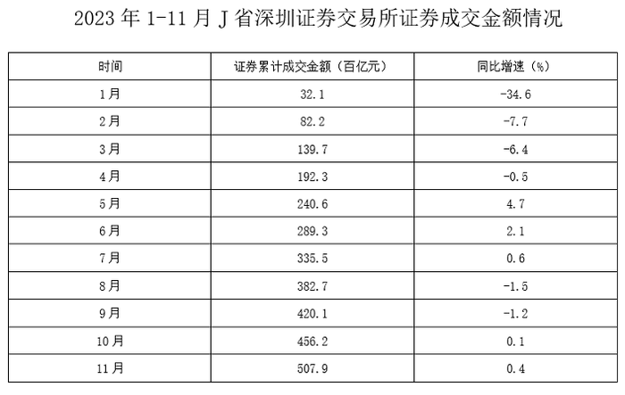
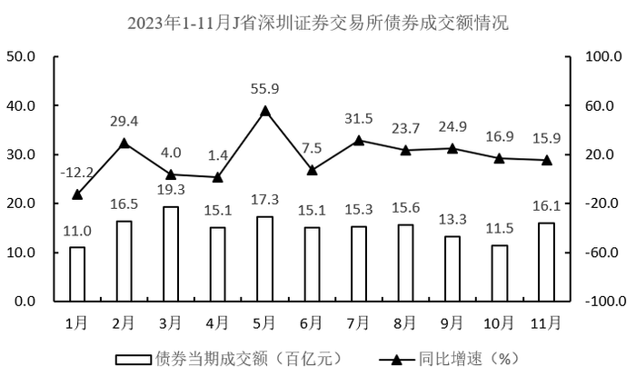

# 现期平均数计算（多月求和÷月份数）

考点：[[20-考点/资料分析/平均数/现期平均数计算（多月求和÷月份数）|平均数 / 现期平均数计算（多月求和÷月份数）]]
材料：[[15-材料/资料分析/6403877 2023年1-11月J省深圳证券交易|6403877 2023年1-11月J省深圳证券交易]]

**问法模型**：题干问'2023年上半年……平均成交额'→ 现期平均数模型：上半年各月当期值之和÷6，直接用柱状图当期值，无需基期或增速

## 推理链
1. 第1步：题干限定'上半年'即2023年1-6月共6个月，锁定双轴组合图柱状（左轴）的债券当期成交额序列
2. 第2步：从图中读取1-6月当期值：11.0、16.5、19.3、15.1、17.3、15.1百亿元（注意55.9是5月同比增速，非成交额；4月与6月同为15.1）
3. 第3步：现期平均数=各月当期值之和÷6，求和11.0+16.5+19.3+15.1+17.3+15.1=94.3百亿元
4. 第4步：直除94.3÷6≈15.72百亿元
5. 第5步：15.72落在15-16百亿元区间，对照选项判定B正确

**最快解法**：⚡ 求和+截位直除：6个数两两凑整速加（11.0+19.3=30.3，16.5+15.1=31.6，15.1+17.3=32.4，合计94.3），再94.3÷6，首位商1、次位商5得15.7，一步锁定B区间；选项同为百亿元单位，无需×100换算

## 易错点
- ⚠ 口径混用：本题只需柱状图'债券当期成交额'，勿误用统计表的'证券累计成交金额'（累计口径），也不能拿表中增速参与计算
- ⚠ 数值标签错位：双轴图中55.9、29.4等是折线同比增速（右轴%），柱才是成交额；4月与6月柱同为15.1，求和时勿漏加或只加一次
- ⚠ 时间与单位陷阱：'上半年'=1-6月共6项，误取1-11月或只用部分月份必错；全材料单位是百亿元，若选项以亿元表述需×100（94.3百亿元=9430亿元）

## 母题抽象
> 🧩 当题干出现'某时段平均/月均成交额（额）'且数据为逐月当期值序列时，直接取该时段各月当期值求和÷月份数，截位直除首位即可匹配区间选项，不必触碰增速与基期

**同类特征**：上半年、平均成交额、月均、当期值求和、区间型选项、百亿元单位

## 相关题
- [[10-真题/资料分析/增长/2264417 基期量反推+环比增长率（图外基期两步链式计算）|2264417]]（国考 2019，相关度1）
- [[10-真题/资料分析/平均数/2579778 现期平均数计算（累计值−单月值做差求子时段总量后求月均）|2579778]]（浙江 2020，相关度1）
- [[10-真题/资料分析/平均数/5802111 现期平均数（日均进口量=区间总量÷区间天数）|5802111]]（浙江 2023，相关度1）
- [[10-真题/资料分析/比重/10297462 现期比重计算（部分占整体比重+区间型选项）|10297462]]（四川 2025，相关度1）
- [[10-真题/资料分析/平均数/16593070 年均量（算术平均数）计算与区间判定|16593070]]（甘肃 2024，相关度1）

---

### 题干
2023年上半年J省深圳证券交易所债券平均成交额为：

### 选项
- A. 不到15百亿元
- B. 15-16百亿元　✅
- C. 16-17百亿元
- D. 超过17百亿元

### 官方解析

根据题干“2023年上半年······平均成交额为”，可判定本题为现期平均数问题。定位统计图可得：2023年上半年（1-6月）J省深圳证券交易所债券当期成交额分别为11.0百亿元、16.5百亿元、19.3百亿元、15.1百亿元、17.3百亿元、15.1百亿元。则所求平均数百亿元，在B项范围内。

故正确答案为B。

### 给定材料

