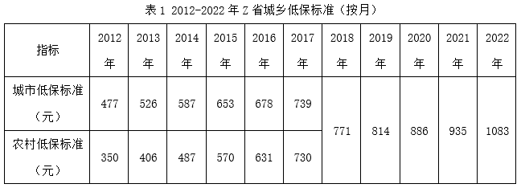
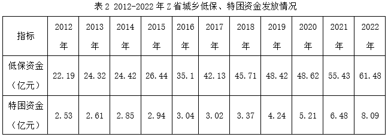

# 平均数公式逆向求人数（人数=资金÷人均年标准）后再作比

考点：[[20-考点/资料分析/平均数/平均数公式逆向求人数（人数=资金÷人均年标准）后再作比|平均数 / 平均数公式逆向求人数（人数=资金÷人均年标准）后再作比]]
材料：[[15-材料/资料分析/4176743 Z省2012-2022年城乡低保标准|4176743 Z省2012-2022年城乡低保标准]]

**问法模型**：题干出现'A对象与B对象人数之比约为'→由'发放资金=人数×人均年标准'逆向求各自人数（人数=资金÷人均年标准），再作比并约分化简

## 推理链
1. 第1步：从文字材料提取2022年底数据：人均城乡低保标准12996元/年、发放低保资金61.48亿元；特困供养人均年标准21072元、发放特困资金8.09亿元
2. 第2步：所用公式：人数=发放资金÷人均年标准，亿元需换算为元（61.48亿元=6.148×10^9元，8.09亿元=8.09×10^8元）
3. 第3步：低保对象人数=61.48×10^8÷12996≈4.73×10^5人（约47.3万人）；特困对象人数=8.09×10^8÷21072≈3.84×10^4人（约3.8万人）
4. 第4步：特困对象人数:低保对象人数≈3.84万:47.3万≈0.0812≈1/12.3（等价写法：=(8.09/61.48)×(12996/21072)≈0.13×0.62≈0.081）
5. 第5步：与选项对照：0.0812最接近1/12，故约为1:12，选D

**最快解法**：⚡ 比式交叉约分法：特困:低保=(8.09/21072)÷(61.48/12996)=(8.09/61.48)×(12996/21072)≈(8/61.5)×(13/21)≈0.13×0.62≈0.081≈1/12.4→直接锁定1:12，全程口算，避免分别算出两套上亿量级的大数

## 易错点
- ⚠ 单位换算陷阱：资金是亿元、标准是元/人·年，跨单位拼接量级巨大，硬算人数极易出错，应先用比式约分；另注意文字按年给标准（12996元/年=1083元/月×12），若误用月口径会差12倍
- ⚠ '累计发放61.48亿元、8.09亿元'实为2022年当期全年发放额，与表2最末列吻合，并非多年累计，当成累计值即错
- ⚠ 比值顺序陷阱：题干问'特困对象与低保对象'之比，分子是小数（约3.8万），若颠倒为低保:特困（约12:1）会误判方向

## 母题抽象
> 🧩 当题干出现'人均标准+发放资金'求人数或人数之比的特征时，用'人数=资金÷人均年标准'逆向模型，先列比值交叉约分再口算近似，验证结果落在哪个选项

**同类特征**：人数之比约为、特困对象与低保对象、2022年、人均年标准、发放资金、亿元对元跨单位换算

## 相关题
- [[10-真题/资料分析/比重/17900953 现期比重结构判断（饼图-示意图比例匹配）|17900953]]（江苏 2024，相关度1）
- [[10-真题/资料分析/比重/2676663 同基结构占比相除求两部分人数之比|2676663]]（选调 2018，相关度1）
- [[10-真题/资料分析/增长/2742301 整体同比增长率计算（整体=私有云+公有云加总后求增速）|2742301]]（北京 2021，相关度1）
- [[10-真题/资料分析/增长/16592975 增长率比较（首尾年份隔点比较）|16592975]]（青海 2024，相关度1）
- [[10-真题/资料分析/平均数/13432271 现期平均数（客运强度=客运量÷运营里程）计算与比较|13432271]]（深圳市考 2025，相关度1）

---

### 题干
2022年，Z省特困对象与低保对象人数之比约为（    ）。

### 选项
- A. 1：6
- B. 1：8
- C. 1：10
- D. 1：12　✅

### 官方解析

根据题干“2022年······与······之比约为”，可判定本题为比值计算问题。定位文字材料可得：截止2022年底，Z省人均城乡低保标准全部达到12996元/年，全省特困供养人均年标准达到21072元。全省累计发放最低生活保障资金61.48亿元，特困资金8.09亿元。根据公式：人数，则2022年Z省低保对象人数：特困对象人数，即特困对象人数：低保对象人数。

故正确答案为D。

### 给定材料

        截止2022年底，Z省人均城乡低保标准全部达到12996元/年，各个地市低保年标准全部达到12420元以上，并实现市城同标，全省特困供养标准第一年实现城乡统筹，人均年标准达到21072元。全年开展临时救助9.06万人次。全省累计发放最低生活保障资金61.48亿元，特困资金8.09亿元，临时救助资金2.56亿元。

