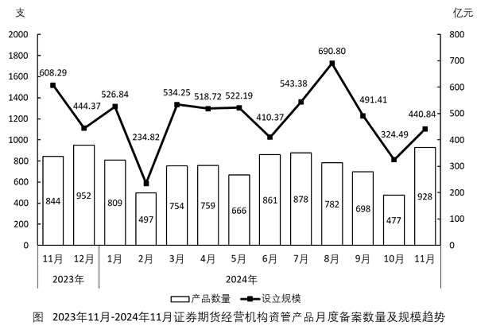

# 平均数增长率（两期平均数比较，现期平均每支设立规模 vs 上年同期）

考点：[[20-考点/资料分析/平均数/平均数增长率（两期平均数比较，现期平均每支设立规模 vs 上年同期）|平均数 / 平均数增长率（两期平均数比较，现期平均每支设立规模 vs 上年同期）]]
材料：[[15-材料/资料分析/4141961 2023年11月—2024年11月证|4141961 2023年11月—2024年11月证]]

**问法模型**：题干出现'平均每支设立规模约比上年同期多/少百分之几'→ 平均数增长率模型：先分别求现期与基期平均数（设立规模÷产品数量）作商，或用平均数增长率公式 (a-b)/(1+b)

## 推理链
1. 第1步：从图1提取数据——2024年11月设立规模440.84亿元、产品数量928支；同比基期取2023年11月：设立规模608.29亿元、产品数量844支（勿误取2023年12月的444.37亿元/952支）
2. 第2步：明确公式：平均每支设立规模=设立规模÷产品数量（亿元/支）；平均数增长率=（现期平均数−基期平均数）÷基期平均数
3. 第3步：代入计算：现期平均=440.84/928≈0.475亿元/支，基期平均=608.29/844≈0.721亿元/支，所求=(0.475−0.721)/0.721≈−0.246/0.721≈−34%
4. 第4步：与选项对照：负号说明'少'，幅度约34%最接近35%，排除A（少27%）和C、D（多），锁定B
5. 第5步（方法二验证）：规模增速a=(440.84−608.29)/608.29≈−27.5%，数量增速b=(928−844)/844≈+10%，平均数增长率=(a−b)/(1+b)=(−27.5%−10%)/(1+10%)≈−37.5%/1.1≈−34%，同样指向'少35%'

**最快解法**：⚡ 公式法（平均数增长率 (a-b)/(1+b)）：口算a≈−27.5%（−167.45/608.29），b≈+10%（84/844），代入得(−27.5%−10%)/1.1≈−34%，符号为负即'少'、幅度靠近35%，直接选B；若不记公式，截位直除两个平均数440.84/928≈0.47与608.29/844≈0.72，(0.47−0.72)/0.72≈−35%亦得B

## 易错点
- ⚠ 基期取错月份：同比基期应取2023年11月（608.29亿元/844支），若顺柱取到2023年12月（444.37/952）会算出完全不同的结论
- ⚠ 方向与幅度双重误判：只看规模增速−27.5%就误选A（少27%），忽略数量b为正增长（+10%）会进一步拉低平均数，实际降幅约34%接近35%
- ⚠ 柱线双轴混淆：平均数必须用右轴线值（亿元）÷左轴柱值（支），不能目测柱线高低比较，且现期平均<基期平均，先排'多'再排幅度更小的'少27%'

## 母题抽象
> 🧩 当题干出现'平均每单位……（总量÷份数）比上年同期多/少x%'时，用平均数增长率公式(a−b)/(1+b)（a=总量增速，b=份数增速，增长取正、下降取负），符号定'多/少'、数值选最接近选项，再可用'先算两期平均数再作商'复核

**同类特征**：平均每支设立规模、比上年同期、约、选项为多/少+百分数、同比基期从月度时序图取上年同月、复合指标=亿元÷支

## 相关题
- [[10-真题/资料分析/增长/10204598 一般增长率计算（结合比重反推总量）|10204598]]（黑龙江 2024，相关度1）
- [[10-真题/资料分析/平均数/2448577 两期平均数升降判断（平均数增长率方向+幅度分档）|2448577]]（国考 2020，相关度1）
- [[10-真题/资料分析/增长/5483992 增长量计算（季度=三个月加总后作差，定性判断区间）|5483992]]（北京 2023，相关度1）
- [[10-真题/资料分析/比重/13504410 两期比重变化（两期比重差）|13504410]]（云南 2025，相关度1）
- [[10-真题/资料分析/增长/1752612 增速同比变动幅度（百分点作差）·折线图读数|1752612]]（北京 2016，相关度1）

---

### 题干
2024年11月，证券期货经营机构备案私募资管产品平均每支设立规模约比上年同期：

### 选项
- A. 少27%
- B. 少35%　✅
- C. 多27%
- D. 多35%

### 官方解析
根据题干“2024年11月······平均每支设立规模约比上年同期”，结合选项为“多/少+百分数”，可判定本题为平均数的增长率问题。定位统计图可得：2024年11月，证券期货经营机构备案私募资管产品设立规模为440.84亿元，产品数量为928支；2023年11月，证券期货经营机构备案私募资管产品设立规模为608.29亿元，产品数量为844支。
方法一：根据公式：平均每支设立规模，可得：2024年11月证券期货经营机构备案私募资管产品平均每支设立规模，2023年11月证券期货经营机构备案私募资管产品平均每支设立规模。根据公式：增长率，则所求为，与B项最接近。
方法二：根据公式：增长率，可得：2024年11月证券期货经营机构备案私募资管产品设立规模的增长率（a），2024年11月证券期货经营机构备案私募资管产品数量的增长率（b）。根据公式：平均数的增长率，则所求为，与B项最接近。
故正确答案为B。

### 给定材料

        2024年11月证券期货经营机构共计销售产品928支。

