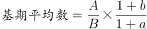
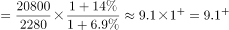
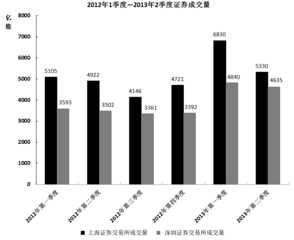

# 基期平均数计算

考点：[[20-考点/资料分析/平均数/基期平均数计算|平均数 / 基期平均数计算]]

**问法模型**：材料时间为2013年而题干问2012年5月‘平均每股成交金额’→ 用基期平均数模型：现期平均数×(1+分母增速)/(1+分子增速)

## 推理链
1. 第1步：题干时间‘2012年5月’早于材料时间‘2013年5月’，且‘平均每股成交金额=成交金额÷成交股数’为两量相除的平均数，判定为基期平均数问题
2. 第2步：定位表格中上海证券交易所一行，提取2013年5月成交金额A、成交金额同比增速a、成交股数B、成交股数同比增速b
3. 第3步：套用基期平均数公式：基期每股成交金额=(A/B)×(1+b)/(1+a)，其中a为分子(成交金额)增速、b为分母(成交股数)增速
4. 第4步：代入计算，现期 A/B 与增速修正项 (1+b)/(1+a) 相乘后结果约9.7元（单位：亿元÷亿股=元/股）
5. 第5步：与选项对照，A项7.4、C项10.4、D项12.5均偏离，与B项9.7最接近，故选B

**最快解法**：⚡ 公式法+截位直除：先截位算现期每股成交金额A/B，再看两项增速是否接近；增速相差不大时基期平均数≈现期平均数，直接对照选项锁定9.7附近的B，无需精算修正系数

## 易错点
- ⚠ 时间陷阱：材料是2013年5月，题干问2012年5月，直接用现期数据相除会错选接近现期值的干扰项
- ⚠ 增速放反：修正系数应为(1+分母增速)/(1+分子增速)，即(1+股数增速)/(1+金额增速)，分子分母增速颠倒会算反方向
- ⚠ 单位口径：成交金额(亿元)÷成交股数(亿股)=元/股，注意量级直接对应，不必再乘除进位

## 母题抽象
> 🧩 当题干出现‘基期时间+平均每股/平均每……’且材料只给现期分子分母及各自同比增速时，用基期平均数公式 A/B×(1+b)/(1+a)（b为分母增速），结果与最接近选项对照即可

**同类特征**：题干时间早于材料时间(2012年5月vs2013年)、‘平均每股成交金额’两量相除结构、限定主体：上海证券交易所、约为多少元(估算型问法)、基期平均数、表格型材料

## 相关题
- [[10-真题/资料分析/平均数/13504661 基期平均数计算|13504661]]（辽宁 2025，相关度2）
- [[10-真题/资料分析/平均数/2274480 基期平均数计算|2274480]]（北京 2019，相关度2）
- [[10-真题/资料分析/平均数/2453204 基期平均数计算（分子分母增速方向相反）|2453204]]（北京 2020，相关度1）
- [[10-真题/资料分析/平均数/2456364 基期平均数计算（基期量换算＋平均）|2456364]]（浙江 2020，相关度1）
- [[10-真题/资料分析/平均数/19283737 基期平均数（日均处理金额，现期量推基期量+天数平均）|19283737]]（国考 2025，相关度1）

---

### 题干
2012年5月，上海证券交易所平均每股成交金额约为多少元：

### 选项
- A. 7.4
- B. 9.7　✅
- C. 10.4
- D. 12.5

### 官方解析

根据题干“平均每股成交金额”结合材料时间为2013年，可判定本题为基期平均数问题。根据公式，定位表格数据代入可得，与B选项最接近。

故正确答案为B。

### 给定材料

