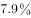
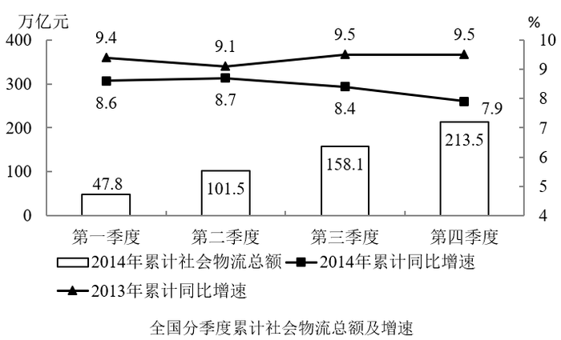

# 现期平均数（强度比值×单位量换算）

考点：[[20-考点/资料分析/平均数/现期平均数（强度比值×单位量换算）|平均数 / 现期平均数（强度比值×单位量换算）]]
材料：[[15-材料/资料分析/180726 2014年全国社会物流运行情况：社会|180726 2014年全国社会物流运行情况：社会]]

**问法模型**：“每实现100万元社会物流额的运输费平均约多少万元”→现期平均数模型：100万×(运输费用÷社会物流总额)，即先求运输费占物流额的比例，再乘给定的单位量

## 推理链
1. 第1步：题干时间与材料时间同为2014年，属现期计算；从文字段提取分母=2014年社会物流总额213.5万亿元，分子=运输费用5.6万亿元（注意题干只要运输费，不是总费用10.6万亿元）
2. 第2步：公式：每100万元物流额的运输费=100万元×(运输费用÷物流总额)=100×5.6/213.5万元
3. 第3步：代入计算：5.6/213.5≈5.6/214≈0.0262，即运输费约占物流额的2.6%，0.0262×100万元≈2.62万元
4. 第4步：与选项对照：2.62≈2.6，排除A（直接抄5.6）、B（直接抄10.6）、D（误用总费用口径10.6/213.5×100≈5.0），锁定C

**最快解法**：⚡ 截位直除+选项反推：5.6/213.5，商首两位约2.6（验证：213.5×2.6%≈5.55≈5.6），故每100万元物流额对应运输费约2.6万元；也可先排错——A、B是照抄材料的原数5.6、10.6，D是误用总费用10.6/213.5≈5%的产物，唯C符合“运输费÷物流额”口径

## 易错点
- ⚠ 分子口径错误：误用物流总费用10.6万亿元（对应D项5.0），题干只问“运输费用”5.6万亿元
- ⚠ 照抄材料数陷阱：把5.6或10.6直接当答案选A/B，忽略“每100万元物流额”要求的是比值×单位量
- ⚠ 单位与量级：万亿元÷万亿元量纲约掉后还需×100万元才得“万元”，漏乘会错成0.026量级；同时勿与构成表的亿元口径混淆

## 母题抽象
> 🧩 当题干出现“每实现/每生产X单位的A，对应B平均约为多少”时，用“占比×单位量”模型：先B÷A求比例，再乘X；核对分子分母口径（部分对总体、时间同为现期），并用选项反查排除照抄材料数的干扰项

**同类特征**：每实现100万元、平均约为、现期（题干时间=材料时间2014年）、运输费用/社会物流额双口径、万亿元与万元的单位换算、选项含照抄材料数的干扰项

## 相关题
- [[10-真题/资料分析/平均数/12019703 现期平均数计算|12019703]]（广东 2026，相关度1）

---

### 题干
2014年每实现100万元的社会物流额，其运输费用平均约为多少万元？

### 选项
- A. 5.6
- B. 10.6
- C. 2.6　✅
- D. 5.0

### 官方解析

由题干“2014年每······平均”，且材料时间为2014年，判断题型为现期平均数问题。定位文字材料第一段可得2014年全国社会物流总额为213.5万亿元，定位文字材料第二段可得物流总费用中运输费用为5.6万亿元，则平均每元社会物流额的运输费元，故每实现100万元的社会物流额，其运输费用为2.6万元。

故正确答案为C。

### 给定材料

        2014年全国社会物流总额213.5万亿元，同比增长，比上年回落1.6个百分点。

        2014年全国社会物流总费用10.6万亿元，同比增长。其中，运输费用5.6万亿元，同比增长；保管费用3.7万亿元，同比增长；管理费用1.3万亿元，同比增长。

