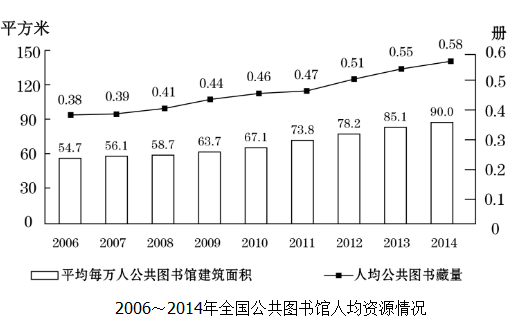

# 现期平均数（区间总量比：Σ册次÷Σ人次）

考点：[[20-考点/资料分析/平均数/现期平均数（区间总量比：Σ册次÷Σ人次）|平均数 / 现期平均数（区间总量比：Σ册次÷Σ人次）]]
材料：[[15-材料/资料分析/180724 2014年全国公共图书馆发展情况：机|180724 2014年全国公共图书馆发展情况：机]]

**问法模型**：题干'2012～2014年平均每流通人次产生多少册次外借'→ 用区间内书刊文献外借册次总和÷总流通人次总和（总量比总量，非逐年比值再平均）

## 推理链
1. 第1步：从图1折线（读右轴，亿册次）提取2012~2014年书刊文献外借册次：3.32、4.09、4.67
2. 第2步：从图1柱形（读左轴，亿人次）提取同期总流通人次：4.34、4.92、5.30
3. 第3步：套用模型'平均每流通人次产生外借册次=三年外借册次之和÷三年流通人次之和'
4. 第4步：分子=3.32+4.09+4.67=12.08亿册次；分母=4.34+4.92+5.30=14.56亿人次
5. 第5步：12.08÷14.56≈0.83，与选项对照最接近0.8，锁定B

**最快解法**：⚡ 截位直除+选项反推：先求和得12.08/14.56，截位为12.1/14.6；用分母反推验证——14.56×0.8≈11.6、14.56×0.9≈13.1，12.08落在两者之间且更靠近0.8一端，直接选B，无需精算

## 易错点
- ⚠ 双轴读数陷阱：图1柱形读左轴（0~8亿人次）、折线读右轴（0~5亿册次），两轴满刻度不同，若把外借册次按左轴读或把人次按右轴读会严重错位
- ⚠ 模型误用陷阱：'平均每流通人次产生册次'是Σ册次÷Σ人次（总量比总量），不能先算各年比值(如3.32/4.34≈0.76)再对三年比值取平均
- ⚠ 指标与时间口径陷阱：'流通人次'与'外借册次'是两个不同指标（人次≠册次）不能混搭；时间范围仅2012~2014三年，勿把2006年起全部年份纳入求和

## 母题抽象
> 🧩 当题干出现'某时段平均每A产生/对应多少B'特征时，用 时段内B总量÷时段内A总量（ΣB/ΣA）一步直除，先核对两指标口径单位与图表双轴刻度，再与选项反推对照

**同类特征**：2012～2014年（区间三年）、平均每流通人次、产生多少册次、书刊文献外借、双轴柱线图跨指标相除、选项为小数且间隔0.2

## 相关题
（暂无）

---

### 题干
2012～2014年，平均每流通人次约产生多少册次的书刊文献外借？

### 选项
- A. 1.0
- B. 0.8　✅
- C. 0.6
- D. 0.4

### 官方解析

由题干“2012～2014年，平均每······”，可判定此题为现期平均数问题。定位图形材料，2012-2014年平均每流通人次产生的书刊文献外借册次=。

故正确答案为B。

### 给定材料

        2014年末全国共有公共图书馆3117个，比上年末增加5个。年末全国公共图书馆从业人员56071人。

 

        2014年末全国公共图书馆实际使用房屋建筑面积1231.60万平方米，比上年末增长6.3%；图书总藏量79092万册，比上年末增长5.6％；电子图书50674万册，比上年末增长34.2%；阅览室座席数85.55万个，比上年末增长5.7%。

