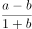
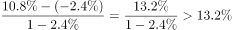
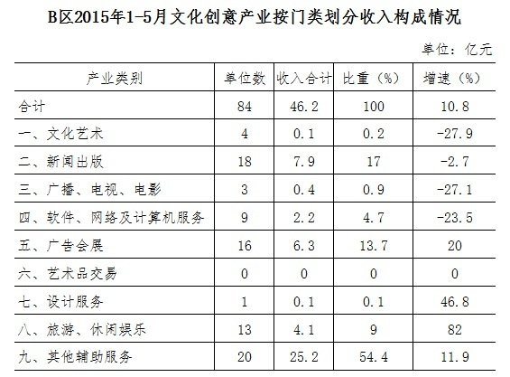

# 平均数增长率（人均收入增长率）

考点：[[20-考点/资料分析/平均数/平均数增长率（人均收入增长率）|平均数 / 平均数增长率（人均收入增长率）]]
材料：[[15-材料/资料分析/181116 2015年1-5月B区规模以上文化创|181116 2015年1-5月B区规模以上文化创]]

**问法模型**：题干出现'从业人员人均完成收入约比上年同期增长'→判定为平均数增长率问题，套公式 g=(a-b)/(1+b)，a=总量（收入）增速，b=份数（人数）增速

## 推理链
1. 第1步：定位文字段1，提取2015年1-5月完成收入46.2亿元、同比+10.8%（即a=10.8%），从业人员平均1.3万人、同比-2.4%（即b=-2.4%）
2. 第2步：平均数增长率公式为 g=(a-b)/(1+b)，分子用收入增速，分母(1+b)用人数增速修正基期份数变化
3. 第3步：代入计算 g=(10.8%-(-2.4%))/(1-2.4%)=13.2%/0.976≈13.5%（口算a-b=13.2%后因b<0、分母0.976<1，真实值略大于13.2%）
4. 第4步：与选项对照：A 2.5%、B 8.4%、C 10.8%、D 13.4%，仅D项13.4%落在13.2%~13.5%区间且最接近，故选D

**最快解法**：⚡ 公式法+估算：先口算a-b=10.8%-(-2.4%)=13.2%，据此排除C(10.8%)、B(8.4%)、A(2.5%)；再因b=-2.4%<0使分母(1+b)=0.976<1，实际增速略高于13.2%，直接锁定D 13.4%，无需精算

## 易错点
- ⚠ 忽略从业人员下降2.4%的影响，误认为人均收入增速就等于收入增速10.8%而错选C
- ⚠ b为负值时符号处理出错：把(a-b)算成10.8%-2.4%=8.4%而错选B，正确应为10.8%+2.4%=13.2%
- ⚠ 误读'比1-4月增幅收窄0.8个百分点'，把同比增速当成10.8%-0.8%=10%参与计算，混淆同比与环比参照口径

## 母题抽象
> 🧩 当题干出现'人均/平均每个单位/单位平均……比上年同期增长(下降)%'特征时，识别为平均数增长率模型，用(a-b)/(1+b)代入分子总量增速a与份数增速b（注意b的正负号），先算a-b锁定区间再对照选项

**同类特征**：人均完成收入、比上年同期增长、平均数增长率、总量增速+人数增速、(a-b)/(1+b)、选项为百分数

## 相关题
- [[10-真题/资料分析/平均数/10204497 平均数增长率（均价=值-量的比值增长率）|10204497]]（海南 2024，相关度2）
- [[10-真题/资料分析/平均数/4737828 平均数增长率|4737828]]（福建 2017，相关度2）
- [[10-真题/资料分析/平均数/1746788 两期平均数增长率（户均注册资本的同比增长率）|1746788]]（国考 2016，相关度2）
- [[10-真题/资料分析/平均数/2367793 平均数增长率（人均薪酬增速，份数增速为0的特例）|2367793]]（江苏 2019，相关度2）
- [[10-真题/资料分析/增长/9629 一般增长率计算（现期需由增量倒推）|9629]]（安徽 2009，相关度1）

---

### 题干
2015年1-5月B区规模以上文化创意产业从业人员人均完成收入约比上年同期增长：

### 选项
- A. 2.5%
- B. 8.4%
- C. 10.8%
- D. 13.4%　✅

### 官方解析

根据题干“2015年1-5月······人均完成收入约比上年同期增长”，结合选项为百分数，可判定本题为平均数增长率计问题。定位文字材料第一段可得：2015年1-5月，B区规模以上文化创意产业完成收入46.2亿元（A），比上年同期增长（a）；从业人员平均人数1.3万人（B），比上年同期下降（b）。根据公式：平均数的增长率=，可得题目所求为，只有D项满足。

故正确答案为D。

### 给定材料

        2015年1-5月，B区规模以上文化创意产业完成收入46.2亿元，比上年同期增长10.8%，比1-4月增幅收窄0.8个百分点，从业人员平均人数1.3万人，比上年同期下降2.4%。

        1-5月，B区规模以上文化创意产业实现利润总额-0.4亿元，亏损额比1-4月略有扩张，亏损额同比略有收窄。其中，新闻出版亏损额进一步扩大，实现利润总额-0.3亿元，比上年同期亏损额增加0.2亿元；软件、网络及计算机服务受个别企业业务整合的影响，降幅较大，实现利润0.2亿元，同比下降81.3%；其他辅助服务亏损额大幅收窄，实现利润-0.1亿元，亏损额同比减少1.1亿元。

        截止到5月底，B区规模以上文化创意产业规模较小，法人单位只有84家，仅占全市的1.0%；大型企业匮乏，收入达亿元企业只有8家，中小型企业居多。

