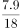
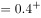
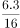
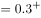
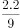
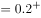
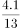

# 现期平均数计算与大小比较（平均每单位收入）

考点：[[20-考点/资料分析/平均数/现期平均数计算与大小比较（平均每单位收入）|平均数 / 现期平均数计算与大小比较（平均每单位收入）]]
材料：[[15-材料/资料分析/181116 2015年1-5月B区规模以上文化创|181116 2015年1-5月B区规模以上文化创]]

**问法模型**：题干问'2015年1-5月平均每个单位创造的收入各选项中最低'→直接用统计表现期'收入合计÷单位数'逐项做商，比较取最小，无需基期还原

## 推理链
1. 第1步：从统计表《B区2015年1-5月文化创意产业按门类划分收入构成情况》提取四个选项领域的'单位数'与'收入合计'：新闻出版18家/7.9亿元，广告会展16家/6.3亿元，软件、网络及计算机服务9家/2.2亿元，旅游、休闲娱乐13家/4.1亿元
2. 第2步：材料时间为2015年1-5月，与题干时间一致，判定为现期平均数，公式：平均每单位收入=收入合计÷单位数（亿元/家）
3. 第3步：代入计算：新闻出版7.9/18≈0.44，广告会展6.3/16≈0.39，软件、网络及计算机服务2.2/9≈0.24，旅游、休闲娱乐4.1/13≈0.32
4. 第4步：比较四个商值：0.24（软件网络）<0.32（旅游休闲娱乐）<0.39（广告会展）<0.44（新闻出版），软件、网络及计算机服务最低，对应C选项

**最快解法**：⚡ 首位直除+基准插值：一眼看出2.2/9首位商2（≈0.24），而4.1/13≈0.32、6.3/16≈0.39、7.9/18≈0.44首位商均为3~4，仅算软件网络一题的商即可锁定C，其余三项只需粗比量级

## 易错点
- ⚠ 错行取数：统计表行距密集，软件、网络及计算机服务（9家/2.2亿元）易与相邻的广播电视电影（3家/0.4亿元）或旅游休闲娱乐（13家/4.1亿元）串行
- ⚠ 误用比重列或增速列：表中17、9、4.7等为约数比重，-23.5等为增速，均不能代替收入绝对值做平均；应使用'收入合计'列的绝对值
- ⚠ 时间与口径混淆：本题为现期平均数，不需套基期公式，也不受文字段'比1-4月增幅收窄0.8个百分点'及利润亏损数据的干扰（利润数据在本题无用，属跨段干扰信息）

## 母题抽象
> 🧩 当题干出现'平均每个（家）单位/人员的某指标为最高或最低'且材料时间为现期时，直接用统计表对应两列做'总量÷份数'的商，再用首位直除或与基准数（如1/4、1/3）插值比较即得答案

**同类特征**：平均每个单位、创造的收入、各选项中最低、2015年1-5月（现期）、按门类划分收入构成表、收入合计÷单位数

## 相关题
（暂无）

---

### 题干
该区规模以上文化创意产业中，以下哪个领域2015年1-5月平均每个单位创造的收入为各选项中最低？

### 选项
- A. 新闻出版
- B. 广告会展
- C. 软件、网络及计算机服务　✅
- D. 旅游、休闲娱乐

### 官方解析

根据题干“······2015年1-5月平均······最低”，结合材料时间为2015年1-5月，可判定本题为现期平均数问题。定位统计表可知选项各领域2015年1-5月单位数及收入合计。根据公式：平均数，则各选项平均每个单位创造的收入分别为：

新闻出版：亿元；

广告会展：亿元；

软件、网络及计算机服务：亿元；

旅游、休闲娱乐：亿元。

比较可知，软件、网络及计算机服务平均每个单位创造的收入为各选项中最低。

故正确答案为C。

### 给定材料

        2015年1-5月，B区规模以上文化创意产业完成收入46.2亿元，比上年同期增长10.8%，比1-4月增幅收窄0.8个百分点，从业人员平均人数1.3万人，比上年同期下降2.4%。

        1-5月，B区规模以上文化创意产业实现利润总额-0.4亿元，亏损额比1-4月略有扩张，亏损额同比略有收窄。其中，新闻出版亏损额进一步扩大，实现利润总额-0.3亿元，比上年同期亏损额增加0.2亿元；软件、网络及计算机服务受个别企业业务整合的影响，降幅较大，实现利润0.2亿元，同比下降81.3%；其他辅助服务亏损额大幅收窄，实现利润-0.1亿元，亏损额同比减少1.1亿元。

        截止到5月底，B区规模以上文化创意产业规模较小，法人单位只有84家，仅占全市的1.0%；大型企业匮乏，收入达亿元企业只有8家，中小型企业居多。

