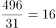

# 现期平均数计算（月总量÷天数求日均）

考点：[[20-考点/资料分析/平均数/现期平均数计算（月总量÷天数求日均）|平均数 / 现期平均数计算（月总量÷天数求日均）]]
材料：[[15-材料/资料分析/181118 2015年7月D市对电视、广播、平面|181118 2015年7月D市对电视、广播、平面]]

**问法模型**：'平均每日……约多少条次'→现期平均数模型：月度涉嫌违法总量÷当月实际天数（7月31天）

## 推理链
1. 第1步：题干限定'2015年7月''平面媒体''涉嫌违法广告'，定位表1平面行，取涉嫌违法量列=496条次（勿误取监测量62134或违法率0.80%）
2. 第2步：现期平均数公式：平均每日=月度总量÷当月天数，7月为大月共31天
3. 第3步：代入计算：496÷31，由31×16=496恰好整除，得日均16条次
4. 第4步：与选项对照，16即A项，故正确答案为A

**最快解法**：⚡ 整除口算法：496÷31，抓住31×16=496整除关系直接锁定16；若口算不熟可截位估算496≈500，500÷31≈16.1，最接近16选A，全程不超过10秒

## 易错点
- ⚠ 天数陷阱：7月是31天，误按30天算得496÷30≈16.5，凑整易误选B(17)
- ⚠ 列看错：表1平面行有三列数据，须取'涉嫌违法量'496，误取监测量62134会算出约2000，误取违法率0.80%则完全跑偏
- ⚠ 行/媒体看错：题干只问平面媒体，勿用合计行594条次或其他媒体数据代入

## 母题抽象
> 🧩 当题干出现'平均每日/每周/每……约多少'特征时，用'材料总量÷对应期数'的现期平均数模型，先核实天数口径（大月31天、小月30天、2月28/29天），再用选项数值反乘验证整除或就近取整

**同类特征**：平均每日、2015年7月、平面媒体、涉嫌违法广告、约多少条次

## 相关题
（暂无）

---

### 题干
2015年7月，平均每日监测到平面媒体涉嫌违法广告约多少条次？

### 选项
- A. 16　✅
- B. 17
- C. 19
- D. 20

### 官方解析

根据题干“2015年7月，平均···约多少条次”，结合材料时间2015年7月，可判定本题为现期平均数计算问题。定位表格材料1可知：2015年7月，平面媒体涉嫌违法量为496条次。常识可知7月份为31天，则平均每日为条次。

故正确答案为A。

### 给定材料

        2015年7月，D市共监测电视、广播、平面和重点网络媒体首页页面广告297207条次，涉嫌违法广告594条次，广告涉嫌违法率为0.20%，比6月下降0.07个百分点。

> [!warning] 疑点（官方解析可能有误，待人工复核）
> 官方解析中除式在文本中缺失显示，但按496÷31=16与答案A完全吻合，无实质矛盾

<!-- CODEX-ANSWER-REVIEW:BEGIN -->
### 本次独立复核

**复核状态：** `resolved`（答案与解析已核定）

**计分答案：** A（可计分）

**复核解析：**

2015年7月平面媒体涉嫌违法广告496条次；7月31天，日均496/31=16条次，选A。

**相关信息：**

月均日量按当月实际天数除；题问7月，不能以全年或累计行口径代替当月值。

**题源依据：** [固定版本原题](https://github.com/Mentat-Uran/kaogongzhentizhengliu/blob/84ab93d4b64b61d897bece8a1c0a5bab06b4feb2/10-%E7%9C%9F%E9%A2%98/%E8%B5%84%E6%96%99%E5%88%86%E6%9E%90/%E5%B9%B3%E5%9D%87%E6%95%B0/1752658%20%E7%8E%B0%E6%9C%9F%E5%B9%B3%E5%9D%87%E6%95%B0%E8%AE%A1%E7%AE%97%EF%BC%88%E6%9C%88%E6%80%BB%E9%87%8F%C3%B7%E5%A4%A9%E6%95%B0%E6%B1%82%E6%97%A5%E5%9D%87%EF%BC%89.md)；固定内容 commit `84ab93d4b64b61d897bece8a1c0a5bab06b4feb2`，Markdown blob `e5ae20ea7228d9696cb36827296c6389bb9208c6`。
<!-- CODEX-ANSWER-REVIEW:END -->
