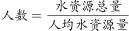
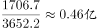
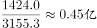
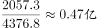
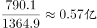

# 人均量反推基数（人数=总量÷人均）比较

考点：[[20-考点/资料分析/平均数/人均量反推基数（人数=总量÷人均）比较|平均数 / 人均量反推基数（人数=总量÷人均）比较]]
材料：[[15-材料/资料分析/182052 一份单表统计资料：北京、上海、天津、|182052 一份单表统计资料：北京、上海、天津、]]

**问法模型**：题干问'四个省份中人数最少'，而材料只给'水资源总量'与'人均水资源量' → 采用反推模型：人数=水资源总量×10^8÷人均水资源量，转化为比较'总量÷人均'的商值大小

## 推理链
1. 第1步：从表格提取四省两列数据——云南：总量1706.7亿立方米、人均3652.2立方米/人；江西：1424.0、3155.3；广西：2057.3、4376.8；湖北：790.1、1364.9
2. 第2步：人口=总量(亿立方米×10^8)÷人均(立方米/人)；因四个省份同含10^8因子，比较人数大小时10^8可整体约去，只需比较'总量÷人均'的商
3. 第3步：截位直除求商值——云南1706.7/3652.2≈0.467；江西1424.0/3155.3≈0.451；广西2057.3/4376.8≈0.470；湖北790.1/1364.9≈0.579
4. 第4步：商值排序为江西0.451＜云南0.467＜广西0.470＜湖北0.579，即江西人数最少
5. 第5步：换回实际量级验证：江西人数≈0.451×10^8=4513万人（云南约4673万、广西约4701万、湖北约5789万），人数最少的是江西，对应B项

**最快解法**：⚡ 截位直除：人数=总量÷人均，四省同乘10^8可约去，直接比较商值——江西14.24/31.55≈0.451最小（云南≈0.467、广西≈0.470、湖北≈0.579），无需真实换算即锁定B

## 易错点
- ⚠ 直接比较人均水资源量大小：误以为'人均最大→人数最少'而错选广西（人均4376.8最大），但广西总量2057.3也很大，商值0.470反而不是最小；必须用总量÷人均
- ⚠ 忘记亿立方米=10^8立方米的换算：若求具体人数而漏乘10^8，结果量级直接差1亿倍
- ⚠ 单位混读：'立方米/人'误看成'万立方米/人'，会使人数再缩小10^4倍

## 母题抽象
> 🧩 当题干问'人数/人口最少（多）'且材料同时给出'总量'与'人均量'两列时，用反推模型'基数=总量÷人均'，同单位因子可约去，直接截位直除比较商值大小即可

**同类特征**：人数最少、只给总量与人均两列、总量÷人均反推人口、亿立方米与立方米/人量级换算、四选项省份横向比较商值

## 相关题
- [[10-真题/资料分析/倍数/5832506 现期倍数（同组数据中最大值与最小值之比）|5832506]]（浙江 2021，相关度1）

---

### 题干
下列四个省份中，人数最少的是（  ）。

### 选项
- A. 云南
- B. 江西　✅
- C. 广西
- D. 湖北

### 官方解析

根据题干所求“人数最少的是”，表格给出水资源总量与人均水资源量，，可判定本题为平均数计算比较问题。定位表格材料数据可得各省水资源总量与人均水资源量，则人数分别为：云南、江西、广西、湖北，故人数最少的是江西。

故正确答案为B。

### 给定材料

