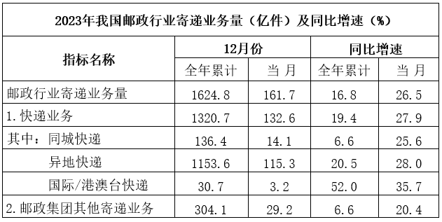

# 现期平均数（单件快递收入）计算与大小比较（含榜单排名放缩）

考点：[[20-考点/资料分析/平均数/现期平均数（单件快递收入）计算与大小比较（含榜单排名放缩）|平均数 / 现期平均数（单件快递收入）计算与大小比较（含榜单排名放缩）]]
材料：[[15-材料/资料分析/3333931 2023年我国邮政行业业务收入与快递|3333931 2023年我国邮政行业业务收入与快递]]

**问法模型**：题干问'四个城市中单件快递实现的业务收入最高'→ 采用现期平均数模型：单件收入=快递业务收入÷快递业务量；对只在收入榜出现的上海，用业务量排名（前五门槛40.1亿件）做下界放缩后再比较

## 推理链
1. 第1步：从文字第三段提取：业务量前五为金华136.9、广州114.5、深圳63.7、揭阳40.7、杭州40.1亿件；收入前五为上海2089.4、广州892.2、深圳668.4、金华372.3、杭州366.7亿元
2. 第2步：所用公式：单件快递业务收入=快递业务收入÷快递业务量，亿元÷亿件恰好等于元/件
3. 第3步：上海不在业务量前五，而第5名杭州为40.1亿件，故上海业务量<40.1亿件，其单件收入>2089.4÷40.1≈52.1元/件
4. 第4步：直接计算三城：广州892.2÷114.5≈7.8元/件，深圳668.4÷63.7≈10.5元/件，杭州366.7÷40.1≈9.1元/件
5. 第5步：52.1元/件远高于其余三城最高值10.5元/件，故单件收入最高的城市是上海，与选项A对照无误

**最快解法**：⚡ 排序放缩+截位直除：先发现上海收入2089.4亿元居首但不在业务量前五，即业务量<40.1亿件，下界2089.4÷40.1≈52元/件；再粗算广州892.2÷114.5≈7.8、深圳668.4÷63.7≈10.5、杭州366.7÷40.1≈9.1，量级一眼比较即锁定A，上海无需精算

## 易错点
- ⚠ 两榜不重合陷阱：上海只在收入榜、揭阳只在业务量榜，易误认为'上海缺业务量无法比较'而只在广州/深圳/杭州中选——应利用业务量前五门槛40.1亿件对上海做放缩下界
- ⚠ 时间/口径错位：表格'12月份'表头下混排全年累计与当月值，若误取当月数据或把邮政行业寄递业务量1624.8当快递业务量则全盘皆错，本题只用文字第三段的全年城市数据
- ⚠ 单位换算：亿元÷亿件=元/件，量级天然匹配，切勿额外乘除'万'等缩放系数

## 母题抽象
> 🧩 当题干问'平均每单位某量最高/最低的对象'且某对象只给出分子（或分母）另一量缺失时，用榜单排名做区间放缩（缺失量必被某名次值界定），再与可直接计算对象的粗算值比较，即可不动笔精算缺失项

**同类特征**：单件快递实现的业务收入、四个城市中……最高、收入榜与业务量榜不重合、现期平均数比较、收入÷业务量、排名前五城市

## 相关题
- [[10-真题/资料分析/平均数/2184619 现期平均数比较（收入÷企业数排序）|2184619]]（选调 2018，相关度1）
- [[10-真题/资料分析/平均数/5893714 现期平均数比较（当月值与1~11月月均值比较，含'累计−当月'数据加工）|5893714]]（国考 2024，相关度1）
- [[10-真题/资料分析/平均数/12881994 现期平均数比较（平均运送距离=旅客周转量÷旅客发送量，逐年做商找最小值）|12881994]]（广东 2025，相关度1）
- [[10-真题/资料分析/平均数/2377059 现期平均数比较（劳动生产率=产量÷人数，子群体人均产量最大值比较）|2377059]]（选调 2019，相关度1）
- [[10-真题/资料分析/平均数/10297453 现期平均数计算与比较（平均每次活动服务人次）|10297453]]（四川 2025，相关度1）

---

### 题干
以下四个城市中，2023年单件快递实现的业务收入最高的城市是：

### 选项
- A. 上海　✅
- B. 广州
- C. 深圳
- D. 杭州

### 官方解析
根据题干“······2023年单件快递实现的业务收入······”，结合材料时间为2023年，可判定本题为现期平均数问题。定位文字材料第三段可得：2023年，我国快递业务量排名前五的城市分别是金华市、广州市、深圳市、揭阳市和杭州市，业务量分别为136.9亿件、114.5亿件、63.7亿件、40.7亿件和40.1亿件；快递业务收入排名前五的城市分别是上海市、广州市、深圳市、金华市和杭州市，快递业务收入分别为2089.4亿元、892.2亿元、668.4亿元、372.3亿元和366.7亿元。根据公式：单件快递实现的业务收入，由于上海快递业务量不在全国快递业务量前五名，可得上海快递业务量低于40.1亿件（排名第5的杭州快递业务量），则其单件快递实现的业务收入高于元，其余三个城市单件快递实现的业务收入分别为：广州，元；深圳，元；杭州，元。故上述四个城市中，2023年单件快递实现的业务收入最高的城市是上海。

故正确答案为A。

### 给定材料

        2023年，我国邮政行业业务收入（不含邮储银行直接营业收入）累计完成15293亿元，同比增长13.2%，其中快递业务收入累计完成12074亿元，同比增长14.3%。

        2023年，快递业务收入中，同城、异地、国际/港澳台快递及其他快递收入的比重分别为5.9%、49.7%、11.6%和32.8%，比重同比分别上升-1.3、0.8、0.5和0个百分点。东、中、西部地区快递业务量的比重分别为75.2%、16.7%和8.1%，业务收入比重分别为76.2%、14.1%和9.7%。与2022年相比，东部地区快递业务量比重下降1.6个百分点，快递业务收入比重下降1.4个百分点；中部地区快递业务量比重上升1.0个百分点，快递业务收入比重上升0.7个百分点；西部地区快递业务量比重上升0.6个百分点，快递业务收入比重上升0.7个百分点。

        2023年，我国快递业务量排名前五的城市分别是金华市、广州市、深圳市、揭阳市和杭州市，业务量分别为136.9亿件、114.5亿件、63.7亿件、40.7亿件和40.1亿件；快递业务收入排名前五的城市分别是上海市、广州市、深圳市、金华市和杭州市，快递业务收入分别为2089.4亿元、892.2亿元、668.4亿元、372.3亿元和366.7亿元。

