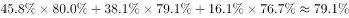

# 加权平均数（按年龄结构占比求平均满意度）

考点：[[20-考点/资料分析/平均数/加权平均数（按年龄结构占比求平均满意度）|平均数 / 加权平均数（按年龄结构占比求平均满意度）]]
材料：[[15-材料/资料分析/182296 2015年5月国家统计局调查队在江苏|182296 2015年5月国家统计局调查队在江苏]]

**问法模型**：题干问'受访老人对当前生活状态的平均满意度'→ 以年龄结构三组占比为权数，对按年龄层三组满意度做加权平均

## 推理链
1. 第1步：从材料第一段提取年龄结构：60-69岁、70-79岁、80岁及其以上三组占比，三组合计100%，即权数p1、p2、p3
2. 第2步：从材料末段提取按年龄层维度的满意度：60-69岁、70-79岁、80岁及其以上老人满意度分别为s1、s2、s3（注意是'按年龄层'这一套，不是按居住状态或按村委会互动那两套）
3. 第3步：用加权平均公式：平均满意度=p1×s1+p2×s2+p3×s3（各组老人占比×该组满意度后求和）
4. 第4步：代入材料原卷实际数值计算，与选项对照，官方解析给出结果对应选项A

**最快解法**：⚡ 加权平均法（公式法）：平均满意度=Σ(各组年龄占比×该组满意度)；考场先识别题干引用了'年龄层'满意度，故权数必取第一段的三档年龄占比，切勿用( s1+s2+s3 )/3的算术平均

## 易错点
- ⚠ 权数选择错误：误用三组满意度的算术平均（除以3），而材料给了年龄结构占比，正确模型是按占比加权平均——官方解析同时引用第一段年龄结构和末段满意度，即提示用前者作权
- ⚠ 三套满意度串行读错：材料按年龄层/居住状态/村委会互动三个维度各给三组满意度，权数只能与'按年龄层'的满意度匹配，误配居住状态或互动频率的数据即错
- ⚠ 口径与剩余项陷阱：'80岁及其以上'是明确口径；另注意全部数据为调查时点占比，若用占比当人数或涉及基期换算均无意义

## 母题抽象
> 🧩 当题干出现'平均满意度/平均指标'且材料同时给出分组结构占比与分组指标值时，用结构占比作权数对指标值加权求和（加权平均），并验证权数合计为100%

**同类特征**：平均满意度、受访老人、对当前生活状态、按年龄层分组、加权平均（占比作权）、单一时点截面调查

## 相关题
（暂无）

---

### 题干
受访老人对当前生活状态的平均满意度为（    ）。

### 选项
- A. 

　✅
- B. 

- C. 

- D. 

### 官方解析

根据文字材料第一段“受访老人中6069岁的占，7079岁的占，80岁及其以上的占。”和文字材料第二段“关于受访老人对当前生活状态的满意度，从年龄层看，6069岁、7079岁、80岁及其以上的老人对当前生活状态的满意度分别为、、；”数据可以计算出受访老人对当前生活状态的平均满意度为。

故正确答案为A。

### 给定材料

        2015年5月，国家统计局调查队在江苏省某市开展了农村养老现状专项调研。受访老人中岁的占，岁的占，80岁及其以上的占。受访老人中有一个子女的占，有两个子女的占，无子女的占。受访老人中与配偶同住的占，与未婚子女同住的占，与某个已婚子女同住的占，在子女家轮流住的占，独居的占。的受访老人为男性。从不同住子女探望老人的频率看，的受访老人表示每天来探望，的表示每周来探望，的表示每月来探望，其余的表示子女遇事或根据要求来探望。

        调查显示，看电视（）、串门聊天（）、打牌（）、散步（）、听广播（）和读书看报（）是农村老人的主要闲暇活动。当问及“你想不想参加集体活动”时，的受访老人表示“想参加”，的老人表示“可参加可不参加”，还有的老人表示“不想参加”。关于受访老人对当前生活状态的满意度，从年龄层看，岁、岁，80岁及其以上的老人对当前生活状态的满意度分别为、、；从居住状态看，与子女同住、与配偶同住、独居的老人对当前生活状态的满意度分别为、、；从与村委会互动的频率看，经常互动、偶尔互动、基本不互动的老人对当前生活状态的满意度分别为、、。

