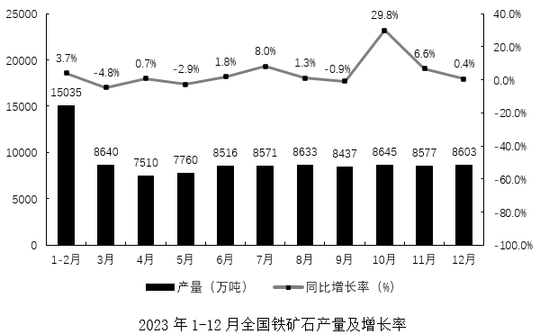

# 现期平均数计算（全年总量÷12个月）

考点：[[20-考点/资料分析/平均数/现期平均数计算（全年总量÷12个月）|平均数 / 现期平均数计算（全年总量÷12个月）]]
材料：[[15-材料/资料分析/3046389 2023年1—12月全国铁矿石各月产|3046389 2023年1—12月全国铁矿石各月产]]

**问法模型**：题干问'2023年平均每个月铁矿石产量约为'→ 现期平均数模型：2023年1—12月各月产量合计÷12，对照区间选项

## 推理链
1. 第1步：从柱线图提取2023年各期产量（万吨）：1-2月15035、3月8640、4月7510、5月7760、6月8516、7月8571、8月8633、9月8437、10月8645、11月8577、12月8603；横轴11个数据项中首项'1-2月'为两个月合并值
2. 第2步：现期平均数公式：月均产量=全年总产量÷12（分母是12个月而非11个数据项）
3. 第3步：全年合计=15035+8640+7510+7760+8516+8571+8633+8437+8645+8577+8603=98927万吨
4. 第4步：月均=98927÷12≈8243.9万吨（截位直除：15035÷12≈1250，其余10个月合计83892÷12≈6990，合计约8240）
5. 第5步：8244万吨落在8000万～8400万吨区间，对照选项锁定C

**最快解法**：⚡ 分块估算+截位直除：先算1-2月月均15035÷2≈7517（偏低），3-12月各月均在7500～8700之间、合计83892÷10≈8389；全年加权月均=(15035+83892)÷12≈8244万吨；或最粗估算：3-12月每月约8500×10=85000，加15035合计约10万，10万÷12≈8330，直接锁定8000万～8400万吨区间选C，无需精算

## 易错点
- ⚠ 分母陷阱：横轴有11个数据项，若按11项平均得98927÷11≈8993万吨，落入'8400万吨以上'误选D；正确分母是12个月
- ⚠ 合并项陷阱：把'1-2月'15035万吨当成1月或2月单月值直接参与平均，口径错误
- ⚠ 读数陷阱：柱看左轴（万吨）、勿与右轴增速折线混淆；9月8437、10月8645等数值需逐柱准确抄录，避免估值偏差跨区间

## 母题抽象
> 🧩 当题干出现'某年（现期）平均每个月/月均……约为'且材料横轴首项为合并时段（如1-2月）时，先求全期总量、再除以真实月份数（12）而非数据项个数（11），并用区间选项倒逼估算精度即可

**同类特征**：平均每个月产量约为、现期平均数、区间型选项（万吨范围）、1-2月合并项、全年合计、除以12而非11

## 相关题
- [[10-真题/资料分析/平均数/13319360 现期平均数（总量÷份数）|13319360]]（江苏 2025，相关度1）
- [[10-真题/资料分析/平均数/13504650 现期平均数计算与多期排序比较|13504650]]（辽宁 2025，相关度1）
- [[10-真题/资料分析/平均数/18385424 现期平均数计算与比较（单价-均价=总额÷数量，跨双轴图取数）|18385424]]（浙江 2024，相关度1）
- [[10-真题/资料分析/平均数/18643712 现期平均数计算（累计值求月均）|18643712]]（天津 2026，相关度1）
- [[10-真题/资料分析/平均数/18643737 现期平均数比较（平均每船次进口量与固定值8万吨比较计数）|18643737]]（天津 2026，相关度1）

---

### 题干
2023年，平均每个月铁矿石产量约为：

### 选项
- A. 7600万吨以下
- B. 7600万～8000万吨
- C. 8000万～8400万吨　✅
- D. 8400万吨以上

### 官方解析
根据题干“2023年，平均每个月铁矿石产量约为”，结合材料时间为2023年1-12月，可判定本题为现期平均数问题。定位统计图可得：2023年1-2月和3-12月全国铁矿石产量分别为15035万吨、8640万吨、7510万吨、7760万吨、8516万吨、8571万吨、8633万吨、8437万吨、8645万吨、8577万吨、8603万吨。则所求平均数为万吨，在C项范围内。
故正确答案为C。

### 给定材料

