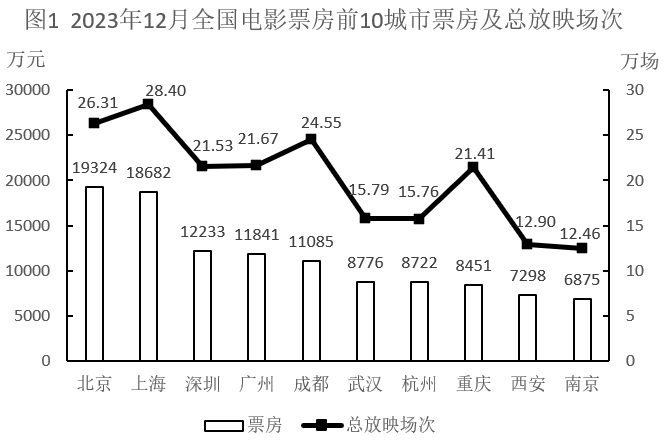
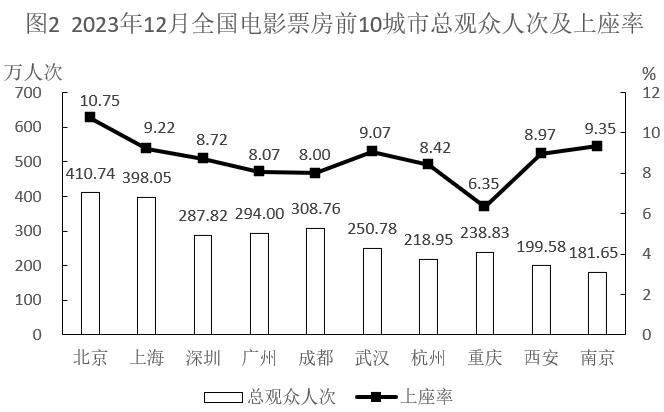

# 现期平均数计算（人均票房=票房÷观众人次，跨图相除+计数比较）

考点：[[20-考点/资料分析/平均数/现期平均数计算（人均票房=票房÷观众人次，跨图相除+计数比较）|平均数 / 现期平均数计算（人均票房=票房÷观众人次，跨图相除+计数比较）]]
材料：[[15-材料/资料分析/6464197 2023年12月全国电影票房前10城|6464197 2023年12月全国电影票房前10城]]

**问法模型**：题干问'有几个城市平均每人次观众创造的票房超过40元'→逐城计算 票房÷总观众人次 与40元比较后计数。

## 推理链
1. 第1步：题干时间与材料时间同为2023年12月，无基期，判定现期平均数问题，模型为 平均每人次票房=电影票房÷总观众人次。
2. 第2步：单位处理：图1票房单位为万元、图2人次单位为万人次，万元÷万人次恰好消去'万'，直接得'元/人次'，无需再换算，40元/人次为比较基准。
3. 第3步：逐城计算前四城：北京19324÷410.74≈47.0元、上海18682÷398.05≈46.9元、深圳12233÷287.82≈42.5元、广州11841÷294.00≈40.3元，均超过40元。
4. 第4步：逐城计算后六城：成都11085÷308.76≈35.9元、武汉8776÷250.78≈35.0元、杭州8722÷218.95≈39.8元、重庆8451÷238.83≈35.4元、西安7298÷199.58≈36.6元、南京6875÷181.65≈37.9元，均未超过40元。
5. 第5步：临界项精算：广州40.28元仅略高于40（40×294=11760<11841，超81万元），杭州39.83元仅略低于40（40×218.95=8758>8722，差36万元），方向相反需精算区分。
6. 第6步：符合条件的为北京、上海、深圳、广州共4个城市，对照选项B。

**最快解法**：⚡ 等价变形避免除法：'票房÷人次>40'等价于'票房>40×人次'（万元对万元，量纲自洽），用乘法逐城口算筛选：北京40×410.74≈16430<19324✓、上海40×398.05≈15922<18682✓、深圳40×287.82≈11513<12233✓、广州40×294=11760<11841✓、杭州40×218.95=8758>8722✗、其余明显不满足，共4个，选B。

## 易错点
- ⚠ 单位陷阱：票房单位是'万元'而非常见'亿元'，19324万元≈1.93亿元；但'万元÷万人次'恰好消去'万'直接得元/人次，若误换算或误判量级会全盘出错。
- ⚠ 临界误判：广州≈40.28元仅微超40、杭州≈39.83元仅微差于40，粗略估算或四舍五入易把杭州算入、把广州漏掉，必须对这两城精算（或用乘法验证11760<11841、8758>8722）。
- ⚠ 分子分母混淆：'平均每人次票房'=票房÷人次（图1÷图2），与同组第2题'平均每场人次'=人次÷场次（图2÷图1）方向相反，勿混淆数据来源。

## 母题抽象
> 🧩 当题干出现'有几个…平均每人次…超过X元'的计数型平均数特征时，用'平均数=分子÷分母逐项比较'，并优先等价变形为'分子>X×分母'的乘法验证，对临界项精算定夺。

**同类特征**：有几个城市（计数型设问）、平均每人次观众创造的票房、超过40元（阈值比较）、跨图取数：图1票房÷图2人次、现期直接计算，无基期、含临界值（广州微超、杭州微差）

## 相关题
（暂无）

---

### 题干
2023年12月资料中有几个城市平均每人次观众创造的票房超过40元？

### 选项
- A. 3
- B. 4　✅
- C. 5
- D. 6

### 官方解析
根据题干“2023年12月······平均每人次······”，结合材料时间为2023年12月，可判定本题为现期平均数问题。定位图1可知2023年12月各个城市电影票房，定位图2可知2023年12月各个城市电影总观众人次。根据公式：平均每人次观众创造的票房，则：
北京：元/人次，符合；
上海：元/人次，符合；
深圳：元/人次，符合；
广州：元/人次，符合；
成都：元/人次，不符合；
武汉：元/人次，不符合；
杭州：元/人次，不符合；
重庆：元/人次，不符合；
西安：元/人次，不符合；
南京：元/人次，不符合。
综上，2023年12月资料中北京、上海、深圳、广州平均每人次观众创造的票房超过40元，即有4个城市。
故正确答案为B。

### 给定材料

注：上座率

