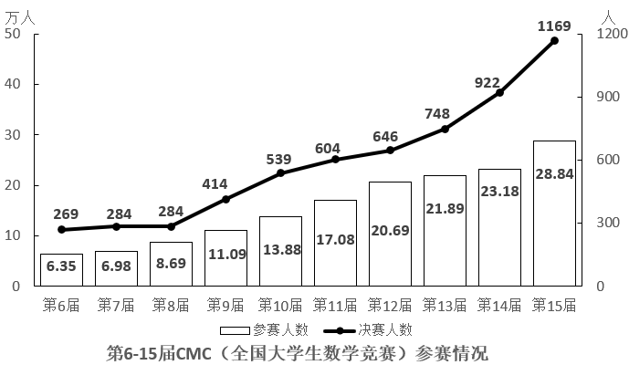

# 现期平均数计算与比较（人均数作商比大小）

考点：[[20-考点/资料分析/平均数/现期平均数计算与比较（人均数作商比大小）|平均数 / 现期平均数计算与比较（人均数作商比大小）]]
材料：[[15-材料/资料分析/6473137 第6-15届全国大学生数学竞赛（CM|6473137 第6-15届全国大学生数学竞赛（CM]]

**问法模型**：题干出现'平均每个参赛学校参赛人数最少'→ 用现期平均数模型：参赛人数÷参赛学校数，对四个选项逐个作商后比较取最小值

## 推理链
1. 第1步：定位统计表（第15届CMC部分赛区情况），提取四个选项赛区数据：河北参赛学校40个、参赛11970人；湖北60个、16637人；四川45个、11346人；广东62个、12118人
2. 第2步：现期平均数公式：平均每个参赛学校参赛人数 = 参赛人数 ÷ 参赛学校数
3. 第3步：代入计算：河北11970÷40≈299.3人/校；湖北16637÷60≈277.3人/校；四川11346÷45≈252.1人/校；广东12118÷62≈195.5人/校
4. 第4步：比较四个商：195.5（广东）< 252.1（四川）< 277.3（湖北）< 299.3（河北），广东最小
5. 第5步：与选项对照，广东对应选项D，与官方答案一致

**最快解法**：⚡ 截位直除＋首数比较：广东12118÷62，首两位19；四川11346÷45，首两位25；河北11970÷40，首两位29；湖北16637÷60，首两位27。广东商的首两位最小（19），四个选项全部直除后一眼锁定最小，选D；若求更快，可先算参赛人数最接近的两个赛区四川与广东（11346/45 vs 12118/62），广东明显更小即可确认

## 易错点
- ⚠ 行序陷阱：表格按'重庆、北京、广东…'固定行序排列而非按数值排序，易凭主观印象跳选；且四川参赛人数11346为四选项中总量最小，易误选C，忽视四川学校数仅45个，作商后252大于广东的195
- ⚠ 口径陷阱：表格只是'部分赛区'（10个赛区约16万人），不能与图1第15届全国总参赛人数28.84万人（288400人）混用；本题只需表格内数据，分子分母均取同一赛区同一行
- ⚠ 除法方向陷阱：'平均每个参赛学校参赛人数'是 人数÷学校数，勿倒置为学校数÷人数

## 母题抽象
> 🧩 当题干出现'平均每个（所/家）…最多或最少'且材料给出'总量+个数'两列时，用 总量÷个数 对选项逐项截位直除，比较商的首位/首两位，最小（大）者即为答案

**同类特征**：表中所列赛区中、第15届、平均每个参赛学校、参赛人数最少、现期平均数比较、逐项作商

## 相关题
- [[10-真题/资料分析/平均数/2184619 现期平均数比较（收入÷企业数排序）|2184619]]（选调 2018，相关度1）
- [[10-真题/资料分析/平均数/5893714 现期平均数比较（当月值与1~11月月均值比较，含'累计−当月'数据加工）|5893714]]（国考 2024，相关度1）
- [[10-真题/资料分析/平均数/12881994 现期平均数比较（平均运送距离=旅客周转量÷旅客发送量，逐年做商找最小值）|12881994]]（广东 2025，相关度1）
- [[10-真题/资料分析/平均数/17764932 现期平均数（单件快递收入）计算与大小比较（含榜单排名放缩）|17764932]]（湖北 2024，相关度1）
- [[10-真题/资料分析/平均数/2377059 现期平均数比较（劳动生产率=产量÷人数，子群体人均产量最大值比较）|2377059]]（选调 2019，相关度1）

---

### 题干
表中所列赛区中，第15届CMC平均每个参赛学校参赛人数最少的是：

### 选项
- A. 河北
- B. 湖北
- C. 四川
- D. 广东　✅

### 官方解析

根据题干“······第十五届······平均每个······”，结合材料给出第十五届CMC各赛区参赛情况，可判定本题为现期平均数问题。定位统计表可知第十五届CMC各赛区参赛学校数及参赛人数，根据公式：平均数，可得：河北为，湖北为，四川为，广东为。比较可知，广东赛区平均每个参赛学校参赛人数最少。

故正确答案为D。

### 给定材料

