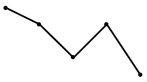
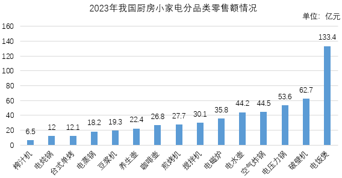

# 现期平均数（单价）逐年计算与趋势折线图匹配

考点：[[20-考点/资料分析/平均数/现期平均数（单价）逐年计算与趋势折线图匹配|平均数 / 现期平均数（单价）逐年计算与趋势折线图匹配]]
材料：[[15-材料/资料分析/6313266 2019-2023年我国厨房小家电全|6313266 2019-2023年我国厨房小家电全]]

**问法模型**：题干问'平均每台零售价变化趋势'的折线图选择 → 逐年用'零售额÷零售量'算均价（亿元÷万台需×10^4换成元/台），比较五点高低走向后匹配图形

## 推理链
1. 第1步：从统计表提取五年数据：零售额672.8/631.9/557.5/520.3/549.3亿元，零售量26748/27444/23744/22049/26543万台（2019-2023）
2. 第2步：平均每台零售价=零售额÷零售量；因单位是亿元÷万台，商为万元/台，需再×10^4换算成元/台
3. 第3步：代入计算：2019年672.8÷26748≈251.5元/台；2020年631.9÷27444≈230.2元/台；2021年557.5÷23744≈234.8元/台；2022年520.3÷22049≈236.0元/台；2023年549.3÷26543≈206.9元/台
4. 第4步：走势判定：2019年（约251.5元/台）显著高于其余各年→2020年降→2021、2022年连续微升→2023年降为最低（约206.9元/台），非单调变化
5. 第5步：对照选项：首年明显偏高排除A、B；2020-2022三年数值接近（230~236）且先微升后于2023年大跌，排除C，只有D符合

**最快解法**：⚡ 量级换算+截位直除：先算首年672.8÷26748≈0.0252×10^4≈252元/台，确认2019年明显最高即排除A、B；再粗算2020-2022年为230/235/236元/台（接近且微升）、2023年549.3÷26543≈0.0207×10^4≈207元/台为最低，匹配'高-降-微升-微升-大降'形态选D

## 易错点
- ⚠ 量级陷阱：亿元÷万台直接相除约0.02，忘乘10^4会误判单价为'不到1元/台'或无从与图形纵轴对应；正确结果应在200元/台量级
- ⚠ 只盯'降-升-降'形状不看幅度：A、C等干扰项中间走势相近，关键判别点是2019年显著偏高、2023年为五年最低、2020-2022年数值接近
- ⚠ 零售量单位是万台（2.2~2.7亿台量级），勿误当成'台'或'亿台'代入导致计算混乱

## 母题抽象
> 🧩 当题干出现'平均每台（单价）价格变化趋势+折线图'特征时，用'总额÷总份数'逐年算均价并先做量级换算（亿元÷万台×10^4），重点核对首末年高低与中间年升降方向再匹配图形

**同类特征**：平均每台零售价、2019-2023年逐年、变化趋势、折线图匹配、零售额÷零售量、亿元÷万台量级换算

## 相关题
- [[10-真题/资料分析/增长/12882030 累计转当期+环比增长率计算与趋势匹配|12882030]]（内蒙古 2025，相关度2）
- [[10-真题/资料分析/增长/15833691 环比增速计算与折线趋势匹配（累计值连环相减化当期值）|15833691]]（黑龙江 2026，相关度1）
- [[10-真题/资料分析/增长/15833698 环比增速计算与折线趋势图匹配|15833698]]（黑龙江 2026，相关度1）
- [[10-真题/资料分析/增长/2028362 增长量比较（逐年同比增量计算＋折线趋势图匹配）|2028362]]（国考 2017，相关度1）
- [[10-真题/资料分析/倍数/2050544 比值（城乡收入比）逐年计算与趋势判断|2050544]]（吉林 2017，相关度1）

---

### 题干
以下折线图中，最能准确反映2019-2023年我国厨房小家电平均每台零售价变化趋势的是：

### 选项
- A. 

- B. 

- C. 

- D. 

　✅

### 官方解析

根据题干“······2019-2023年······平均每台零售价变化趋势的是”，可判定本题为现期平均数问题。定位统计表可得：2019-2023年，我国厨房小家电全品类零售量及零售额。平均每台零售价，可得2019-2023年我国厨房小家电平均每台零售价分别为：

2019年，元/台；

2020年，元/台；

2021年，元/台；

2022年，元/台；

2023年，元/台。

比较可知，2019年我国厨房小家电平均每台零售价比其它年份都明显高，排除A、B两项；2020年-2022年这三年数值接近，排除C项，只有D项符合。

故正确答案为D。

### 给定材料

