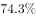

# 加权平均（线段法-十字交叉）反推男性占比

考点：[[20-考点/资料分析/平均数/加权平均（线段法-十字交叉）反推男性占比|平均数 / 加权平均（线段法/十字交叉）反推男性占比]]
材料：[[15-材料/资料分析/184894 2015年A市统计局对5000名有网|184894 2015年A市统计局对5000名有网]]

**问法模型**：题干给出总体人均次数19.4次、女性人均21.1次及男女差值3.8次，求男性所占比例 → 加权平均混合模型，用线段法（十字交叉）以'距离反比'定两组占比

## 推理链
1. 第1步：从文字段提取：总体人均网购19.4次；女性人均21.1次，且女性比男性高3.8次
2. 第2步：推算隐藏数据：男性人均=21.1-3.8=17.3次（材料未直接给出）
3. 第3步：加权平均规则：19.4=男占比×17.3+女占比×21.1，男、女占比之比等于各自均值到总体均值距离的反比
4. 第4步：线段法配份：男性距离=21.1-19.4=1.7，女性距离=19.4-17.3=2.1，故男:女=1.7:2.1，男性占1.7份
5. 第5步：代入计算：男性占比=1.7÷(1.7+2.1)=1.7/3.8≈17/38≈44.7%
6. 第6步：与选项对照，约44.7%对应D项，故正确答案为D

**最快解法**：⚡ 线段法（十字交叉/杠杆原理）：总体19.4居中，男17.3在低端距2.1、女21.1在高端距1.7，男性占比=1.7÷3.8≈17/38，因38×0.45=17.1，故结果略小于45%约44.7%，秒选D

## 易错点
- ⚠ 男性人均次数是隐藏数据，必须先由'女性21.1比男性高3.8次'推得17.3次，跳过此步无法列式
- ⚠ 线段法距离与占比成反比：若把男女比误作2.1:1.7，会算出约55.3%而掉入对称陷阱
- ⚠ 总体人均19.4次≠(21.1+17.3)/2=19.2次，说明男女占比并非1:1，不能想当然取50%

## 母题抽象
> 🧩 当题干出现'总体平均数+A、B两组各自平均数（或其差值），反求某组占比/人数比'时，用线段法：两组占比之比=两组均值到总体均值距离之比的反比，再用占比除以距离之和验证，如1.7/3.8≈44.7%

**同类特征**：男性所占比例约为、人均网购次数、女性比男性高出3.8次、总体人均19.4次、男性次数需自行推算、混合加权平均模型

## 相关题
- [[10-真题/资料分析/平均数/2022288 人均次数比较（含隐含数据推算）|2022288]]（吉林 2016，相关度1）

---

### 题干
受访者中男性所占比例约为：

### 选项
- A. 

- B. 

- C. 

- D. 

　✅

### 官方解析
题干所求为“男性所占比例”，材料给出人均网购次数和男、女各自的平均网购次数，故本题为比值计算问题。定位文字材料，“受访者2015年人均网购次数为19.4次”，“女性受访者人均网购次数为21.1次，比男性受访者高出3.8次”，所以男性网购次数为次，利用线段法求解男女比为，男性占1.7份，女性占2.1份，所以男性占总人数的比例为。
故正确答案为D。

### 给定材料

        A市统计局在该市范围内做了一项调查，抽取了5000名18到70周岁且在2015年有过网购经历的居民，结果显示：受访者2015年人均网购次数为19.4次。从分组情况看，有三类人群使用网购相对频繁：一是年轻群体，35岁以下的受访者人均网购次数为25.5次；二是较高学历群体，文化程度为大学本科及以上学历和大专学历的受访者人均网购次数分别是27.3次和21.8次；三是中高收入群体，个人月收入为10000元以上和5000到10000元的受访者人均网购次数分别是31.0次和26.0次。此外，女性受访者人均网购次数为21.1次，比男性受访者高出3.8次。2015年该市网购9类主要商品和服务的受访者占比情况如下图。

