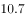
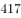
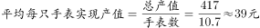

# 现期平均数（平均单价=产值÷产量）

考点：[[20-考点/资料分析/平均数/现期平均数（平均单价=产值÷产量）|平均数 / 现期平均数（平均单价=产值÷产量）]]
材料：[[15-材料/资料分析/185160 2015年我国钟表行业年度经营概况：|185160 2015年我国钟表行业年度经营概况：]]

**问法模型**：题干出现'平均每制造一只手表实现约多少元产值'且未涉及基期年份 → 直接用现期平均数模型：手表产值(亿元)÷手表产量(亿只)，亿与亿量纲相约，结果即为元/只

## 推理链
1. 第1步：从材料第二段提取现期数据——2015年全行业生产手表10.7亿只，手表完成产值约417亿元
2. 第2步：平均单价公式=总量÷份数，即平均每只手表产值=手表产值÷手表产量
3. 第3步：代入计算417亿元÷10.7亿只=417÷10.7≈38.97元/只（亿元与亿只的'亿'量级相互抵消，无需额外换算）
4. 第4步：与选项对照：38.97≈39，锁定B；同时可排除干扰项D（若误用全行业总产值675亿元，得675÷10.7≈63，恰好是D=63的陷阱来源）

**最快解法**：⚡ 截位直除+选项反验：417÷10.7，首商约38.97直接对应B；如用反验更快——39×10.7≈417吻合，而36×10.7≈385偏小、42×10.7≈449偏大、63×10.7≈674（即675亿总产值的陷阱值），一步锁定B

## 易错点
- ⚠ 分子错用全行业工业总产值675亿元（675÷10.7≈63恰为D选项），必须只用手表产值417亿元，分子分母须同属'手表'这一指标对象
- ⚠ 单位疑虑：见'亿元÷亿只'误以为需换算或结果不对，实际10⁸元/10⁸只量纲相约，商直接就是元/只
- ⚠ 被增速信息干扰：材料中手表产值'增速提高1.9个百分点'、多处增速数值缺失，但本题只问2015年现期平均值，与增速无关，勿陷入隔年计算

## 母题抽象
> 🧩 当题干出现'平均每（一）……实现/创造/花费多少（元）'且明确是现期年份时，用现期平均数=对应总量÷对应份数；核心验证：分子分母必须是同一指标对象（此处均为'手表'），且量级单位相约后直接得目标单位

**同类特征**：平均每制造一只手表、实现约多少元的产值、现期（2015年）无基期字眼、手表产量10.7亿只、手表产值417亿元、亿元÷亿只=元/只

## 相关题
（暂无）

---

### 题干
2015年钟表全行业平均每制造一只手表，能实现约多少元的产值？

### 选项
- A. 36
- B. 39　✅
- C. 42
- D. 63

### 官方解析

      根据“2015年…平均每制造一只手表，实现多少元的产值”判断本题为现期平均数问题。定位材料第二段，全行业全年生产手表亿只，完成产值约亿元。。

故正确答案为B。

### 给定材料

        2015年我国钟表全行业实现工业总产值约675亿元，同比增长，增速比上年同期提高1.7个百分点。

        全行业全年生产手表10.7亿只，同比增长，完成产值约417亿元，同比增长，增速提高1.9个百分点；生产时钟（含钟心）5.2亿只，同比下降，完成产值162亿元，同比下降，降幅扩大1.3个百分点；钟表零配件、定时器及其它计时仪器产值96亿元，同比增长，增速基本保持上年水平。

        2015年我国钟表行业规模以上工业企业主营业务收入365.8亿元，同比增长；实现利润23.4亿元，与上年相比下降，而2015年轻工行业主营业务利润率（利润/主营业务收入）的平均水平为。

        2015年我国钟表行业海关进出口总额为92.5亿美元，同比增长，完成出口总额为57.7亿美元，同比增长，进口额34.8亿美元。出口总额中加工贸易额占，较上年缩小2个百分点。

