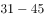
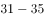
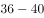
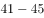
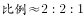
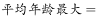
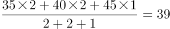
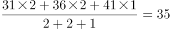
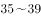

# 加权平均数（分段组中值法估算平均年龄）

考点：[[20-考点/资料分析/平均数/加权平均数（分段组中值法估算平均年龄）|平均数 / 加权平均数（分段组中值法估算平均年龄）]]
材料：[[15-材料/资料分析/185342 2000、2005、2010三个年份|185342 2000、2005、2010三个年份]]

**问法模型**：题干问某分5岁年龄段的群体'平均年龄可能会是'多少岁 → 以各年龄组人数为权、组中值为代表值做加权平均，并用上下限确定取值范围对照选项

## 推理链
1. 第1步：定位表格2005年'小计'行，提取三个年龄组总人数：31—35岁265509人、36—40岁248837人、41—45岁137235人，合计265509+248837+137235=651581人
2. 第2步：题干'可能会是'暗示估算而非精确值：每组以组中值代表年龄，31—35岁→33岁、36—40岁→38岁、41—45岁→43岁
3. 第3步：代入加权平均公式：平均年龄=(33×265509+38×248837+43×137235)÷651581=(8761797+9455806+5901105)÷651581=24118708÷651581≈37.0岁
4. 第4步：核验取值范围：各组全取下限/上限，最小约(31×265509+36×248837+41×137235)÷651581≈35.0岁，最大约(35×265509+40×248837+45×137235)÷651581≈39.0岁，即平均年龄只能落在约[35,39]岁内
5. 第5步：与选项对照：A项34低于下限、C项40和D项41高于上限，仅B项37与加权估算值37.0吻合，故选B

**最快解法**：⚡ 组中值加权+截位直除：以26.6万、24.9万、13.7万为权，取33、38、43岁为组中值；前两组权重接近，可合并为权重约51.4万、代表值约35.5岁，再与第三组43岁（权13.7万）合成：(35.5×51.4+43×13.7)÷65.2≈(1824.7+589.1)÷65.2≈37.0，直接锁定B；再用范围[35,39]排除34和40、41

## 易错点
- ⚠ 对33、38、43三个组中值简单平均得38而忽略以各组人数为权重，误差方向直指错误选项；必须按人数加权计算
- ⚠ 读数串行串列：须取2005年'小计'行三个年龄列的总量，勿误取某职称行数值（如一级教师、未评职称行）或错取2000/2010年数据；'合计'列含31—45岁以外的教师，不能使用
- ⚠ 忽略'可能会是'的取值范围含义：平均年龄只能落在约[35,39]岁，34在范围之外、40/41超上限，勿因40靠近上界而误选C

## 母题抽象
> 🧩 当题干出现'分段统计群体的平均××可能会是'特征时，用各段人数为权、组中值为代表值做加权平均估算，并用各段上下限算出取值范围排除界外选项

**同类特征**：平均年龄、可能会是、31-45岁、分5岁一组、加权平均、2005年

## 相关题
- [[10-真题/资料分析/比重/2033806 混合比重（加权平均反推群体权重，线段法-十字交叉）|2033806]]（江苏 2016，相关度1）

---

### 题干
2005年，我国31-45岁的普通高中专任教师的平均年龄可能会是（    ）岁。

### 选项
- A. 34
- B. 37　✅
- C. 40
- D. 41

### 官方解析

由问题所求，“2005年，我国岁的普通高中专任教师的平均年龄”可判定此题为平均数问题。问题所求“可能会是（ ）岁”，需要计算平均数取值范围。定位表格可得，2005年，普通高中专任教师在岁、岁、岁的人数分别为265509人、248837人、137235人，。岁，平均年龄最小为岁，所以平均年龄的取值范围为岁，只有B项满足。

故正确答案为B。

### 给定材料

        2000年、2005年、2010年我国普通高中专任教师总人数分别为756850人、1299460人、1518194人。其中，女性人数分别为273110人、558625人、723566人。

        从年龄结构看，2000年、2005年、2010年31-35岁普通高中专任教师总人数分别为185873人、265509人、322829人，其中，女性人数分别为68346人、117838人、164175人；36-40岁普通高中专任教师总人数分别为117242人、248837人、272313人，其中，女性人数分别为35751人、95566人、122953人；41-45岁普通高中专任教师总人数分别为55522人、137235人、239616人，其中，女性人数分别为15728人、42931人、93641人。

> [!warning] 疑点（官方解析可能有误，待人工复核）
> 官方解析文字存在数值截断缺失（'最小为岁''取值范围为岁'等关键数字空缺），经复算：组中值加权平均≈37.0岁、取值范围约[35.0,39.0]，与官方答案B一致，不构成口径矛盾，答案维持B

<!-- CODEX-ANSWER-REVIEW:BEGIN -->
### 本次独立复核

**复核状态：** `resolved`（答案与解析已核定）

**计分答案：** B（可计分）

**复核解析：**

2005年三个年龄组人数分别265509、248837、137235。用组中值33、38、43岁作加权平均，结果约37.02岁，选37岁B。

**相关信息：**

分组数据无组内个体年龄时以组中值估算，权重为组人数；结果是估计值而非精确个体均龄。

**题源依据：** [固定版本原题](https://github.com/Mentat-Uran/kaogongzhentizhengliu/blob/84ab93d4b64b61d897bece8a1c0a5bab06b4feb2/10-%E7%9C%9F%E9%A2%98/%E8%B5%84%E6%96%99%E5%88%86%E6%9E%90/%E5%B9%B3%E5%9D%87%E6%95%B0/2031606%20%E5%8A%A0%E6%9D%83%E5%B9%B3%E5%9D%87%E6%95%B0%EF%BC%88%E5%88%86%E6%AE%B5%E7%BB%84%E4%B8%AD%E5%80%BC%E6%B3%95%E4%BC%B0%E7%AE%97%E5%B9%B3%E5%9D%87%E5%B9%B4%E9%BE%84%EF%BC%89.md)；固定内容 commit `84ab93d4b64b61d897bece8a1c0a5bab06b4feb2`，Markdown blob `d2efd1ceb7803a5e71c9fabeaa1e3c3ab25d934f`。
<!-- CODEX-ANSWER-REVIEW:END -->
