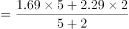
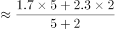
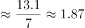

# 加权平均数（按日型5-2加权折算周平均）

考点：[[20-考点/资料分析/平均数/加权平均数（按日型5-2加权折算周平均）|平均数 / 加权平均数（按日型5:2加权折算周平均）]]
材料：[[15-材料/资料分析/186398 某市调查总队对2000名市民的媒体需|186398 某市调查总队对2000名市民的媒体需]]

**问法模型**：题干出现'一周（有5个工作日）内平均每天'且材料分'工作日/双休/节假日'两列 → 采用(工作日值×5+双休节假日值×2)÷7的加权平均模型

## 推理链
1. 第1步：由题干锁定'大专'类、'看电视'两个条件，在统计表'大专'行×'电视'列读取数据：工作日每天1.69小时，双休/节假日每天2.29小时
2. 第2步：题干明确一周有5个工作日和2个双休/节假日，一周平均每天=（工作日值×5+双休/节假日值×2）÷7
3. 第3步：代入计算：（1.69×5+2.29×2）÷7=（8.45+4.58）÷7=13.03÷7≈1.86小时
4. 第4步：与选项对照，1.86小时与B项一致，且该值介于1.69与2.29之间、偏向权重更大的工作日值，逻辑自洽，故选B

**最快解法**：⚡ 公式法（5:2加权平均）+夹逼排除：真值必落在1.69与2.29之间且因工作日权重5>2而偏向1.69，可先排除A（直接取工作日值）与C（1.99恰为两值简单平均），再精算13.03÷7≈1.86锁定B

## 易错点
- ⚠ 误选A：把'平均每天'直接当成工作日值1.69，漏掉双休/节假日2天的拉动
- ⚠ 误选C：将1.69与2.29简单平均得1.99，忽略一周5:2的日型权重
- ⚠ 串列/串行陷阱：双向复合表头需同时锁定'大专'行与'电视'列，勿读成网络列或其他文化程度行

## 母题抽象
> 🧩 当题干出现'一周/一段时间内平均每天'且材料按'工作日/双休节假日'分列给值时，用（工作日值×5+节假日值×2）÷7加权平均，验证结果介于两值之间且偏向天数权重更大的一端

**同类特征**：一周内平均每天、有5个工作日、限定文化程度类别（大专）、限定媒体类型（看电视）、双日型（工作日/双休节假日）数据

## 相关题
（暂无）

---

### 题干
“大专”类受访市民一周（有5个工作日）内平均每天看电视的时间为：

### 选项
- A. 1.69小时
- B. 1.86小时　✅
- C. 1.99小时
- D. 2.15小时

### 官方解析

由题干“平均每天看电视的时间为”，可判定该题是现期平均数问题。定位数据表中数据，“大专”类受访市民工作日每天看电视1.69小时，双休/节假日每天看电视2.29小时，一周有5个工作日和2个双休/节假日，可得“大专”受访市民一周内每天看电视时间小时，与B项最接近。

故正确答案为B。

### 给定材料

      某市调查总队随机抽取2000名市民开展媒体需求调查，受访市民按文化程度分为小学及以下、初中、高中/中专、大专、大学本科、研究生等六类，所占比重分别为、、、、、，调查结果见下表。

