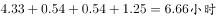
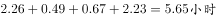
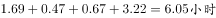
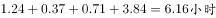
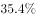

# 行内四列加总比较（各文化程度工作日四类媒体时长求和比大小）

考点：[[20-考点/资料分析/平均数/行内四列加总比较（各文化程度工作日四类媒体时长求和比大小）|平均数 / 行内四列加总比较（各文化程度工作日四类媒体时长求和比大小）]]
材料：[[15-材料/资料分析/186398 某市调查总队对2000名市民的媒体需|186398 某市调查总队对2000名市民的媒体需]]

**问法模型**：问'各文化程度类别中工作日在主要媒体平均花费时间最多的类别' → 对每行四种媒体的'工作日'列横向加总，比较各行总时长取最大

## 推理链
1. 第1步：从表格锁定'工作日'列（电视、广播、报纸/杂志、网络各第1列），提取四个选项行的数据：小学及以下(4.33、0.54、0.54、1.25)，高中/中专(2.26、0.49、0.67、2.23)，大专(1.69、0.47、0.67、3.22)，大学本科(1.24、0.37、0.71、3.84)
2. 第2步：规则——某文化程度工作日在主要媒体平均花费时间=电视+广播+报纸/杂志+网络四个工作日数值之和（同一行四列相加，单位均为小时，无需换算）
3. 第3步：代入计算：A小学及以下=4.33+0.54+0.54+1.25=6.66；B高中/中专=2.26+0.49+0.67+2.23=5.65；C大专=1.69+0.47+0.67+3.22=6.05；D大学本科=1.24+0.37+0.71+3.84=6.16
4. 第4步：比较总时长：6.66>6.16>6.05>5.65，A项小学及以下最大，故正确答案为A

**最快解法**：⚡ 行内加总+估杀排序：先算A项4.33+0.54+0.54+1.25=6.66；再用目测抵消法验D项——A的电视4.33比D的网络3.84多0.49，其余三项广播(0.54>0.37)与报纸/杂志(0.54<0.71)大体抵消，故A>D；C项大专电视1.69明显偏小、总和约6.05<A；B项高中/中专各项均不突出，约5.65最小。无需精算全部四项即可锁定A

## 易错点
- ⚠ 只盯单项最大值误判：网络列最大在大学本科(3.84)、电视列最大在小学及以下(4.33)，若只看单一媒体列会误选D，必须逐行四列横向加总
- ⚠ 双向复合表头串列：每列需同时锁定'媒体×日型'两个维度，8列数据极易把'双休/节假日'列（如大专电视2.29、本科网络4.88）读成工作日列，导致加总值偏大
- ⚠ 报纸/杂志是合并口径的单一列，只能加一次，勿拆成报纸、杂志两列或漏加；本题按类别自身均值比较，无需用比重加权（比重数据在本版材料中本就空缺）

## 母题抽象
> 🧩 当题干出现'某分类维度下各类别在多个指标上的合计量（总时长/总额）谁最大'特征时，对每行横向加总各指标数值再比大小，并警惕'单项最大≠合计最大'的陷阱

**同类特征**：工作日、主要媒体平均花费时间、最多、文化程度类别比较、四类媒体横向加总、行内求和比大小

## 相关题
- [[10-真题/资料分析/平均数/2719389 现期平均数计算与大小比较（列-条）|2719389]]（国考 2021，相关度1）
- [[10-真题/资料分析/平均数/2042014 平均数大小比较（逐行锁定最小列、无需加权的整体平均判定）|2042014]]（江苏 2017，相关度1）

---

### 题干
在不同文化程度的受访市民中，工作日在主要媒体平均花费时间最多的类别是：

### 选项
- A. 小学及以下　✅
- B. 高中/中专
- C. 大专
- D. 大学本科

### 官方解析

根据表格材料可以得，不同文化程度的受访市民工作日在主要媒体花费时间如下：

A项：；

B项：；

C项：；

D项：。

A项小学及以下花费的时间最多。

故正确答案为A。

### 给定材料

      某市调查总队随机抽取2000名市民开展媒体需求调查，受访市民按文化程度分为小学及以下、初中、高中/中专、大专、大学本科、研究生等六类，所占比重分别为、、、、、，调查结果见下表。

