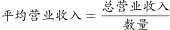
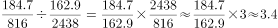

# 户均营业收入（平均数=总量÷份数）求现期倍数

考点：[[20-考点/资料分析/平均数/户均营业收入（平均数=总量÷份数）求现期倍数|平均数 / 户均营业收入（平均数=总量÷份数）求现期倍数]]
材料：[[15-材料/资料分析/186400 2016年第一季度全国星级饭店按一至|186400 2016年第一季度全国星级饭店按一至]]

**问法模型**：题干问'五星级饭店的平均营业收入是四星级的多少倍'→ 先用 平均数=营业收入÷饭店数量 求各档户均收入，再作商得倍数=(五星收入/五星家数)÷(四星收入/四星家数)=(五星收入×四星家数)/(四星收入×五星家数)

## 推理链
1. 第1步：从表格提取2016年第一季度现期数据：五星级816家、营业收入184.7亿元；四星级2438家、营业收入162.9亿元
2. 第2步：明确模型：平均营业收入=营业收入÷饭店数量（亿元/家），所求为两个平均数之比（倍数）
3. 第3步：列式：五星级户均=184.7/816≈0.226亿元/家，四星级户均=162.9/2438≈0.0668亿元/家
4. 第4步：作商：倍数=(184.7/816)÷(162.9/2438)=(184.7×2438)/(162.9×816)，交叉相乘化为 (184.7/162.9)×(2438/816)≈1.13×2.99≈3.38
5. 第5步：与选项对照：3.38≈3.4倍，对应选项C，其余1.8/2.6/4.1均偏离

**最快解法**：⚡ 交叉相乘+截位直除：倍数=(184.7×2438)/(162.9×816)，先截位算 2438/816≈2.99≈3，再乘 184.7/162.9≈1.13，得 3×1.13≈3.4，锁定C；或分子分母直接估 185×2440≈451400、163×816≈133000，451400/133000≈3.4

## 易错点
- ⚠ '平均'陷阱：直接拿营业收入之比 184.7/162.9≈1.13 当答案，漏除家数，得不出任何正确选项
- ⚠ 分子分母放反：题干是'五星级是四星级的'，分子必须全用五星级数据；若把家数比写成 816/2438，会得 1.13×0.335≈0.38，方向算反
- ⚠ 量级与单位干扰：五星级收入(184.7)高于四星级(162.9)但家数(816)远少于四星级(2438)，'收入略高、家数约1/3'两个因子方向相乘才得≈3.4；若换算万元/家需两边同×10000，倍数不变，不必真换算

## 母题抽象
> 🧩 当题干出现'A的平均每单位量是B的多少倍'特征时，用 平均数=总量÷份数，倍数=(A总量×B份数)/(B总量×A份数)交叉相乘，再截位直除验证选项

**同类特征**：平均营业收入、是……的（多少倍）、现期时间断面（2016年第一季度，无基期）、分档取数（五星级对四星级）、总量÷份数后再作商、选项为倍数形式

## 相关题
- [[10-真题/资料分析/增长/10297082 增长量倍数比较（同比增长量作商+区间选项）|10297082]]（天津 2025，相关度1）
- [[10-真题/资料分析/增长/16070311 增长率之商（两指标同比增速的倍数关系）|16070311]]（重庆 2026，相关度1）

---

### 题干
2016年第一季度，全国五星级饭店的平均营业收入是四星级饭店的：

### 选项
- A. 1.8倍
- B. 2.6倍
- C. 3.4倍　✅
- D. 4.1倍

### 官方解析

根据题干所求“2016年第一季度，······平均营业收入是······”，选项为倍数，可判定此题为现期倍数问题。定位表格可得，2016年第一季度，五星级饭店为816家、营业收入184.7亿元，四星级饭店为2438家、营业收入162.9亿元。，则五星级饭店的平均营业收入是四星级饭店的倍。

故正确答案为C。

### 给定材料

