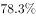
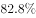
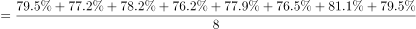
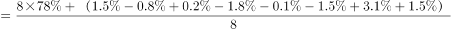
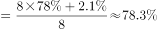

# 折线图多期数据算术平均（现期平均数，限定时间范围取期数）

考点：[[20-考点/资料分析/平均数/折线图多期数据算术平均（现期平均数，限定时间范围取期数）|平均数 / 折线图多期数据算术平均（现期平均数，限定时间范围取期数）]]
材料：[[15-材料/资料分析/186750 2016年某省小微服务业发展状况：营|186750 2016年某省小微服务业发展状况：营]]

**问法模型**：题干'2015-2016年平均每季度…多少'→ 从图1截取2015Q1至2016Q4共8期数值求算术平均（剔除范围外的2014Q4），注意结果单位是%

## 推理链
1. 第1步：题干限定时间范围为'2015-2016年'，对应图1中2015年1季度至2016年4季度共8个季度数据：79.5、77.2、78.2、76.2、77.9、76.5、81.1、79.5，须剔除范围外的2014年4季度76.7
2. 第2步：平均数公式=各期数值之和÷期数，即8期数值总和÷8
3. 第3步：求和79.5+77.2+78.2+76.2+77.9+76.5+81.1+79.5=626.1，626.1÷8≈78.26≈78.3%
4. 第4步：图1纵轴单位为%，'多少企业认为良好或稳定'实为占比百分数，78.3%对应选项B

**最快解法**：⚡ 基准偏差法：以78为基准，8期偏差为+1.5、-0.8、+0.2、-1.8、-0.1、-1.5、+3.1、+1.5，合计+2.1，平均偏差≈+0.26，故平均≈78.3%；或尾数法直接加和626.1÷8，验证选项B

## 易错点
- ⚠ 时间范围陷阱：若误把2014Q4的76.7算入，变成9期平均702.8÷9≈78.1%，落入干扰选项；题干'2015-2016年'必须剔除2014Q4
- ⚠ 单位口径陷阱：纵轴单位是%，'多少企业认为'问的是占比百分数，不是企业个数，也不能与'同比提高3.3个百分点'（79.5-76.2的百分点差）混淆
- ⚠ 图1为逐季当期值而非累计值，直接算术平均即可，无需加权或折算基期

## 母题抽象
> 🧩 当题干出现'某时间段平均每期'且材料为逐期折线图时，先按题干时间范围筛选期数（剔除首点等范围外数据），再对各期数值求算术平均，验证期数与单位（%）是否被首点或'个百分点'干扰

**同类特征**：2015-2016年平均每季度、折线图多期数据求平均、剔除2014年4季度、算术平均数、单位为%（占比而非个数）、'大约'暗示近似计算

## 相关题
- [[10-真题/判断推理/定义判断/2448465 单定义-禁止条件排除（多要件否定式定义）|2448465]]（国考 2020，相关度1）

---

### 题干
2015-2016年，平均每季度大约有多少企业认为自身综合经营状况良好或稳定？

### 选项
- A. 

- B. 

　✅
- C. 

- D. 

### 官方解析

由题干“2015-2016年，平均每季度”，可判定该题为现期平均数问题。定位折线图中数据，平均每季度认为自身综合经营状况良好或稳定的企业大约有。

故正确答案为B。

### 给定材料

        2016年，某省小微服务业呈现出经营平稳面、资产规模、享受税收优惠政策范围“三扩大”的特点，主要行业实现较快增长。

        2016年，该省小微服务业样本企业实现营业收入80.1亿元，同比增长，高于规模以上重点服务业企业8.2个百分点，增速比上年回落0.6个百分点。经营平稳面扩大，2016年4季度，的企业认为本企业综合经营状况良好或稳定，同比提高3.3个百分点，处于历史较高水平。

        2016年，小微服务业样本企业资产总计367亿元，同比增长，户均1643.7万元。负债合计194.8亿元，同比增长，低于资产增长速度1.2个百分点。资产负债率为，处于较为合理水平。实现利润总额4.6亿元，销售利润率为。小微服务业企业的资金和盈利水平均处于平稳状态。

        各主要行业中，水利、环境和公共设施管理业，信息传输、软件和信息技术服务业，租赁和商务服务业，房地产业的增速明显高于平均水平。

