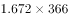
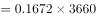
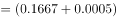
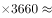
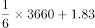
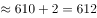
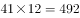
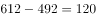

# 现期平均数之差（日-月两种时间口径统一为全年后作差）

考点：[[20-考点/资料分析/平均数/现期平均数之差（日-月两种时间口径统一为全年后作差）|平均数 / 现期平均数之差（日/月两种时间口径统一为全年后作差）]]
材料：[[15-材料/资料分析/186834 我国年轻人2016年在收入、存款、贷|186834 我国年轻人2016年在收入、存款、贷]]

**问法模型**：题干问'上海人均全年记账次数多出全国多少次'→ 将上海的'日均口径'与全国的'月均口径'分别统一为全年次数（日均×366、月均×12）后作差

## 推理链
1. 第1步：从材料提取条件——2016年全年366天（闰年）；上海人均日记账1.672笔/天；全国年轻人每月平均记账约41笔
2. 第2步：确定换算规则——日均值转全年用×366（闰年不能用365），月均值转全年用×12，两者统一到'年'口径才可比
3. 第3步：上海人均全年记账次数=1.672×366=611.952≈612次；全国人均全年记账次数=41×12=492次
4. 第4步：作差=611.952-492=119.952≈120次，对照选项得B

**最快解法**：⚡ 截位直除+拆位相乘：1.672×366拆为1.6×366=585.6与0.072×366=26.352，合计611.952≈612；612-492=120，直接锁定B（选项间隔为2，需精确乘出611.952而非粗略估算）

## 易错点
- ⚠ 日转年误用×365——材料明示2016年全年366天（闰年），1.672×365=610.28，差值为118.28会误选A118次
- ⚠ 口径未统一：直接拿1.672与41比较，或将上海误按月算（1.672×12≈20）、把41误当年均，均无法得出正确差值
- ⚠ 全国'约41笔'是月均而非全年值，须×12；且计算结果119.952需四舍五入为120，与D124等干扰项区分

## 母题抽象
> 🧩 当题干出现'日均/月均……全年多出多少'特征时，先把双方统一为同一时间粒度（日均×当年实际天数366、月均×12），再作差并与选项对照

**同类特征**：上海1.672笔/天（日均口径）、全国月均41笔（月度口径）、2016年全年366天（闰年）、多出多少次（作差问法）、现期平均数、日转年×366、月转年×12

## 相关题
- [[10-真题/资料分析/平均数/13319360 现期平均数（总量÷份数）|13319360]]（江苏 2025，相关度1）
- [[10-真题/资料分析/平均数/13504650 现期平均数计算与多期排序比较|13504650]]（辽宁 2025，相关度1）
- [[10-真题/资料分析/平均数/18385424 现期平均数计算与比较（单价-均价=总额÷数量，跨双轴图取数）|18385424]]（浙江 2024，相关度1）
- [[10-真题/资料分析/平均数/18643712 现期平均数计算（累计值求月均）|18643712]]（天津 2026，相关度1）
- [[10-真题/资料分析/平均数/18643737 现期平均数比较（平均每船次进口量与固定值8万吨比较计数）|18643737]]（天津 2026，相关度1）

---

### 题干
在2016年，上海年轻人人均全年记账次数多出全国年轻人：

### 选项
- A. 118次
- B. 120次　✅
- C. 122次
- D. 124次

### 官方解析

题目求2016年全年记账次数的比较，材料给出2016年“每月平均记账次数”和“日记账次数”，可判定此题为现期平均数问题。上海年轻人人均全年记账次数为：次，全国年轻人人均全年记账次数为：次，因此上海年轻人比全国全年记账多次。

故正确答案为B。

### 给定材料

下面是关于我国年轻人2016年各项消费的数据统计：

        2016年（全年366天），全国年轻人人均月收入为6726元。同时，存款额度也在增加，2016年年轻人的人均月存款为2340元，较2015年同比增加，而2015年的人均月存款较2014年增加。在贷款方面，月收入4000元以上的办理信用卡比例超过，而贷款年龄段比例则为：18-25岁占、26-35岁占、36-45岁占。年轻人每月平均记账次数约为41笔，其中上海以1.672笔的人均日记账次数居榜首。在消费方面，KTV的年人均消费由2014年的699.9元增加到2016年的814.6元；在旅游方面，人均年度交通支出达4985元。年轻人2016年在书本上的人均支出达到168元，相对于2015年的155元，同比增长。2016年，年轻人与雾霾相关的支出较2015年多出，人均支出达到998.7元；每日人均食品消费45.9元，比去年增加8.8元，早餐平均花费4.5元。

> [!warning] 疑点（官方解析可能有误，待人工复核）
> 官方解析中的两个计算式数字显示为占位空缺，但按口径换算1.672×366=611.952、41×12=492，差119.952≈120，与官方答案B完全一致，无矛盾

<!-- CODEX-ANSWER-REVIEW:BEGIN -->
### 本次独立复核

**复核状态：** `resolved`（答案与解析已核定）

**计分答案：** B（可计分）

**复核解析：**

上海日均记账1.672笔折全年1.672×366=611.952笔；全国月均41笔折全年41×12=492笔；差119.952，约120次，选B。

**相关信息：**

2016是闰年，按题面全年366日；全国数据为月均，乘12而非366。

**题源依据：** [固定版本原题](https://github.com/Mentat-Uran/kaogongzhentizhengliu/blob/84ab93d4b64b61d897bece8a1c0a5bab06b4feb2/10-%E7%9C%9F%E9%A2%98/%E8%B5%84%E6%96%99%E5%88%86%E6%9E%90/%E5%B9%B3%E5%9D%87%E6%95%B0/2049302%20%E7%8E%B0%E6%9C%9F%E5%B9%B3%E5%9D%87%E6%95%B0%E4%B9%8B%E5%B7%AE%EF%BC%88%E6%97%A5-%E6%9C%88%E4%B8%A4%E7%A7%8D%E6%97%B6%E9%97%B4%E5%8F%A3%E5%BE%84%E7%BB%9F%E4%B8%80%E4%B8%BA%E5%85%A8%E5%B9%B4%E5%90%8E%E4%BD%9C%E5%B7%AE%EF%BC%89.md)；固定内容 commit `84ab93d4b64b61d897bece8a1c0a5bab06b4feb2`，Markdown blob `970463ec311393e0f49057e288c64bb03fb43c58`。
<!-- CODEX-ANSWER-REVIEW:END -->
