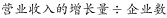
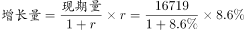

# 平均数增长量（分子增长、分母不变型）

考点：[[20-考点/资料分析/平均数/平均数增长量（分子增长、分母不变型）|平均数 / 平均数增长量（分子增长、分母不变型）]]
材料：[[15-材料/资料分析/186852 2016年1季度全国规模以上文化及相|186852 2016年1季度全国规模以上文化及相]]

**问法模型**：题干出现'平均每家……营业收入比上年同期增长多少万元'→ 平均数增长量模型：因企业数（分母）无变化，平均每家收入的增长量＝总收入增长量÷企业数＝现期平均×r/(1+r)。

## 推理链
1. 第1步：从表格'总计'行提取现期数据——2016年1季度营业收入16719亿元、同比增速8.6%（文字段该数字留白，必须回表读取）；题干给定企业数4.7万家且'数量无变化'。
2. 第2步：企业数量不变 ⇒ 平均每家企业收入的同比增速＝总收入的同比增速8.6%；平均数增长量＝现期平均×r/(1+r)，等价于总增长量÷企业数。
3. 第3步：现期平均每家收入＝16719亿元÷4.7万家＝16719×10⁴万元÷4.7×10⁴家≈3557万元/家（完成亿元→万元换算）。
4. 第4步：代入计算：3557×8.6%/(1+8.6%)≈3557×0.0792≈282万元；或总增长量＝16719×8.6%/108.6%≈1324亿元，再除以4.7万家≈282万元/家。
5. 第5步：与选项对照：282万元与C项280最接近（A.60、B.150、D.500均相差悬殊），故选C。

**最快解法**：⚡ 百化分+截位直除：企业数不变⇒只算总增长量再除以企业数。8.6%≈1/11.6，总增长量≈16719/(1+11.6)≈16719/12.6≈1327亿元；1327亿元÷4.7万家＝13270万元÷4.7万≈282万元，直除口算即可锁定C（280）。

## 易错点
- ⚠ 设问是'增长多少万元'即增长量，不是增长率；且必须完成亿元→万元换算（1亿元=10⁴万元）并注意'4.7万'的量级，漏换算会差10⁴倍。
- ⚠ 总增速8.6%必须从表格'总计'行读取（文字段该数字留白）；'增速比上年全年增速提高1.7个百分点'反推的是2015年全年增速6.9%，不是2015年1季度基期增速，切勿代入公式。
- ⚠ 用现期平均3557万元计算增长量时须乘r/(1+r)=8.6%/108.6%≈0.0792，若误用现期×r直接相乘得约306万元，方向虽仍指向C但计算口径错误。

## 母题抽象
> 🧩 当题干出现'平均每家/人均……比上年同期增长多少（绝对量单位）'且明确分子或分母'无变化'时，用平均数增长量模型：不变的是分母则增长量＝现期平均×r/(1+r)＝总增长量÷分母，先统一单位换算，再百化分直除与选项对照。

**同类特征**：平均每家、企业数量无变化（分母不变）、比上年同期增长多少万元（增长量设问）、亿元→万元单位换算、增速8.6%需从表格总计行读取、4.7万家的量级处理

## 相关题
- [[10-真题/资料分析/平均数/16593089 平均数增长率|16593089]]（新疆 2024，相关度1）
- [[10-真题/资料分析/平均数/4628153 现期平均数（月均）计算＋口径合并（四星级及以上）|4628153]]（新疆 2021，相关度1）
- [[10-真题/资料分析/平均数/2030158 平均数增长率（两期平均数升降比较）|2030158]]（四川 2016，相关度1）
- [[10-真题/资料分析/平均数/2448389 平均数增长量（两期平均数作差比较）|2448389]]（国考 2020，相关度1）
- [[10-真题/资料分析/平均数/2448499 现期平均数计算（户均注册资本，跨单位量级换算）|2448499]]（国考 2020，相关度1）

---

### 题干
如全国规模以上文化及相关产业企业数量无变化，则2016年1季度平均每家全国规模以上文化及相关产业企业的营业收入约比上年同期增长多少万元？

### 选项
- A. 60
- B. 150
- C. 280　✅
- D. 500

### 官方解析

根据题干“······2016年1季度平均每家······营业收入约比上年同期增长多少万元”，可判定本题为平均数的增长量问题。由于全国规模以上文化及相关产业企业数量无变化，因此用即可。定位文字材料可得：2016年1季度，全国规模以上文化及相关产业企业共4.7万家，实现营业收入16719亿元，比上年同期增长，可知2016年1季度全国规模以上文化及相关产业企业营业收入的亿元。则平均每家全国规模以上文化及相关产业企业的营业收入约比上年同期增长万元。

故正确答案为C。

### 给定材料

        2016年1季度，全国规模以上文化及相关产业企业共4.7万家，实现营业收入16719亿元，比上年同期增长，增速比上年全年增速提高1.7个百分点。 

 

> [!warning] 疑点（官方解析可能有误，待人工复核）
> 官方解析文本存在排版缺失（'用即可'处公式脱落、'比上年同期增长'后增速数字留白），属呈现问题而非答案错误；按标准公式计算结果≈282万元，与官方答案C（280）一致，不影响结论。

<!-- CODEX-ANSWER-REVIEW:BEGIN -->
### 本次独立复核

**复核状态：** `resolved`（答案与解析已核定）

**计分答案：** C（可计分）

**复核解析：**

收入增长量先按企业总量计算：16719×8.6%÷1.086≈1323.97亿元；企业数4.7万家且不变，平均每家增长约1323.97÷4.7≈281.7万元，最接近C（280万元）。原追加解析直接乘8.6%漏除了1.086，305.7万元不是增长量。

**相关信息：**

资料分析—增长量=现期量×增长率÷(1+增长率)，再除以企业数；注意“每家增长量”与现期均值乘增长率的区别。

**题源依据：** [固定版本原题](https://github.com/Mentat-Uran/kaogongzhentizhengliu/blob/84ab93d4b64b61d897bece8a1c0a5bab06b4feb2/10-%E7%9C%9F%E9%A2%98/%E8%B5%84%E6%96%99%E5%88%86%E6%9E%90/%E5%B9%B3%E5%9D%87%E6%95%B0/2049708%20%E5%B9%B3%E5%9D%87%E6%95%B0%E5%A2%9E%E9%95%BF%E9%87%8F%EF%BC%88%E5%88%86%E5%AD%90%E5%A2%9E%E9%95%BF%E3%80%81%E5%88%86%E6%AF%8D%E4%B8%8D%E5%8F%98%E5%9E%8B%EF%BC%89.md)；固定内容 commit `84ab93d4b64b61d897bece8a1c0a5bab06b4feb2`，Markdown blob `67393f4f2feed2b9ebdebecc4ed54f8c02dd10b5`。
<!-- CODEX-ANSWER-REVIEW:END -->
