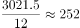

# 折线图找增速极值年份+现期月均计算（全年总量÷12）

考点：[[20-考点/资料分析/平均数/折线图找增速极值年份+现期月均计算（全年总量÷12）|平均数 / 折线图找增速极值年份+现期月均计算（全年总量÷12）]]
材料：[[15-材料/资料分析/186994 江西省2015年财政总收入运行情况（|186994 江西省2015年财政总收入运行情况（]]

**问法模型**：题干问'同比增长率最低的年份，平均每月的财政收入约为'→先由折线右轴锁定增速最低年份，再取该年柱状图总量除以12求月均

## 推理链
1. 第1步：从统计图折线（右轴，%）读取2011-2015年各年同比增长率：34.2%、24.4%、15.3%、13.7%、12.7%
2. 第2步：逐年比较增速，最低为2015年的12.7%，锁定目标年份为2015年
3. 第3步：从柱状图（左轴，亿元）读取2015年财政总收入为3021.5亿元（与文字段'财政总收入3021.5亿元'交叉一致）
4. 第4步：应用月均公式：平均每月财政收入=该年财政总收入÷12
5. 第5步：代入计算：3021.5÷12≈251.8亿元
6. 第6步：与选项对照：251.8最接近252亿元，故选C

**最快解法**：⚡ 折线找极值+截位直除：折线右轴找最低点12.7%→对应2015年；柱值3021.5÷12，直除首两位得25，即251.8≈252，锁定C；亦可用3000÷12=250快速定位量级，3021.5略大于3000故略大于250，唯一在250附近的选项为C（252）

## 易错点
- ⚠ 双轴图单位陷阱：柱（亿元，左轴）与折线（%，右轴）不可比大小，须只在右轴折线上比增速，若误用柱高或把折线高低当总量高低会选错年份
- ⚠ 概念混淆：题干问'同比增长率最低'是增速（%）而非增长量（亿元），若误找增长量最低的2013年（312.3亿元，对应2358.4÷12≈196.3亿元）则无对应选项且方向错误
- ⚠ 选项差距小（242/247/252/257，间隔仅5亿元），除数必须用12（月），不能粗略估算到十位以上误差；且易错除以11等其他数字

## 母题抽象
> 🧩 当题干出现'增长率最高/最低的年份+平均每月/月均'特征时，先在双轴图折线上锁定目标年份，再取对应柱值按'总量÷12'截位直除，用选项间距判断所需精度

**同类特征**：同比增长率最低的年份、平均每月、折线找极值、柱状图取对应年份总量、全年总量÷12、双轴图

## 相关题
- [[10-真题/资料分析/增长/50805 现期量计算（同比增速不变预测+求月平均数）|50805]]（甘肃 2009，相关度1）
- [[10-真题/资料分析/倍数/2443046 现期倍数（'累计−当月'拆分后求月均倍数）|2443046]]（辽宁 2019，相关度1）
- [[10-真题/资料分析/平均数/2280937 现期平均数（月均进口量=6个月当月值之和÷6）|2280937]]（四川 2018，相关度1）
- [[10-真题/资料分析/平均数/4637139 基期平均数计算（基期量÷月数）|4637139]]（国考 2022，相关度1）
- [[10-真题/资料分析/平均数/2184641 现期平均数计算（部分÷比重反推整体+月均+亿元→万亿元单位换算）|2184641]]（选调 2018，相关度1）

---

### 题干
2011-2015年，江西省财政总收入同比增长率最低的年份，平均每月的财政收入约为（  ）。

### 选项
- A. 242亿元
- B. 247亿元
- C. 252亿元　✅
- D. 257亿元

### 官方解析

根据题干所求“平均每月的财政收入约为”，可判定此题为平均数问题。定位统计图可得，江西省财政总收入同比增长率最低的年份为2015年，该年财政总收入为3021.5亿元，平均每月的财政收入为亿元。

故正确答案为C。

### 给定材料

        江西省2015年财政总收入3021.5亿元，比上年增长，财政总收入占生产总值的比重为，比上年提高1.0个百分点。其中，税收收入2373.0亿元，增长，占财政总收入比重为，其他收入648.5亿元。所有县（市、区）财政总收入突破6亿元，其中，财政总收入超10亿元的县（市、区）85个，比上年增加8个；超20亿元的36个，增加7个；超30亿元的17个，增加2个；超50亿元的5个，增加2个；百亿县实现零突破，南昌县财政总收入达100.9亿元。

