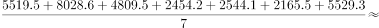
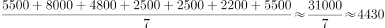

# 现期平均数计算与比较（算术平均、剔除全国行）

考点：[[20-考点/资料分析/平均数/现期平均数计算与比较（算术平均、剔除全国行）|平均数 / 现期平均数计算与比较（算术平均、剔除全国行）]]
材料：[[15-材料/资料分析/186840 2015年全国及上海、江苏、浙江、安|186840 2015年全国及上海、江苏、浙江、安]]

**问法模型**：题干为'2015年一般公共预算收入高于表中七个省（市）平均值的有'→ 先求7个省（市）一般公共预算收入的算术平均值（务必剔除'全国'行），再逐项与平均值比较大小。

## 推理链
1. 第1步：从表格提取7个省（市）2015年一般公共预算收入：上海5519.5、江苏8028.6、浙江4809.5、安徽2454.2、福建2544.1、江西2165.5、山东5529.3（亿元），剔除'全国'行152217亿元
2. 第2步：公式：平均值=七省市数值之和÷7
3. 第3步：求和 5519.5+8028.6+4809.5+2454.2+2544.1+2165.5+5529.3=31050.7亿元，平均值=31050.7÷7≈4435.8亿元
4. 第4步：逐一比较：上海5519.5、江苏8028.6、浙江4809.5、山东5529.3均高于4435.8亿元；安徽2454.2、福建2544.1、江西2165.5均低于
5. 第5步：对照选项，高于平均值的是'上海、江苏、浙江、山东'，对应C项

**最快解法**：⚡ 排名代入法：四个选项均恰为4个省（市），故高于平均值的必是数值前4名；按一般公共预算收入排序：江苏8028.6＞山东5529.3＞上海5519.5＞浙江4809.5＞福建2544.1＞安徽2454.2＞江西2165.5（第4名4809.5与第5名2544.1之间断层），前四名对应C项，完全无需计算平均值。

## 易错点
- ⚠ 把'全国'行152217亿元计入平均值：若按8项平均约22783亿元，则7省（市）全部低于'平均值'，无正确选项——题干'七个省（市）'已明确剔除全国行
- ⚠ 误用'税收收入'列数据（如浙江4167.7、山东4203.1）排名，口径与题干'一般公共预算收入'不符
- ⚠ 未观察选项结构而死算平均值浪费时间：四选项均为4个省（市）名单，直接取排名前四即可锁定答案

## 母题抽象
> 🧩 当题干出现'高于/低于若干主体平均值的有哪几个'且各选项均列出相同数量的主体名单时，先数选项含几个主体，直接取该指标排名前N名（低于平均则取后N名）代入选项验证，跳过平均值计算；若需精确均值，切记剔除材料中的'全国/合计'行。

**同类特征**：高于…平均值、七个省（市）、一般公共预算收入、选项均为4个主体名单、现期值直接比较、须剔除全国/合计行

## 相关题
- [[10-真题/资料分析/其他/2062840 现期值读数比较（跨表直接查找比大小）|2062840]]（广州市考 2016，相关度1）

---

### 题干
2015年一般公共预算收入高于表中七个省（市）平均值的有：

### 选项
- A. 上海、安徽、福建、江西
- B. 江苏、浙江、安徽、山东
- C. 上海、江苏、浙江、山东　✅
- D. 安徽、福建、江西、山东

### 官方解析

根据题干“2015年一般公共预算收入高于表中七个省（市）平均值”，可判定此题为平均数问题。

方法一：

代入表格数据，七个省（市）一般公共预算平均值为亿元，一般公共预算高于该平均值的省（市）为上海5519.5亿元、江苏8028.6亿元、浙江4809.5亿元、山东5529.3亿元。

方法二：

选项都为4个具体省（市）名称，问高于平均值的有几个，则只需要选择选项当中相对最大的四个城市即可。按照表格中一般公共预算排名前四的省（市）依次是：江苏、山东、上海、浙江，对应C项。

故正确答案为C。

### 给定材料

> [!warning] 疑点（官方解析可能有误，待人工复核）
> 官方解析方法一中'七个省（市）一般公共预算平均值为亿元'处漏印了具体数值（按数据应约为4435.8亿元），属解析排版缺漏，不影响答案C的正确性。
