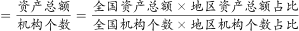
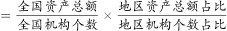
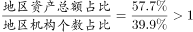
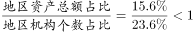
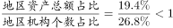
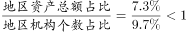
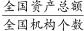
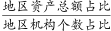

# 现期平均数大小比较（资产总额占比÷网点个数占比，全国总量约掉）

考点：[[20-考点/资料分析/平均数/现期平均数大小比较（资产总额占比÷网点个数占比，全国总量约掉）|平均数 / 现期平均数大小比较（资产总额占比÷网点个数占比，全国总量约掉）]]
材料：[[15-材料/资料分析/187100 中国人民银行《2015年中国区域金融|187100 中国人民银行《2015年中国区域金融]]

**问法模型**：题干问'营业网点的平均资产总额最高的地区'→ 现期平均数比较模型：每网点平均资产=该地区资产总额占比÷该地区网点占比（×全国总量比，四地区相同可约掉）

## 推理链
1. 第1步：从表格提取四地区两列占比：营业网点机构个数占比东部39.9、中部23.6、西部26.8、西北9.7；资产总额占比东部57.7、中部15.6、西部19.4、西北7.3
2. 第2步：每网点平均资产=(资产占比×174.2万亿元)÷(网点占比×22.1万个)=（资产占比÷网点占比）×(174.2万亿/22.1万)，后一括号对四地区相同，比较商即可
3. 第3步：截位直除比较：东部57.7/39.9≈1.45；中部15.6/23.6≈0.66；西部19.4/26.8≈0.72；西北7.3/9.7≈0.75
4. 第4步：仅东部的商大于1，其余三地区分子均小于分母（商<1），东部每网点平均资产最高，对照选项锁定A

**最快解法**：⚡ 占比商直除+首数定性：平均资产=资产占比÷网点占比（总量项约掉）；先算东部57.7÷39.9≈1.45>1，再看中部、西部、西北三组均为'分子<分母'（15.6<23.6、19.4<26.8、7.3<9.7，商必<1），无需精算即可锁定东部

## 易错点
- ⚠ 分母列口径错误：必须用'营业网点机构个数占比'列（39.9/23.6/26.8/9.7），勿误用'法人机构个数占比'列（34.8/24.9/31.1/9.2）
- ⚠ 名称口径不一致：正文与题干用'东北'，表格行名为'西北'，须确认该行数据9.7/10.8/7.3/9.2即为题干所指地区，避免错行取数
- ⚠ 量级与硬算陷阱：174.2万亿元×占比与22.1万个×占比数值巨大，硬算绝对量费时易错，应占比相除约掉总量；本题是平均数比较，直接比值即可，区别于'多多少倍'需先减后除的题

## 母题抽象
> 🧩 当题干出现'平均到某单位的量（每网点资产/人均资产等）最高或最低'且表格只给占比、正文才给全国总量时，用'分子地区占比÷分母地区占比'约掉总量直接比商，商最大（或最小）的地区即答案

**同类特征**：2015年末、营业网点的平均资产总额、最高的地区是、现期平均数比较、四地区占比横向对比、无需计算绝对量

## 相关题
- [[10-真题/资料分析/平均数/2184619 现期平均数比较（收入÷企业数排序）|2184619]]（选调 2018，相关度1）
- [[10-真题/资料分析/平均数/5893714 现期平均数比较（当月值与1~11月月均值比较，含'累计−当月'数据加工）|5893714]]（国考 2024，相关度1）
- [[10-真题/资料分析/平均数/12881994 现期平均数比较（平均运送距离=旅客周转量÷旅客发送量，逐年做商找最小值）|12881994]]（广东 2025，相关度1）
- [[10-真题/资料分析/平均数/17764932 现期平均数（单件快递收入）计算与大小比较（含榜单排名放缩）|17764932]]（湖北 2024，相关度1）
- [[10-真题/资料分析/增长/2172271 基期量计算（时点值差法：基期时点值=现期时点值-期间新增量）|2172271]]（江苏 2018，相关度1）

---

### 题干
2015年末，我国银行业金融机构营业网点的平均资产总额最高的地区是：

### 选项
- A. 东部　✅
- B. 中部
- C. 西部
- D. 东北

### 官方解析

材料时间为2015年末，由题干“2015年末……平均……是”，可知本题为现期平均数。地区平均资产总额。定位表格第一列第三列可知：

东部地区；

中部地区；

西部地区；

东北地区。

一定，东部地区最高，所以东部地区平均资产总额最高。

故正确答案为A。

### 给定材料

        中国人民银行发布的《2015年中国区域金融运营报告》披露：2015年末，全国各地区银行业金融机构网点共计22.1万个，从业人员379.0万人，资产总额174.2万亿元，同比分别增长、、。分地区看，中部、西部和东北地区银行业金融机构发展加快，从业人员和资产规模占全国的比例同比均有所提高，东部地区这两项指标同比分别下降1.0个百分点和0.7个百分点。

