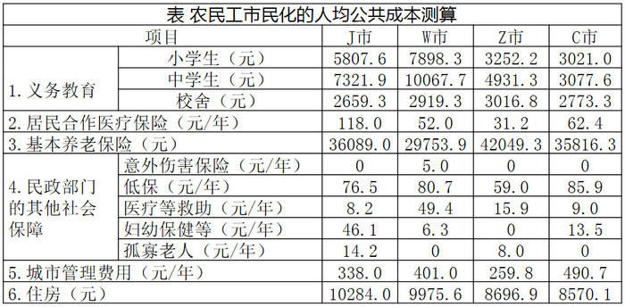

# 现期平均数比较（大类子项加总后四城排名）

考点：[[20-考点/资料分析/平均数/现期平均数比较（大类子项加总后四城排名）|平均数 / 现期平均数比较（大类子项加总后四城排名）]]
材料：[[15-材料/资料分析/187692 某研究中心对C、Z、W、J四个城市农|187692 某研究中心对C、Z、W、J四个城市农]]

**问法模型**：先找'某项人均成本最低的城市'，再问该城市'另一项人均成本位列第几' → 第一步在对应行找最小值锁定城市，第二步将该大类下各子项跨行加总后与四城比较定名次

## 推理链
1. 第1步：定位表格第3项'基本养老保险（元）'，四城数据为J市36089.0、W市29753.9、Z市42049.3、C市35816.3，最低的是W市29753.9
2. 第2步：'义务教育人均公共成本'=小学生+中学生+校舍三项之和（三项均为一次性元，口径一致可直接加总；题干称'人均'平均数，四城子项数相同，比较总和即可）
3. 第3步：W市义务教育合计=7898.3+10067.7+2919.3=20885.3元
4. 第4步：J市=5807.6+7321.9+2659.3=15788.8元；Z市=3252.2+4931.3+3016.8=11200.3元；C市=3021.0+3077.6+2773.3=8871.9元
5. 第5步：四城比较W市20885.3 > J市15788.8 > Z市11200.3 > C市8871.9，W市义务教育人均公共成本位列第一，选A

**最快解法**：⚡ 部分和截位判断法：先锁定养老保险最低的W市，再看义务教育——W市仅小学生+中学生两项7898.3+10067.7≈17966，已超过J市三项总和15788.8、Z市11200.3、C市8871.9，无需加校舍项即可确定W市必然最大，直接锁定'第一'

## 易错点
- ⚠ 列顺序陷阱：表中城市列为J、W、Z、C，与题干叙述顺序C、Z、W、J不同，定位养老保险最低城市时易串列（如误选Z市42049.3反而它是最高）
- ⚠ 子项加总陷阱：义务教育是大类下含小学生/中学生/校舍3个子项，须加总后比较，直接取某一子项（如只比小学生7898.3）会误判名次
- ⚠ 口径陷阱：表中混杂一次性元与元/年，本题涉及的养老保险与义务教育均为一次性元口径，直接加总即可，勿把其他年度项（城市管理、医疗保险）掺入

## 母题抽象
> 🧩 当题干出现'A项最低（高）的城市，其B项位列第几'时，先在A项所在行找最值锁定城市，再将B项大类下各子项加总与四城比较；速算上可用'目标城市部分和已超过其他城市总和'提前判优，省去完整加总

**同类特征**：某项人均公共成本最低的城市、另一项位列第几/排名、两步定位：先找最值城市再比较、大类含多个子项需跨行加总、四城横向比较

## 相关题
（暂无）

---

### 题干
四个城市中，农民工市民化的基本养老保险人均公共成本最低的城市，其市民化的义务教育人均公共成本位列：

### 选项
- A. 第一　✅
- B. 第二
- C. 第三
- D. 第四

### 官方解析
根据“市民化的义务教育人均公共成本”为平均数，判断本题为现期平均数的比较。定位表格第3项，农民工市民化的基本养老保险人均公共成本最低的城市是W市，因为都是小学生、中学生、校舍3项，平均数比较直接比较3项总和即可。W市农民工市民化的义务教育人均公共成本为元；J市为元；Z市为元；C市为元。因此W市位列第一。
故正确答案为A。

### 给定材料

为了衡量农民工在市民化过程中政府的公共支出，某研究中心对C市、Z市、W市、J市四个城市进行了调研测算。

