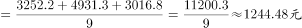
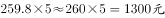
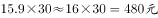

# 跨行子项加总后年均摊算，与多年度累计费用比较

考点：[[20-考点/资料分析/平均数/跨行子项加总后年均摊算，与多年度累计费用比较|平均数 / 跨行子项加总后年均摊算，与多年度累计费用比较]]
材料：[[15-材料/资料分析/187692 某研究中心对C、Z、W、J四个城市农|187692 某研究中心对C、Z、W、J四个城市农]]

**问法模型**：题干出现'将一次性投入摊分到每一年'并与'若干年的年度成本'比较 → 先把该市大类下子项加总再÷年数，然后把各选项'年度值×年数'算出，找差值最小者

## 推理链
1. 第1步：从表中提取Z市义务教育三个子项（均为一次性元）：小学生3252.2、中学生4931.3、校舍3016.8，表中未给大类合计，必须加总
2. 第2步：Z市义务教育人均公共成本合计=3252.2+4931.3+3016.8=11200.3元；摊分到9年，每年=11200.3÷9≈1244.5元/年
3. 第3步：确认选项口径：城市管理、低保、居民合作医疗保险、医疗等救助均为'元/年'，n年费用=年度值×n（是乘不是除）
4. 第4步：代入Z市数据计算各选项：A=259.8×5=1299.0元；B=59.0×15=885.0元；C=31.2×10=312.0元；D=15.9×30=477.0元
5. 第5步：与1244.5比较差值：A差约54.5、B差约359.5、C差约932.5、D差约767.5，A项最接近，故选A

**最快解法**：⚡ 量级排除+截位口算：Z市义务教育三项加总≈11200，÷9≈1245；四个选项乘积口算为1299、885、312、477，仅A（259.8×5≈1300）在1200~1300量级且最接近，直接锁定A，无需精确计算

## 易错点
- ⚠ 义务教育大类无合计行，需跨行加总三个子项，只取'小学生'或'中学生'单个子项会全错
- ⚠ 口径陷阱：义务教育合计是一次性元，需÷9摊到每年；而选项中的城市管理、低保、医疗保险、医疗救助是元/年，'5年/15年/10年/30年'应×年数而非÷年数
- ⚠ 列定位陷阱：城市列顺序为J、W、Z、C，Z市在第3列，易串列取成W市（7898.3+10067.7+2919.3）或C市数据
- ⚠ 量级干扰：基本养老保险、住房为万元级数据，与本题无关，加总时勿误取或位数错位

## 母题抽象
> 🧩 当题干出现'将某阶段/一次性总成本摊分到每年，再与另一指标若干年的费用比较接近程度'时，用'子项加总÷年数 vs 年度值×年数'双侧换算到同口径，比差值取最接近项

**同类特征**：摊分到每一年、九年义务教育阶段人均公共成本、接近、跨子项加总、年度成本×年数、指定单城市数据定位

## 相关题
（暂无）

---

### 题干
如果将农民工市民化所需的九年义务教育阶段人均公共成本摊分到每一年，则Z市的该成本接近该市( )。

### 选项
- A. 5年的市民化所需城市管理人均公共成本费用　✅
- B. 15年的市民化所需低保人均公共成本费用
- C. 10年的市民化所需居民合作医疗保险人均公共成本费用
- D. 30年的市民化所需医疗等救助人均公共成本费用

### 官方解析

根据所求为Z市的九年义务教育人均公共成本与其他指标的比较，判断本题为现期计算问题。Z市农民工市民化所需的九年义务教育阶段每年所需人均公共成本。A项为；B项为；C项为；D项为。因此所求数据接近A项。

故正确答案为A。

### 给定材料

为了衡量农民工在市民化过程中政府的公共支出，某研究中心对C市、Z市、W市、J市四个城市进行了调研测算。

