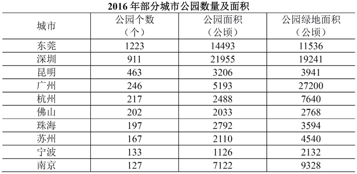

# 现期平均数计算（平均每个公园的面积=公园面积÷公园个数）

考点：[[20-考点/资料分析/平均数/现期平均数计算（平均每个公园的面积=公园面积÷公园个数）|平均数 / 现期平均数计算（平均每个公园的面积=公园面积÷公园个数）]]
材料：[[15-材料/资料分析/191532 2016年全国城市公园统计：前五省份|191532 2016年全国城市公园统计：前五省份]]

**问法模型**：题干问'平均每个公园的面积约为多少'→ 现期平均数模型：平均数=对应口径总量÷份数（公园面积2033公顷÷公园个数202个）

## 推理链
1. 第1步：题干锁定主体'佛山市'、时间2016年、指标'平均每个公园的面积'，属现期平均数，无需基期换算
2. 第2步：定位表格佛山行，提取公园个数202个、公园面积2033公顷（注意取'公园面积'列，不是'公园绿地面积'列2768公顷）
3. 第3步：套用公式 平均每个公园面积=公园面积÷公园个数=2033÷202
4. 第4步：2033÷202≈10.07公顷/个，与A项10最接近，故正确答案为A

**最快解法**：⚡ 截位直除：2033÷202，商首位为1、次位接近0，约10.07，直接锁定A（10）；无需精算，首位判断即可排除B/C/D

## 易错点
- ⚠ 双口径混淆：误用'公园绿地面积'2768公顷作分子，2768÷202≈13.7，会误选B(15)；材料注释明确'公园绿地'是更宽口径的统称，本题问'每个公园的面积'必须用'公园面积'列
- ⚠ 主体错位：表格按公园个数降序排列，佛山在表中第6行，若按行序凭直觉找数可能串行取到杭州(2033为佛山非杭州，杭州面积2488)或珠海(2792)的数据
- ⚠ 量级误判：若粗算时把2033÷202看成2033÷20.2或忽略数量级，可能错选D(25)，需确认除数为202

## 母题抽象
> 🧩 当题干出现'平均每个/每单位X的Y'且材料为现期数据时，直接用'Y的对应总量÷X的份数'，同表同行两列相除，务必先核对分子取哪一列口径再动笔

**同类特征**：平均每个公园的面积、现期时点（2016年）、单一城市主体（佛山）、表格同行两列相除、选项为整数且间隔均匀（10/15/20/25）、约数问法'约为'

## 相关题
（暂无）

---

### 题干
2016年，佛山市平均每个公园的面积约为多少公顷？

### 选项
- A. 10　✅
- B. 15
- C. 20
- D. 25

### 官方解析
由题干“2016年······佛山市平均每个公园······”，可判定本题为现期平均数问题。定位表格材料，佛山市公园个数202个，公园面积2033公顷。故2016年，佛山市平均每个公园的面积。
故正确答案为A。

### 给定材料

<b>根据以下资料，回答下列5题。</b>

        2016年，全国城市公园数量排名前五的省份依次是广东、浙江、江苏、山东和云南，公园数量分别为3512个、1171个、942个、828个和683个。其中，广东省的公园面积达到65318公顷，占全国公园面积的比重超过；公园绿地面积达到89591公顷，占全国公园绿地面积的比重约为。

注：公园绿地指具有公园作用的所有绿地的统称，即公园性质的绿地，并非公园中的绿地面积，包括综合公园、专类公园、带状公园、街旁游乐园和社区公园等。

