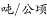

# 现期平均数计算（单位面积产量=产量÷面积）

考点：[[20-考点/资料分析/平均数/现期平均数计算（单位面积产量=产量÷面积）|平均数 / 现期平均数计算（单位面积产量=产量÷面积）]]
材料：[[15-材料/资料分析/191710 2014年我国农业（种植业）生产情况|191710 2014年我国农业（种植业）生产情况]]

**问法模型**：题干出现'2014年……单位种植面积的产量约为'且时间为现期 → 直接用现期平均数模型：粮食产量÷粮食种植面积，注意'万吨÷万公顷=吨/公顷'的量纲抵消。

## 推理链
1. 第1步：题干明确求2014年粮食单位种植面积的产量，材料现期为2014年，判定为现期平均数问题，无需求基期。
2. 第2步：从材料第一段取分子所需面积条件：粮食种植面积11274万公顷（'比上年增加78万公顷'为干扰信息，本题不需要）。
3. 第3步：从材料第二段取产量条件：全年粮食产量60710万吨，注意不能用谷物55727万吨（粮食≠谷物口径）。
4. 第4步：代入公式：单位面积产量=60710万吨÷11274万公顷=60710/11274吨/公顷（万与万抵消，结果量纲为吨/公顷）。
5. 第5步：截位直除：60710/11274≈607/113，商5余4340，4340/11274≈0.38，得≈5.39吨/公顷。
6. 第6步：与选项对照：5.39与D项5.4最接近（A3.9、B4.4、C4.9均明显偏小），故选D。

**最快解法**：⚡ 截位直除法：60710÷11274，截位为607÷113，首位商5（113×5=565≈607-余42），得≈5.4吨/公顷，一步锁定D；量级上'万吨/万公顷'直接抵消，无需任何换算。

## 易错点
- ⚠ 单位量级陷阱：万吨÷万公顷=吨/公顷，'万'字直接抵消；若误以为还需×1000换算成公斤/公顷，或忘抵消'万'得出0.0054等，量级即错。
- ⚠ 口径错位：纯文字材料面积与产量数值密集相邻，易错取'谷物55727万吨'作分子（粮食=谷物+豆类+薯类，粮食总量应为60710万吨），也易把棉花422万公顷等面积数据错当产量。
- ⚠ 多算一步的陷阱：材料给出'比上年增加78万公顷'，易被诱导先反推2013年面积11196万公顷求基期平均数，而题干问的是2014年现期值，直接相除即可。

## 母题抽象
> 🧩 当题干出现'现期年份+单位（种植）面积的产量/人均××约为'特征时，用现期平均数模型：分子总量÷分母份数，先检查量纲（万吨÷万公顷=吨/公顷），再截位直除对照选项量级与首位。

**同类特征**：2014年（现期时间词）、单位种植面积的产量、约为+纯数值选项、粮食产量60710万吨、种植面积11274万公顷、万吨÷万公顷量纲抵消

## 相关题
（暂无）

---

### 题干

2014年，我国粮食单位种植面积的产量约为（    ）。

### 选项
- A. 3.9
- B. 4.4
- C. 4.9
- D. 5.4　✅

### 官方解析

由题意“2014年，······单位种植面积的产量······”，已知，且材料时间为2014年，可判定本题为现期平均数问题。定位文字材料第一段“2014年我国粮食种植面积11274万公顷”和材料第二段“全年粮食产量60710万吨”可知2014年我国粮食。

故正确答案为D。

### 给定材料

        2014年我国粮食种植面积11274万公顷，比上年增加78万公顷。棉花种植面积422万公顷，减少13万公顷。油料种植面积1408万公顷，增加6万公顷。糖料种植面积191万公顷，减少9万公顷。

        粮食再获丰收。全年粮食产量60710万吨，比上年增加516万吨，增产。其中，夏粮产量13660万吨，增产；早稻产量3401万吨，减产；秋粮产量43649万吨，增产。全年谷物产量55727万吨，比上年增产。其中，稻谷产量20643万吨，增产；小麦产量12617万吨，增产；玉米产量21567万吨，减产。

        全年棉花产量616万吨，比上年减产。油料产量3517万吨，与上年持平。糖料产量13403万吨，减产。茶叶产量209万吨，增产。

