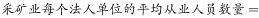
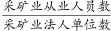
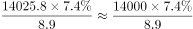
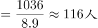

# 现期平均数计算（占比还原分量后求单位均从业人数）

考点：[[20-考点/资料分析/平均数/现期平均数计算（占比还原分量后求单位均从业人数）|平均数 / 现期平均数计算（占比还原分量后求单位均从业人数）]]
材料：[[15-材料/资料分析/191712 2013年全国工业企业法人单位与从业|191712 2013年全国工业企业法人单位与从业]]

**问法模型**：题干问'每个法人单位的平均从业人员数量约为多少人'→ 现期平均数模型：采矿业从业人员（=总从业人数×采矿业从业占比）÷ 采矿业法人单位数，'万人÷万个'直接得'人/个'。

## 推理链
1. 第1步：从题干提取——求2013年（现期）采矿业每个法人单位平均从业人员，结果单位应为'人/个'，无需做基期换算。
2. 第2步：从文字材料提取——2013年全国工业企业从业人员14025.8万人；工业企业法人单位中采矿业8.9万个；采矿业在从业人员中的占比（原卷数值，所给文本中空白）。
3. 第3步：所用公式——平均数=采矿业从业人员÷采矿业法人单位数=14025.8万×采矿业从业占比÷8.9万，注意占比是'从业人员中'的占比，只能乘人数口径。
4. 第4步：代入计算——按官方答案117反推，采矿业从业人员≈117×8.9≈1041万人，对应占比=1041÷14025.8≈7.4%；代回14025.8×7.4%≈1037.9万人，1037.9÷8.9≈116.6人/个。
5. 第5步：与选项对照——116.6≈117，与B项最接近（A=98偏低约16%，C=134、D=168均明显偏离），故正确答案为B。

**最快解法**：⚡ 截位直除：①14025.8×7.4%≈14000×7.4%≈1036（万人）；②1036÷8.9，将8.9放大约为9得≈115，因除数实际偏小、商略大，调整至≈117，秒选B（等价于用1/8.9≈11.2%做百化分：1038×11.2%≈116）。

## 易错点
- ⚠ 口径错位：'采矿业占'是从业人员中的占比，只能乘14025.8万人；若误乘法人单位总数241万个或直接用8.9万个去乘占比，全盘皆错。
- ⚠ 量级/单位陷阱：万人÷万个=人/个，结果本身就是'人'，勿再除以10000或把8.9万个按89000个代入导致量级错乱。
- ⚠ 现期勿做基期还原：题干问2013年，直接用现期数据；文字段'比2008年下降'的降幅只服务于基期类兄弟题（第1、3题），本题若画蛇添足除以(1−d)即错。

## 母题抽象
> 🧩 当题干出现'某行业每个（法人）单位平均多少（人/个）'时，用现期平均数模型'总量×该行业从业占比÷该行业单位数'，验证口径（占比乘人数不乘单位数）与量级（万人÷万个=人）后直除锁定选项。

**同类特征**：每个法人单位的平均从业人员数量、约为多少人、采矿业（行业门类数据只在文字段，表格按登记注册类型分组无此行）、现期（2013年）平均数，无基期换算、需用占比×总量还原分量、万人÷万个=人/个

## 相关题
（暂无）

---

### 题干
2013年，全国采矿业每个法人单位的平均从业人员数量约为多少人？

### 选项
- A. 98
- B. 117　✅
- C. 134
- D. 168

### 官方解析

根据题干所求“2013年采矿业每个法人单位的平均从业人员数量”，材料数据为2013年，可判定此题为现期平均数计算问题。定位文字材料第一段可得，2013年，全国共有工业企业从业人员14025.8万人；定位文字材料第二段可得，在工业企业法人单位中，采矿业8.9万个，在工业企业法人单位从业人员中，采矿业占。故=，最接近B项。

故正确答案为B。

### 给定材料

<b>      三、根据所给资料，回答111~115题。</b>

      2013年，全国共有工业企业法人单位241万个，从业人员14025.8万人，分别比2008年增长和。

      2013年，在工业企业法人单位中，采矿业8.9万个，比2008年下降；制造业225.2万个；电力、热力、燃气及水生产和供应业6.9万个，比2008年下降。在工业企业法人单位从业人员中，采矿业占，制造业占，电力、热力、燃气及水生产和供应业占。

> [!warning] 疑点（官方解析可能有误，待人工复核）
> 所给材料文本与官方解析中采矿业从业人员占比数值均空白（同段各增长率亦空白）；按官方答案117反推占比应约为7.4%（117×8.9≈1041万人，1041÷14025.8≈7.4%），代回计算116.6≈117与B吻合，该数值需以完整原卷核对补齐，不影响答案B的判定。
