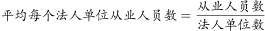
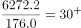
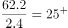
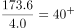
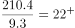

# 现期平均数比较（平均每个法人单位从业人员数从高到低排序）

考点：[[20-考点/资料分析/平均数/现期平均数比较（平均每个法人单位从业人员数从高到低排序）|平均数 / 现期平均数比较（平均每个法人单位从业人员数从高到低排序）]]
材料：[[15-材料/资料分析/191712 2013年全国工业企业法人单位与从业|191712 2013年全国工业企业法人单位与从业]]

**问法模型**：题干出现'按2013年平均每个法人单位从业人员数量从高到低排序'→ 对各登记注册类型逐一用'平均数=从业人员÷法人单位数'相除后比较大小

## 推理链
1. 第1步：题干要求比较的四个类型（私营、股份合作、集体、其他）均为表格中登记注册类型的细分行，数据为2013年现期值，无需基期换算，从表格直接取数：私营176.0万个/6272.2万人，股份合作2.4万个/62.2万人，集体4.0万个/173.6万人，其他9.3万个/210.4万人
2. 第2步：公式：平均每个法人单位从业人员=从业人员(万人)÷法人单位数(万个)，万人÷万个直接得'人/个'
3. 第3步：代入计算：集体企业173.6÷4.0=43.4人/个；私营企业6272.2÷176.0≈35.6人/个；股份合作企业62.2÷2.4≈25.9人/个；其他企业210.4÷9.3≈22.6人/个
4. 第4步：排序得：集体(43.4)＞私营(35.6)＞股份合作(25.9)＞其他(22.6)，对照选项仅C项'集体企业＞私营企业＞股份合作企业＞其他企业'吻合，故选C

**最快解法**：⚡ 截位直除+首位商比较：四个分数同为万人÷万个口径，只需估首位商——集体173.6/4≈43；私营6272/176≈35.6；股份合作62.2/2.4≈26；其他210.4/9.3≈22.6；依次递减，直接锁定C，无需精算

## 易错点
- ⚠ 私营企业单位数(176.0万个)与从业人数(6272.2万人)均为最大，凭总量直觉会误排私营第一，实际分母大拉低平均值(仅约35.6人/个)，必须真除比较
- ⚠ 集体企业总量(173.6万人)偏小易被忽视，但其分母仅4.0万个，平均值43.4人/个反而最高，是本题排序的关键反差项
- ⚠ 干扰项集中在私营与集体位置互换（A、B、D均错），另需注意只用表格登记注册类型口径，勿跨口径混入文字段的行业门类数据

## 母题抽象
> 🧩 当题干出现'按某年平均每个单位（法人/企业）的某总量从高到低排序'特征时，用平均数=总量÷单位数对候选逐一截位直除，先比首位商排除明显大小关系，再对接近者复核，验证总量最大者未必均值最大

**同类特征**：2013年、平均每个法人单位、从业人员数量、从高到低排序、不同类型企业、登记注册类型

## 相关题
- [[10-真题/资料分析/平均数/2184619 现期平均数比较（收入÷企业数排序）|2184619]]（选调 2018，相关度1）
- [[10-真题/资料分析/平均数/2578802 现期平均数计算与分类排序（分组算术平均）|2578802]]（四川 2020，相关度1）
- [[10-真题/资料分析/增长/1758944 年均增长率比较与排序|1758944]]（上海 2016，相关度1）
- [[10-真题/资料分析/平均数/2604298 基期平均数（基期量）大小比较——四大区域月均收入2018年排序|2604298]]（广东 2020，相关度1）
- [[10-真题/资料分析/增长/1797916 基期量计算与排序（环比基期比较）|1797916]]（黑龙江 2016，相关度1）

---

### 题干
将不同类型企业按2013年平均每个法人单位从业人员数量从高到低排序，下列正确的是：

### 选项
- A. 
私营企业股份合作企业集体企业其他企业

- B. 
私营企业集体企业其他企业股份合作企业

- C. 
集体企业私营企业股份合作企业其他企业
　✅
- D. 
集体企业股份合作企业私营企业其他企业

### 官方解析

根据题干所求“将不同类型企业按2013年平均每个法人单位从业人员数量从高到低排序”，材料数据为2013年，可判定此题为现期平均数比较问题，。根据表格材料可知，2013年平均每个法人单位的从业人员数量，私营企业：人，股份合作企业：人，集体企业：人，其他企业：人。

因此有：集体企业私营企业股份合作企业其他企业，C项满足。

故正确答案为C。

### 给定材料

<b>      三、根据所给资料，回答111~115题。</b>

      2013年，全国共有工业企业法人单位241万个，从业人员14025.8万人，分别比2008年增长和。

      2013年，在工业企业法人单位中，采矿业8.9万个，比2008年下降；制造业225.2万个；电力、热力、燃气及水生产和供应业6.9万个，比2008年下降。在工业企业法人单位从业人员中，采矿业占，制造业占，电力、热力、燃气及水生产和供应业占。

