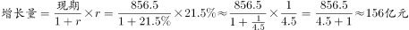

# 月均同比增收（现期增长量÷累计月份数）

考点：[[20-考点/资料分析/平均数/月均同比增收（现期增长量÷累计月份数）|平均数 / 月均同比增收（现期增长量÷累计月份数）]]
材料：[[15-材料/资料分析/191726 2015年1～11月北京市文化创意产|191726 2015年1～11月北京市文化创意产]]

**问法模型**：题干出现'月均同比约增收多少亿元'→ 采用现期增长量模型：同比增量=现期×r/(1+r)，再除以累计月份数11

## 推理链
1. 第1步：定位材料第三段：2015年1～11月（累计11个月）规模以上互联网信息服务行业实现收入856.5亿元；该同比增速百分数在本版本材料中为空白，须以原始完整试卷数值代入（由官方答案B可反推所需增速约21.9%）
2. 第2步：模型公式：同比增量=现期×r/(1+r)=856.5×r/(1+r)；月均同比增收=同比增量÷11（1～11月累计口径，除数是11不是12）
3. 第3步：由官方答案反推量级：14亿元/月×11个月=同比增量约154亿元，则r/(1+r)=154/856.5≈18%，解得r≈18%/82%≈21.9%（约22%）
4. 第4步：代入计算：取r≈22%，同比增量=856.5×0.22/1.22≈154亿元，月均增收=154÷11≈14.0亿元
5. 第5步：选项对照：A.13对应r≈20%、C.20对应r≈35%、D.30对应r≈63%，均偏离该行业增速的合理量级，仅B.14吻合，故选B

**最快解法**：⚡ 公式法+百化分：将增速约22%百化分为2/9，则r/(1+r)=2/11，月均增收=856.5×(2/11)÷11=856.5×2/121≈14，截位直除一步锁定B；口诀'1～11月月均÷11不是÷12'。

## 易错点
- ⚠ 除数陷阱：'1～11月月均'必须÷11，误÷12会把约14.0算成约12.8而误选A.13
- ⚠ 增长量公式陷阱：漏除(1+r)直接用856.5×r（≈188亿元，÷11≈17.1）会误倾向C.20；且勿把'高于全市平均增速15.2个百分点'当成该行业增速本身或按比例换算——它是百分点差
- ⚠ 数据定位陷阱：本版本材料该增速百分数为空白，严禁凭记忆补数，须对照原始完整试卷；勿误用同段17.8亿元（数字内容服务）或6.3亿元（其他互联网服务）作现期值

## 母题抽象
> 🧩 当题干出现'月均同比增收/月均增长量'且材料给出累计现期值与同比增速时，用'增量=现期×r/(1+r)，再÷累计月份数'两步模型，验证除数口径（1～11月除11）与选项量级

**同类特征**：月均同比增收、现期平均数+增长量复合、1～11月累计除以11、同比增长率代入r/(1+r)、选项为整数亿元、规模以上互联网信息服务行业856.5亿元

## 相关题
（暂无）

---

### 题干
2015年1～11月，规模以上互联网信息服务行业月均同比约增收多少亿元？

### 选项
- A. 13
- B. 14　✅
- C. 20
- D. 30

### 官方解析

由题目问“2015年1～11月，······月均同比约增收多少亿元”判定本题为现期平均数的增长量计算问题。定位材料第三段“2015年1～11月，规模以上互联网信息服务行业实现收入856.5亿元，同比增长”，2015年1～11月的，则1～11月的月均。

故正确答案为B。

### 给定材料

<b>二、根据下列统计资料回答问题</b>

       2015年1～11月，北京市20个文化创意产业功能区实现收入7019.8亿元，同比增长，高于全市文化创意产业收入平均增速1.2个百分点，占全市文化创意产业收入的比重为。其中文化科技融合示范功能区实现收入3772.5亿元，同比增长，占20个功能区总收入的；文化金融融合功能区实现收入436.5亿元，同比增长，占20个功能区总收入的。

       传媒影视板块中，CBD-定福庄国际传媒产业走廊功能区、新媒体产业功能区、影视产业功能区分别增长、和，三个功能区收入合计占20个功能区总收入的；文化休闲板块中，北京老字号品牌文化推广功能区、主题公园功能区分别增长和1.5倍，两个功能区收入合计占20个功能区总收入的。

        2015年1～11月，规模以上互联网信息服务行业实现收入856.5亿元，同比增长，高于全市文化创意产业平均增速15.2个百分点；数字内容服务和其他互联网服务行业分别实现收入17.8亿元和6.3亿元，同比分别增长和；全市重点互联网出版单位实现收入373.2亿元，同比增长。

> [!warning] 疑点（官方解析可能有误，待人工复核）
> 本版本材料与官方解析中的同比增速百分数均显示为空白（解析文字缺数字），属排版缺字而非计算错误：按答案B=14反推同比增量约154亿元、对应增速约21.9%（约21%～23%区间均可得约14），结论自洽，务必以原始完整试卷的增速数值代入复核
