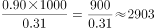

# 每股收益折算（收益总量相当的股数换算）

考点：[[20-考点/资料分析/平均数/每股收益折算（收益总量相当的股数换算）|平均数 / 每股收益折算（收益总量相当的股数换算）]]
材料：[[15-材料/资料分析/192016 某一时点15只A股股票（恒瑞医药、中|192016 某一时点15只A股股票（恒瑞医药、中]]

**问法模型**：题干问'持有A股票1000股，需持有约多少B股票才能与此收益相当'→ 用 总收益相等模型：1000×A每股收益÷B每股收益 求所需股数

## 推理链
1. 第1步：定位表格取数——大商股份（600694）每股收益0.90元，金龙汽车（600686）每股收益0.31元
2. 第2步：收益总量=持股数×每股收益，'收益相当'即 1000×0.90 = 所需金龙汽车股数×0.31
3. 第3步：代入计算：所需股数=1000×0.90÷0.31=900÷0.31≈2903股
4. 第4步：与选项对照，2903与C项2900股最接近（A为3500、B为2000、D为3000中2900差距最小），故选C

**最快解法**：⚡ 截位直除：900÷0.31，首位商2、次位商9，得≈2903，直接锁定C；亦可百化分：0.31≈1/3.2，则900×3.2≈2880≈2900，仍对应C

## 易错点
- ⚠ 乘除方向搞反：误算成1000×0.31÷0.90≈344股或0.31÷0.90的比例，掉入干扰项；正确逻辑是每股收益低（0.31）的股票需要更多股数才能追平每股收益高（0.90）的1000股
- ⚠ 量级错误：每股收益数值很小（0.90、0.31元），漏乘1000或小数点错位会得出29股、290股之类的错误量级
- ⚠ 跨行取数看错行：金龙汽车（600686）与大商股份（600694）代码相邻、表中分处不同行，易误取王府井0.29或招商地产0.57等相邻数据；另计算结果2903为近似值，须按'最接近选项'处理，误以为2903≠2900而重算

## 母题抽象
> 🧩 当题干出现'持有A股票N股，需要约多少B股票才能与此收益相当'特征时，用 N×A每股收益÷B每股收益 折算股数，验证结果与最接近的选项一致

**同类特征**：持有1000股、与此收益相当、需要持有约多少股、每股收益（元）跨行取数、收益总量=股数×每股收益、平均数折算问题

## 相关题
（暂无）

---

### 题干
若有人持有1000股大商股份，那么他需要持有约_______金龙汽车的股份才能与此收益相当。

### 选项
- A. 3500股
- B. 2000股
- C. 2900股　✅
- D. 3000股

### 官方解析

根据题干所求“若有人持有1000股大商股份，那么他需要持有约_______金龙汽车的股份才能与此收益相当”，材料给出两公司股份的每股收益，可判定此题为平均数问题。定位表格，大商股份每股收益0.90元，金龙汽车每股0.31元。与1000股大商股份收益相当，需要持有金龙汽车股份股，C项最接近。

故正确答案为C。

### 给定材料

