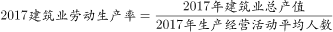
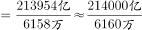
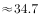

# 现期平均数计算（劳动生产率=总产值÷平均人数，含亿元-万人单位换算）

考点：[[20-考点/资料分析/平均数/现期平均数计算（劳动生产率=总产值÷平均人数，含亿元-万人单位换算）|平均数 / 现期平均数计算（劳动生产率=总产值÷平均人数，含亿元/万人单位换算）]]
材料：[[15-材料/资料分析/193981 2015—2017年部分季度全国建筑|193981 2015—2017年部分季度全国建筑]]

**问法模型**：题干问'2017年按总产值计算的劳动生产率'且时间即材料现期 → 直接用现期建筑业总产值÷现期平均人数，核心是单位换算（亿元÷万人=万元/人=10⁴元/人），无需基期或增长公式

## 推理链
1. 第1步：从统计表提取：2017年'四季度'列（全年累计）建筑业总产值为213954亿元，同列生产经营活动平均人数为6158万人
2. 第2步：劳动生产率=总产值÷平均人数；单位规则：1亿元/万人=10⁸元/10⁴人=10⁴元/人=1万元/人
3. 第3步：代入计算：213954亿元÷6158万人≈34.7441万元/人=347441元/人
4. 第4步：与选项对照：D项347441元/人完全吻合；C项336229元/人恰为误用2016年数据（193567亿元÷5757万人≈336229元/人）的结果，A'无法计算'不成立，故选D

**最快解法**：⚡ 单位换算+截位直除：先明确亿元÷万人=万元/人，选项均为'元/人'故结果×10⁴；213954÷6158，6158×34.7≈21.4万，首三位商34.7，精确约34.7441万元/人，直接锁定D=347441元/人

## 易错点
- ⚠ 单位换算陷阱：分子亿元、分母万人，商的单位是'万元/人'而非'元/人'，换算成元/人需×10⁴，漏掉这一步会得出34.74而误判量级
- ⚠ 现期/基期混淆：题干问2017年即现期，直接相除即可；若误用2016年数据（193567亿元÷5757万人）得约336229元/人，正是C项诱误来源
- ⚠ 时间列与口径陷阱：必须取2017年'四季度'列的累计值（即全年），并注意生产经营活动平均人数为累计期内平均人数，分子分母须取同一时间列；指标名称相近的'建筑工程产值''建筑业竣工产值'不可替代'建筑业总产值'

## 母题抽象
> 🧩 当题干出现'劳动生产率/人均产值=总量指标÷人数指标'特征时，先确认分子分母单位（亿元÷万人=万元/人），再判断现期/基期——现期直接相除，最后核对选项单位是否需×10⁴换算

**同类特征**：按总产值计算的劳动生产率、2017年现期（无基期转化）、建筑业总产值（亿元）÷生产经营活动平均人数（万人）、选项单位为元/人（需×10⁴换算）、累计值口径（四季度列=全年值）、直接相除型平均数

## 相关题
（暂无）

---

### 题干
2017年，按总产值计算的建筑业劳动生产率为（  ）。

### 选项
- A. 无法计算
- B. 323705元/人
- C. 336229元/人
- D. 347441元/人　✅

### 官方解析

由题干“2017年，按总产值计算的建筑业劳动生产率为”，可判定此题为现期平均数问题。定位统计表第二行，2017年建筑业总产值为213954亿元，定位统计表倒数第三行，2017年生产经营活动平均人数为6158万人。万元/人，与D项347441元/人最接近。

故正确答案为D。

### 给定材料

