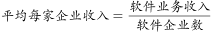
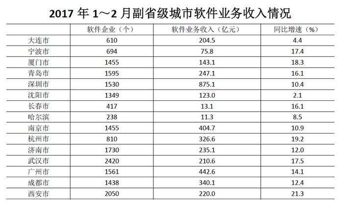

# 现期平均数比较（收入÷企业数排序）

考点：[[20-考点/资料分析/平均数/现期平均数比较（收入÷企业数排序）|平均数 / 现期平均数比较（收入÷企业数排序）]]
材料：[[15-材料/资料分析/194868 2017年1～2月我国15个副省级城|194868 2017年1～2月我国15个副省级城]]

**问法模型**：题干出现'平均每家软件企业软件业务收入从高到低排序'→采用现期平均数模型：软件业务收入÷软件企业数，逐城做商后比较大小排序

## 推理链
1. 第1步：题干限定'长三角地区副省级城市'，从表格15城中筛出南京、杭州、宁波三市（上海为直辖市不在副省级城市表中，苏州、无锡等不在15城名单）
2. 第2步：从表格对应行提取数据——南京市：企业1455个、收入404.7亿元；杭州市：企业810个、收入326.6亿元；宁波市：企业694个、收入75.8亿元
3. 第3步：套用平均数公式'平均每家企业收入=收入÷企业数'：杭州=326.6/810，南京=404.7/1455，宁波=75.8/694（单位亿元/家，约千万元级）
4. 第4步：截位直除比首位——杭州326.6/810首位商4，南京404.7/1455首位商2，宁波75.8/694首位商1，即杭州≈0.40＞南京≈0.28＞宁波≈0.11
5. 第5步：从高到低排序为杭州、南京、宁波，对照选项只有B符合，其余三个选项顺序均不符

**最快解法**：⚡ 首位直除法：三城同列做商，杭州326.6÷810首商4、南京404.7÷1455首商2、宁波75.8÷694首商1，首位商即可分出4＞2＞1，直接锁定'杭州、南京、宁波'选B，无需算出完整数值

## 易错点
- ⚠ 只看收入列不看企业数：南京收入404.7亿元为三城最高，误排南京第一而错选A
- ⚠ 只看企业数列排序：企业数南京1455＞杭州810＞宁波694，直接按企业数排会得'南京、杭州、宁波'错选A
- ⚠ 城市筛选口径错：长三角筛选易误纳入厦门、济南等非长三角城市，或漏掉宁波；注意表格中'哈尔滨'一行少写'市'字的书写不一致不影响本题

## 母题抽象
> 🧩 当题干出现'平均每家(个/人)××的××从高到低排序'特征时，先按题干地域/范围限定筛选对象，再对每个对象做'总量÷份数'的商，用首位直除比较商的大小即可排序，切勿单看总量或单看份数排错序

**同类特征**：平均每家软件企业软件业务收入、从高到低排序、长三角地区副省级城市、现期平均数比较、跨量纲做商（亿元÷个）、收入÷企业数

## 相关题
- [[10-真题/资料分析/平均数/2578802 现期平均数计算与分类排序（分组算术平均）|2578802]]（四川 2020，相关度1）
- [[10-真题/资料分析/平均数/5893714 现期平均数比较（当月值与1~11月月均值比较，含'累计−当月'数据加工）|5893714]]（国考 2024，相关度1）
- [[10-真题/资料分析/平均数/12881994 现期平均数比较（平均运送距离=旅客周转量÷旅客发送量，逐年做商找最小值）|12881994]]（广东 2025，相关度1）
- [[10-真题/资料分析/增长/1758944 年均增长率比较与排序|1758944]]（上海 2016，相关度1）
- [[10-真题/资料分析/平均数/17764932 现期平均数（单件快递收入）计算与大小比较（含榜单排名放缩）|17764932]]（湖北 2024，相关度1）

---

### 题干
2017年1～2月，长三角地区副省级城市按照平均每家软件企业软件业务收入从高到低排序正确的是：

### 选项
- A. 南京、杭州、宁波
- B. 杭州、南京、宁波　✅
- C. 宁波、杭州、南京
- D. 宁波、南京、杭州

### 官方解析

根据题干“2017年1～2月，平均每家软件企业软件业务收入”，可判定本题为现期平均数的比较问题。定位表格材料可知每个城市的软件企业数和软件业务收入，根据，则长三角地区副省级城市平均每家企业软件业务收入如下：；；，从高到低排序为杭州、南京、宁波。

故正确答案为B。

### 给定材料

        2017年1～2月，我国副省级城市实现软件业务收入3874亿元，同比增长。其中，软件产品收入1216亿元，同比增长；信息技术服务收入2042亿元，同比增长；嵌入式系统软件收入616亿元，同比增长。

