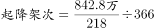
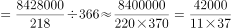
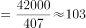

# 现期平均数（多步平均：总量÷机场数÷天数，日均口径）

考点：[[20-考点/资料分析/平均数/现期平均数（多步平均：总量÷机场数÷天数，日均口径）|平均数 / 现期平均数（多步平均：总量÷机场数÷天数，日均口径）]]
材料：[[15-材料/资料分析/195087 2016年我国境内（颁证）民用航空机|195087 2016年我国境内（颁证）民用航空机]]

**问法模型**：题干出现'平均每个……日均完成……'特征 → 采用现期平均数模型：总架次÷机场数÷全年天数（除数合并为218×366）

## 推理链
1. 第1步：由题干锁定三个取数——国内航线飞机起降842.8万架次（第四段）、境内颁证机场218个（第一段）、2016年为闰年共366天
2. 第2步：单位换算：842.8万架次=8428000架次（'万'对应10^4，不可漏）
3. 第3步：套用平均数公式：每个机场日均架次=总架次÷机场数÷天数=8428000÷218÷366
4. 第4步：合并除数：218×366=79788，8428000÷79788≈105.6架次
5. 第5步：与选项对照：105.6与C项106最接近，故选C

**最快解法**：⚡ 截位直除+合并除数：把两个除数先乘成218×366≈79788≈8万，则8428000÷79788≈842.8万÷8万≈105~106，直接锁定C；也可分步：842.8万÷218≈3.87万架次/机场·年，再÷366≈105.6≈106

## 易错点
- ⚠ 口径陷阱：题干问的是'国内航线'架次842.8万，误用起降总量923.8万架次会算得约115.8，反而更接近D项124而出错；也不能用运输架次793.5万（口径更小）
- ⚠ 单位陷阱：842.8'万'架次必须换成8428000架次再除，漏掉10^4量级会导致数量级完全错误
- ⚠ 时间基数陷阱：2016年是闰年应除以366天而非365天；且除数是全部境内机场218个，即使数据是'国内航线'也要除以机场总数而非仅国内机场

## 母题抽象
> 🧩 当题干出现'平均每个X日均/每天完成多少Y'特征时，用'Y总量÷X个数÷天数'模型（闰年366天），先统一单位、再合并除数截位直除，验证最接近的选项

**同类特征**：平均每个机场、日均、国内航线飞机起降、现期平均数、万架次单位换算、2016年闰年366天

## 相关题
- [[10-真题/资料分析/平均数/2049608 现期平均数（日均量=当月总量÷当月实际天数）|2049608]]（山东 2017，相关度2）
- [[10-真题/资料分析/平均数/5802111 现期平均数（日均进口量=区间总量÷区间天数）|5802111]]（浙江 2023，相关度2）
- [[10-真题/资料分析/平均数/13319360 现期平均数（总量÷份数）|13319360]]（江苏 2025，相关度1）
- [[10-真题/资料分析/平均数/13504650 现期平均数计算与多期排序比较|13504650]]（辽宁 2025，相关度1）
- [[10-真题/资料分析/平均数/18385424 现期平均数计算与比较（单价-均价=总额÷数量，跨双轴图取数）|18385424]]（浙江 2024，相关度1）

---

### 题干
2016年我国平均每个境内民用航空机场日均完成国内航线飞机起降约多少架次？

### 选项
- A. 75
- B. 91
- C. 106　✅
- D. 124

### 官方解析

根据题干“2016年平均每······日均完成······架次”，结合材料时间为2016年，可判定本题为现期平均数问题。定位文字材料第一段可得：“我国境内民用航空机场共218个；定位文字材料第四段可得：国内航线完成842.8万架次”。2016年是闰年，故2016年我国平均每个境内民用航空机场日均完成国内航线飞机架次，与C项最接近。

故正确答案为C。

### 给定材料

        2016年，我国境内民用航空（颁证）机场共218个（不含香港、澳门和台湾地区，以下简称境内机场）。

        2016年我国境内机场全年完成旅客吞吐量101635.7万人次，比上年增长。分航线看，国内航线完成91401.7万人次，增长；其中内地至香港、澳门和台湾地区航线完成2764.5万人次，下降。国际航线完成10234.0万人次，增长。

        全年完成货邮吞吐量1510.4万吨，比上年增长。分航线看，国内航线完成974.0万吨，增长；其中内地至香港、澳门和台湾地区航线完成93.6万吨，增长。国际航线完成536.4万吨，增长。

        全年完成飞机起降923.8万架次，比上年增长；其中运输架次为793.5万架次，增长。分航线看，国内航线完成842.8万架次，增长；其中内地至香港、澳门和台湾地区航线完成20.3万架次，下降。国际航线完成81.0万架次，增长。

        2016年，年旅客吞吐量1000万人次以上的机场有28个，较上年净增2个，完成旅客吞吐量占全部境内机场旅客吞吐量的。年旅客吞吐量200～1000万人次的机场有21个，较上年净减1个，完成旅客吞吐量占全部境内机场旅客吞吐量的。年旅客吞吐量200万人次以下的机场有169个，较上年净增7个，完成旅客吞吐量占全部境内机场旅客吞吐量的。

