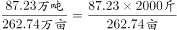
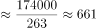
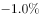

# 现期平均数（单位面积产量）计算+万吨-万亩与斤-亩单位换算

考点：[[20-考点/资料分析/平均数/现期平均数（单位面积产量）计算+万吨-万亩与斤-亩单位换算|平均数 / 现期平均数（单位面积产量）计算+万吨/万亩与斤/亩单位换算]]
材料：[[15-材料/资料分析/195124 某省2017年园林水果：全省总量及苹|195124 某省2017年园林水果：全省总量及苹]]

**问法模型**：题干'增速最高水果的单位面积产量约为…斤/亩'→先锁定增速最高的品种（官方解析认定为枣），再用现期平均数=产量÷挂果面积，最后×2000换算为斤/亩

## 推理链
1. 第1步：题干要求先找'挂果面积同比增速最高'的水果，官方解析定位材料第一段判定为枣（本版材料增速数值留空，以官方解析认定的枣为准，不凭空补造增速）
2. 第2步：跨段配对取数：第一段'枣的挂果面积为262.74万亩'，第二段'枣的产量为87.23万吨'
3. 第3步：现期平均数公式：单位面积产量=产量÷挂果面积=87.23万吨÷262.74万亩
4. 第4步：代入计算：87.23/262.74≈0.332，因1万吨=10⁴吨、1万亩=10⁴亩量级恰好相消，0.332即0.332吨/亩
5. 第5步：单位换算：1吨=2000斤，0.332吨/亩×2000=664斤/亩
6. 第6步：与选项对照，664与C项最接近，故选C

**最快解法**：⚡ 截位直除+单位换算：87.23/262.74，分子分母各截三位≈87.2/263≈0.332（万吨÷万亩=吨/亩），再×2000=664，直接锁定C；牢记'问斤/亩就在吨/亩基础上×2000'，A项332正是漏乘2000（误得公斤/亩口径）的陷阱

## 易错点
- ⚠ 单位换算陷阱：87.23÷262.74≈0.332只是吨/亩（=332公斤/亩），问'斤/亩'必须×2000，漏乘会误选A(332)
- ⚠ 品种锁定错误：本版材料增速数值留空，不能凭面积或产量排名惯性猜'增速最高'者（如按产量惯性易猜猕猴桃），依官方解析为枣；且枣的面积与产量分处第一、二段，须跨段同序对位取数，勿串行错位
- ⚠ 现期/基期混淆：题干问2017年现期单产，直接用2017年产量÷2017年挂果面积即可，材料增速缺失不影响本题计算，勿试图用增速回推基期

## 母题抽象
> 🧩 当题干出现'增速最高（或最大/满足某条件）的某主体的单位面积产量（斤/亩）'时，先按条件锁定主体并跨段配对产量与面积，用'产量÷面积=现期平均数（万吨/万亩=吨/亩）'，再按问法口径×2000换算斤/亩后对照选项

**同类特征**：挂果面积同比增速最高、单位面积产量、斤/亩、现期平均数、跨段配对取数、万吨/万亩单位换算

## 相关题
- [[10-真题/资料分析/平均数/13319360 现期平均数（总量÷份数）|13319360]]（江苏 2025，相关度1）
- [[10-真题/资料分析/平均数/13504650 现期平均数计算与多期排序比较|13504650]]（辽宁 2025，相关度1）
- [[10-真题/资料分析/平均数/18385424 现期平均数计算与比较（单价-均价=总额÷数量，跨双轴图取数）|18385424]]（浙江 2024，相关度1）
- [[10-真题/资料分析/平均数/18643712 现期平均数计算（累计值求月均）|18643712]]（天津 2026，相关度1）
- [[10-真题/资料分析/平均数/18643737 现期平均数比较（平均每船次进口量与固定值8万吨比较计数）|18643737]]（天津 2026，相关度1）

---

### 题干
2017年，该省挂果面积同比增速最高水果的单位面积产量约为（  ）斤/亩。

### 选项
- A. 332
- B. 445
- C. 664　✅
- D. 1075

### 官方解析

根据题干“2017年，······的单位面积产量约为······斤/亩”，可判定此题为现期平均数问题。定位文字材料第一段，可直接找出该省挂果面积同比增速最高的水果是枣（），定位文字材料第一段“枣的挂果面积为262.74万亩”和第二段“枣的产量为87.23万吨”，可求得2017年枣的单位面积产量为斤/亩，与C项最接近。

故正确答案为C。

### 给定材料

<b>根据以下资料，回答66—70题。</b>

        2017年，某省全省园林水果面积1987.30万亩，比上年增长。其中，苹果的挂果面积为726.21万亩，同比增长；梨的挂果面积为61.29万亩，同比增长；柑桔的挂果面积为40.26万亩，同比增长；桃的挂果面积为45.05万亩，同比增长；猕猴桃的挂果面积为64.76万亩，同比增长；葡萄的挂果面积为54.05万亩，同比增长；枣的挂果面积为262.74万亩，同比增长；柿子的挂果面积为37.80万亩，同比增长；杏的挂果面积为45.42万亩，同比增长；石榴的挂果面积为6.51万亩，同比增长；樱桃的挂果面积为10.92万亩，同比增长。

        2017年，该省全省园林水果产量1801.02万吨，增长。其中，苹果的产量为1153.94万吨，同比增长；梨的产量为110.37万吨，同比增长；柑桔的产量为54.06万吨，同比增长为；桃的产量为84.61万吨，同比增长；猕猴桃的产量为138.97万吨，同比增长；葡萄的产量为68.15万吨，同比增长；枣的产量为87.23万吨，同比增长；柿子的产量为40.63万吨，同比增长；杏的产量为20.21万吨，同比增长；石榴的产量为10.34万吨，同比增长；樱桃的产量为13.66万吨，同比增长。

> [!warning] 疑点（官方解析可能有误，待人工复核）
> 本版材料文本中各品种挂果面积同比增速数值全部留空，'枣增速最高'无法由给定文本独立验证，只能依官方解析采用枣；此为材料转录缺失而非解析错误，官方答案C（664）与87.23/262.74×2000的计算结果一致，不受影响

<!-- CODEX-ANSWER-REVIEW:BEGIN -->
### 本次独立复核

**复核状态：** `resolved`（答案与解析已核定）

**计分答案：** C（可计分）

**复核解析：**

11种水果挂果面积增速图中枣最高，为12.6%。枣产量87.23万吨、挂果面积262.74万亩，单产=87.23/262.74吨/亩×2000斤/吨≈664斤/亩，选C。

**相关信息：**

吨/亩换成斤/亩乘2000；此处采用题干筛选的挂果面积，不能用总果园面积。

**题源依据：** [固定版本原题](https://github.com/Mentat-Uran/kaogongzhentizhengliu/blob/84ab93d4b64b61d897bece8a1c0a5bab06b4feb2/10-%E7%9C%9F%E9%A2%98/%E8%B5%84%E6%96%99%E5%88%86%E6%9E%90/%E5%B9%B3%E5%9D%87%E6%95%B0/2188149%20%E7%8E%B0%E6%9C%9F%E5%B9%B3%E5%9D%87%E6%95%B0%EF%BC%88%E5%8D%95%E4%BD%8D%E9%9D%A2%E7%A7%AF%E4%BA%A7%E9%87%8F%EF%BC%89%E8%AE%A1%E7%AE%97%2B%E4%B8%87%E5%90%A8-%E4%B8%87%E4%BA%A9%E4%B8%8E%E6%96%A4-%E4%BA%A9%E5%8D%95%E4%BD%8D%E6%8D%A2%E7%AE%97.md)；固定内容 commit `84ab93d4b64b61d897bece8a1c0a5bab06b4feb2`，Markdown blob `1c7903c8aa0920f0e37495db0eb64082d20c91aa`。
<!-- CODEX-ANSWER-REVIEW:END -->
