# 现期平均数（单位面积产量）计算与阈值计数比较

考点：[[20-考点/资料分析/平均数/现期平均数（单位面积产量）计算与阈值计数比较|平均数 / 现期平均数（单位面积产量）计算与阈值计数比较]]
材料：[[15-材料/资料分析/195124 某省2017年园林水果：全省总量及苹|195124 某省2017年园林水果：全省总量及苹]]

**问法模型**：题干'单位面积产量超过[阈值]的水果共有几种'→对11个品种逐一用单产=产量÷挂果面积（万吨÷万亩=吨/亩），与阈值比较后计数

## 推理链
1. 第1步：定位第一段11个品种挂果面积（苹果726.21、梨61.29、柑桔40.26、桃45.05、猕猴桃64.76、葡萄54.05、枣262.74、柿子37.80、杏45.42、石榴6.51、樱桃10.92万亩）与第二段同序产量（1153.94、110.37、54.06、84.61、138.97、68.15、87.23、40.63、20.21、10.34、13.66万吨），判定为现期平均数问题
2. 第2步：单位面积产量=产量÷挂果面积；由于1万吨÷1万亩在数值上恰等于1吨/亩，商值即吨/亩，官方口径阈值为1000公斤/亩=1吨/亩
3. 第3步：与'超过1吨/亩'等价于逐项直比产量与面积两列数值：苹果1153.94>726.21✓、梨110.37>61.29✓、柑桔54.06>40.26✓、桃84.61>45.05✓、猕猴桃138.97>64.76✓、葡萄68.15>54.05✓、柿子40.63>37.80✓、石榴10.34>6.51✓、樱桃13.66>10.92✓；枣87.23<262.74（约0.33吨/亩）✗、杏20.21<45.42（约0.45吨/亩）✗
4. 第4步：达标者为苹果、梨、柑桔、桃、猕猴桃、葡萄、柿子、石榴、樱桃，仅枣、杏两项不达标，11−2=9种
5. 第5步：与选项对照，9种对应B选项

**最快解法**：⚡ 量纲相消直比法（免除法）：阈值恰为1吨/亩且万吨/万亩=吨/亩，故单产是否超阈值等价于产量数值是否大于面积数值，逐项直接比大小不作除法；仅枣（87.23<262.74）与杏（20.21<45.42）不达标，11−2=9，选B

## 易错点
- ⚠ 单位口径陷阱：万吨÷万亩=吨/亩，阈值为1000公斤/亩须换算成1吨/亩再比，直接拿万吨/万亩数值与公斤数比较会差1000倍
- ⚠ 枣、杏两品种易误判：枣产量87.23万吨在11品种中居中，但挂果面积262.74万亩居第二，单产仅约0.33吨/亩，凭产量或面积惯性排单产必错
- ⚠ 柿子（40.63/37.80≈1.07）、石榴（10.34/6.51≈1.59）、樱桃（13.66/10.92≈1.25）等接近阈值的项，粗略估算易把达标项误删；两段品种顺序一致但必须跨段逐项对位，串行错位即全错
- ⚠ 本版文本中题干'超过'后的阈值数值缺失，须按官方解析的1000公斤/亩口径执行，不得自行改用其他阈值

## 母题抽象
> 🧩 当题干出现'单产（产量÷面积）超过某值的有几项'特征时，先核对分子分母单位使商值口径与阈值一致（万吨/万亩=吨/亩），若阈值恰为1个单位可直接逐项比分子分母大小免作除法，用总数减不达标项数快速得答案

**同类特征**：单位面积产量、超过（固定阈值）、共有几种、现期当年数据、万吨与万亩配对、逐品种计数

## 相关题
- [[10-真题/资料分析/平均数/2188149 现期平均数（单位面积产量）计算+万吨-万亩与斤-亩单位换算|2188149]]（陕西 2018，相关度1）
- [[10-真题/资料分析/平均数/2448544 现期平均数计算——单位面积产量阈值筛选计数|2448544]]（国考 2020，相关度1）
- [[10-真题/资料分析/平均数/4658508 平均数（单产）增长率——两期平均数比较|4658508]]（四川 2021，相关度1）
- [[10-真题/资料分析/平均数/1746800 平均数倍率阈值比较（全国平均单产×80%逐行计数）|1746800]]（国考 2016，相关度1）
- [[10-真题/资料分析/平均数/2047656 单位面积产量（单产）计算，跨图表拼接+面积基期倒推|2047656]]（福建 2019，相关度1）

---

### 题干

2017年，单位面积产量超过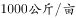的水果共有（  ）种。

### 选项
- A. 8
- B. 9　✅
- C. 10
- D. 11

### 官方解析

根据题干“2017年，单位面积产量······”，结合材料时间为2017年，可判定本题为现期平均数问题。定位材料第一段和第二段，可分别得知各类水果的挂果面积和产量。

根据公式：单位面积产量=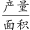，可分别得出各类水果的单位面积产量：

苹果：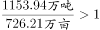吨/亩、梨：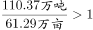吨/亩、柑桔：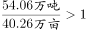吨/亩、桃：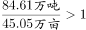吨/亩、猕猴桃：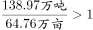吨/亩、葡萄：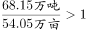吨/亩、枣：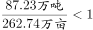吨/亩、柿子：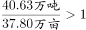吨/亩、杏：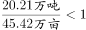吨/亩、石榴：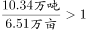吨/亩、樱桃：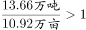吨/亩。1吨/亩=1000公斤/亩，故各类水果中单位面积产量超过1000公斤/亩的水果有：苹果、梨、柑桔、桃、猕猴桃、葡萄、柿子、石榴、樱桃，共9个。

故正确答案为B。

### 给定材料

<b>根据以下资料，回答66—70题。</b>

        2017年，某省全省园林水果面积1987.30万亩，比上年增长。其中，苹果的挂果面积为726.21万亩，同比增长；梨的挂果面积为61.29万亩，同比增长；柑桔的挂果面积为40.26万亩，同比增长；桃的挂果面积为45.05万亩，同比增长；猕猴桃的挂果面积为64.76万亩，同比增长；葡萄的挂果面积为54.05万亩，同比增长；枣的挂果面积为262.74万亩，同比增长；柿子的挂果面积为37.80万亩，同比增长；杏的挂果面积为45.42万亩，同比增长；石榴的挂果面积为6.51万亩，同比增长；樱桃的挂果面积为10.92万亩，同比增长。

        2017年，该省全省园林水果产量1801.02万吨，增长。其中，苹果的产量为1153.94万吨，同比增长；梨的产量为110.37万吨，同比增长；柑桔的产量为54.06万吨，同比增长为；桃的产量为84.61万吨，同比增长；猕猴桃的产量为138.97万吨，同比增长；葡萄的产量为68.15万吨，同比增长；枣的产量为87.23万吨，同比增长；柿子的产量为40.63万吨，同比增长；杏的产量为20.21万吨，同比增长；石榴的产量为10.34万吨，同比增长；樱桃的产量为13.66万吨，同比增长。

> [!warning] 疑点（官方解析可能有误，待人工复核）
> 本版题干'超过'后阈值数值缺失，官方解析明确口径为1000公斤/亩（=1吨/亩）；材料导读猜测阈值或为全省平均单产1801.02/1987.30≈0.91吨/亩，与官方口径不同，但两种阈值下不达标者均为枣与杏，答案均为B（9种），不影响结论

<!-- CODEX-ANSWER-REVIEW:BEGIN -->
### 本次独立复核

**复核状态：** `resolved`（答案与解析已核定）

**计分答案：** B（可计分）

**复核解析：**

原题阈值图明确为1000公斤/亩，即1吨/亩。逐种用产量(万吨)/挂果面积(万亩)比较：苹果1.59、梨1.80、柑桔1.34、桃1.88、猕猴桃2.15、葡萄1.26、枣0.33、柿子1.08、杏0.45、石榴1.59、樱桃1.25吨/亩。除枣、杏外9种超过阈值，选B。

**相关信息：**

万吨/万亩=吨/亩；“超过”不包含等于。需用各品种挂果面积而非全园面积。

**题源依据：** [固定版本原题](https://github.com/Mentat-Uran/kaogongzhentizhengliu/blob/84ab93d4b64b61d897bece8a1c0a5bab06b4feb2/10-%E7%9C%9F%E9%A2%98/%E8%B5%84%E6%96%99%E5%88%86%E6%9E%90/%E5%B9%B3%E5%9D%87%E6%95%B0/2188152%20%E7%8E%B0%E6%9C%9F%E5%B9%B3%E5%9D%87%E6%95%B0%EF%BC%88%E5%8D%95%E4%BD%8D%E9%9D%A2%E7%A7%AF%E4%BA%A7%E9%87%8F%EF%BC%89%E8%AE%A1%E7%AE%97%E4%B8%8E%E9%98%88%E5%80%BC%E8%AE%A1%E6%95%B0%E6%AF%94%E8%BE%83.md)；固定内容 commit `84ab93d4b64b61d897bece8a1c0a5bab06b4feb2`，Markdown blob `e8b5b043f47e2fe33064b340a75160cc3f42d42b`。
<!-- CODEX-ANSWER-REVIEW:END -->
