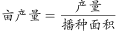
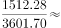
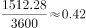
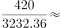
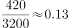
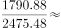
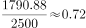
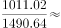
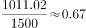

# 现期平均数比较（亩产量=产量÷播种面积）

考点：[[20-考点/资料分析/平均数/现期平均数比较（亩产量=产量÷播种面积）|平均数 / 现期平均数比较（亩产量=产量÷播种面积）]]
材料：[[15-材料/资料分析/198620 2016年某自治区农林牧渔业发展综述|198620 2016年某自治区农林牧渔业发展综述]]

**问法模型**：题干问'2016年亩产量最低的农作物'→ 对四个选项分别用'产量÷播种面积'求现期平均数（比值）并比较大小

## 推理链
1. 第1步：从材料第二段提取2016年播种面积：粮食（含薯类）3601.70万亩、棉花3232.36万亩、特色林果2475.48万亩、园林水果1490.64万亩
2. 第2步：从材料第三段提取对应2016年产量：粮食（含薯类）1512.28万吨、棉花420万吨、特色林果1790.88万吨、园林水果1011.02万吨
3. 第3步：亩产量=产量÷播种面积，万吨÷万亩恰好等于吨/亩，单位可直接相除无需换算
4. 第4步：代入计算：粮食1512.28/3601.70≈0.42吨/亩，棉花420/3232.36≈0.13吨/亩，特色林果1790.88/2475.48≈0.72吨/亩，园林水果1011.02/1490.64≈0.68吨/亩
5. 第5步：比较四个商：0.13＜0.42＜0.68＜0.72，棉花亩产量最低
6. 第6步：对照选项，正确答案为B（棉花）

**最快解法**：⚡ 分子分母定性排除+截位直除：四选项中棉花分子最小（420万吨，约为粮食的1/3.6、特色林果的1/4.3、园林水果的1/2.4）而分母次大（3232.36万亩，仅次于粮食3601.70万亩），商必最小，可直接锁定B；若需验证，首两位直除得0.13/0.42/0.72/0.68即可

## 易错点
- ⚠ 特色林果与园林水果是包含关系（园林水果⊂特色林果），面积2475.48/1490.64万亩与产量1790.88/1011.02万吨两对数据不可交叉错配
- ⚠ 需跨段取数：面积取第2段、产量取第3段；粮食明确'含薯类'且面积产量口径一致，勿把粮食面积3601.70万亩误当作全部农作物面积9348.42万亩，也勿纳入蔬菜等其他题干未列作物
- ⚠ 单位处理：万吨÷万亩=吨/亩可直接相除，勿误做公斤或平方米换算；棉花产量写作整数420，与其他带小数数据精度不同但不影响比较

## 母题抽象
> 🧩 当题干出现'亩产量/单位面积产量最高（低）'特征时，用'产量÷播种面积'的现期平均数模型，先挑分子最小且分母相对大的选项定性锁定，再对其余项截位直除验证

**同类特征**：亩产量最低、现期（2016年）平均数、产量÷播种面积、跨段取数（面积段+产量段）、选项含特色林果与园林水果包含关系、四个比值直接比较

## 相关题
（暂无）

---

### 题干
2016年，亩产量最低的农作物是：

### 选项
- A. 粮食（含薯类）
- B. 棉花　✅
- C. 特色林果
- D. 园林水果

### 官方解析

根据题干“2016年，亩产量最低的农作物是”判定本题为现期平均数问题。定位文字材料第二段可得，2016年粮食(含薯类)播种面积3601.70万亩，棉花播种面积3232.36万亩，特色林果播种面积2475.48万亩，园林水果播种面积1490.64万亩；定位文字材料第三段可得，2016年粮食产量（含薯类）1512.28万吨，棉花产量420万吨，特色林果产量1790.88万吨，园林水果产量1011.02万吨。

根据可得，2016年粮食（含薯类）亩产量为吨，棉花亩产量吨，特色林果亩产量吨，园林水果亩产量吨。因此2016年亩产量最低的农作物是棉花。

故正确答案为B。

### 给定材料

        2016年，某自治区全年实现农林牧渔业总产值2969.70亿元，比上年增长，其中，农业产值2163.11亿元，增长；林业产值50.28亿元，增长；畜牧业产值653.15亿元，增长；渔业产值22.18亿元，增长；农林牧渔服务业产值80.98亿元，增长。

        全年农作物播种面积9348.42万亩，同比增长。其中，粮食（含薯类）3601.70万亩，增长；棉花3232.36万亩，下降；油料382.82万亩，增长；甜菜115.69万亩，增长；蔬菜489.84万亩，增长。特色林果2475.48万亩，增长，其中，园林水果1490.64万亩，增长。

        全年粮食产量（含薯类）1512.28万吨，下降。棉花420万吨，增长。油料75.89万吨，增长。甜菜554.99万吨，增长。蔬菜1966.45万吨，增长。特色林果产量1790.88万吨，增长，其中，园林水果1011.02万吨，增长。

        年末猪牛羊存栏4621.35万头（只），比上年下降。全年猪牛羊出栏4341.90万头（只），增长。猪牛羊肉总产量134.70万吨，增长，其中，牛肉产量42.48万吨，增长；羊肉产量58.32万吨，增长；猪肉产量33.90万吨，增长。禽肉产量15.92万吨，增长。禽蛋产量36.13万吨，增长。牛奶产量156.08万吨，增长。水产品产量16.16万吨，增长。

        年末农业机械总动力2581.96万千瓦，同比增长。拥有大中型拖拉机48.68万台，增长；小型拖拉机26.74万台，下降。农作物机耕率，农作物机播率。化肥施用量（折纯）250.21万吨，增长。农村用电量108.16亿千瓦时，增长。

        拥有农业产业化经营组织12682家，比上年增加820家。自治区级以上农业产业化重点龙头企业507家。农产品加工（流通）企业14165家（其中规模以上企业达到1030家），增加407家；实现农产品加工（流通）业总产值1895.02亿元，增长；自治区级以上休闲观光农业示范点达到183家，其中，国家级示范点达到19家。

> [!warning] 疑点（官方解析可能有误，待人工复核）
> 官方解析中各亩产量数值处排版空缺（如'棉花亩产量吨'），按材料数据实算棉花420/3232.36≈0.13吨/亩确为四者最低，结论与官方答案B一致，不影响结论
