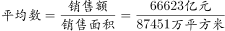
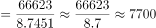

# 现期平均数计算（均价=销售额÷销售面积，含单位量级换算）

考点：[[20-考点/资料分析/平均数/现期平均数计算（均价=销售额÷销售面积，含单位量级换算）|平均数 / 现期平均数计算（均价=销售额÷销售面积，含单位量级换算）]]
材料：[[15-材料/资料分析/198935 2016年1-8月我国东、中、西部地|198935 2016年1-8月我国东、中、西部地]]

**问法模型**：题干出现'平均每平方米售价'→ 用全国商品房销售额÷销售面积，并把'亿元/万平方米'换算成'元/平方米'（×10⁴）

## 推理链
1. 第1步：题干问2016年1-8月'全国商品房平均每平方米售价'，定位表2'全国总计'行，属现期平均数，不需用增速推基期
2. 第2步：提取数据：全国商品房销售额66623亿元，商品房销售面积87451万平方米
3. 第3步：公式：均价=销售额÷销售面积；单位换算：亿元/万平方米=10⁸元/10⁴平方米=10⁴元/平方米
4. 第4步：代入计算：66623÷87451≈0.762，再×10⁴≈7620元/平方米
5. 第5步：与选项对照：7620元最接近7600元，锁定C

**最快解法**：⚡ 截位直除+量级修正：66623÷87451≈666÷875≈0.76（首位商7，次位商6），补回10⁴量级得约7600元/平方米，直接选C；选项间差距大（5300/6000/7600/8200），粗算0.76×10⁴即可排除ABD

## 易错点
- ⚠ 单位换算陷阱：销售额(亿元)÷销售面积(万平方米)=0.76量级，若不×10000会误以为无对应选项或错选；亿元/万平方米=10⁴元/平方米是本题核心关卡
- ⚠ 口径陷阱：必须用表2的'商品房销售额'与'销售面积'，不能误用表1的'房地产开发投资额64387亿元'做分子，两表口径完全不同
- ⚠ 行别陷阱：用'全国总计'行的87451万平方米与66623亿元，勿串用东部（42766/42668）、中部或西部数据

## 母题抽象
> 🧩 当题干出现'平均每平方米售价/均价'特征时，用'销售额÷销售面积'的现期平均数模型，并验证单位量级：亿元÷万平方米后须×10⁴化成元/平方米再对照选项

**同类特征**：平均每平方米售价、全国商品房、现期平均数、销售额÷销售面积、亿元与万平方米量级换算、选项带'元'且量级上千

## 相关题
- [[10-真题/资料分析/平均数/13319360 现期平均数（总量÷份数）|13319360]]（江苏 2025，相关度1）
- [[10-真题/资料分析/平均数/13504650 现期平均数计算与多期排序比较|13504650]]（辽宁 2025，相关度1）
- [[10-真题/资料分析/平均数/18385424 现期平均数计算与比较（单价-均价=总额÷数量，跨双轴图取数）|18385424]]（浙江 2024，相关度1）
- [[10-真题/资料分析/平均数/18643712 现期平均数计算（累计值求月均）|18643712]]（天津 2026，相关度1）
- [[10-真题/资料分析/平均数/18643737 现期平均数比较（平均每船次进口量与固定值8万吨比较计数）|18643737]]（天津 2026，相关度1）

---

### 题干
2016年1-8月份，全国商品房平均每平方米售价约：

### 选项
- A. 5300元
- B. 6000元
- C. 7600元　✅
- D. 8200元

### 官方解析

根据题干“2016年1-8月份，全国商品房平均每平方米售价”，可判定本题为现期平均数问题。定位表2，2016年1-8月份，全国商品房销售额66623亿元，商品房销售面积87451万平方米。代入公式：元。

故正确答案为C。

### 给定材料

> [!warning] 疑点（官方解析可能有误，待人工复核）
> 官方解析'代入公式：元。'处算式显示不完整（缺失具体代入式），但按66623亿元÷87451万平方米×10⁴≈7618元≈7600元与答案C一致，不影响结论
