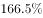

# 基期平均数（先反推缺失季度再求月均）

考点：[[20-考点/资料分析/平均数/基期平均数（先反推缺失季度再求月均）|平均数 / 基期平均数（先反推缺失季度再求月均）]]
材料：[[15-材料/资料分析/199272 中国移动支付市场：2015年银行与非|199272 中国移动支付市场：2015年银行与非]]

**问法模型**：题干求'2015年（早于图示区间首期）月均交易额'→基期平均数模型：用基期量=现期量/(1+环比增速)补出2015Q1，2015年四个季度加总÷12

## 推理链
1. 第1步：题干求2015年全年月均交易额，图1只给2015Q2—2016Q2五个季度（3.47、4.39、5.67、5.97、7.5万亿元），缺2015Q1，须先反推
2. 第2步：折线为环比增速，2015Q2的22.21%即相对2015Q1的增速，套用基期量公式：2015Q1=3.47/(1+22.21%)
3. 第3步：3.47/1.2221≈2.84万亿元，即2015Q1交易规模
4. 第4步：2015年全年合计=2.84+3.47+4.39+5.67≈16.37万亿元（只取2015年四个季度，2016年的5.97、7.5不计入）
5. 第5步：月均=16.37÷12≈1.36万亿元
6. 第6步：与选项对照，1.36与D项1.4万亿元最接近，故选D

**最快解法**：⚡ 公式法+截位直除：2015Q1≈3.47/1.22≈2.85；全年≈2.85+3.47+4.39+5.67≈16.4，16.4÷12≈1.37，首位'1.3几'直接锁定D(1.4)

## 易错点
- ⚠ 时间范围误扩：把2016Q1(5.97)、2016Q2(7.5)并入'2015年全年'，得约22.3÷12≈1.9而误选B
- ⚠ 漏推2015Q1：只用图中2015年三个季度13.53÷12≈1.1而误选A；图中折线是环比，2015Q2的22.21%正是反推Q1的钥匙，切勿拿2016Q2的25.8%当同比（那是兄弟题1的做法）
- ⚠ 跨载体口径混淆：文字段'非银行支付机构'21.96万亿元÷12≈1.83对应B，与图中'第三方移动支付市场'口径不等同，官方按图形口径计算，勿跨口径取数

## 母题抽象
> 🧩 当题干出现'基期年份+月均/日均'且图示区间缺少该年份首期时，先用基期量=现期量/(1+环比增速)补齐缺口，再仅对该年份内的期间加总÷12（或÷月数），与最接近选项对照；切勿把基期年份之外的期间并入，也不可直接挪用文字段另一口径的年度总量

**同类特征**：月均交易额约为、所求年份早于图示区间起点（2015年 vs 图示始于2015Q2）、第三方移动支付市场（图中口径）、季度数据缺一期需用环比反推、选项为万亿元且数值密集（1.2~1.9）、基期平均数问法

## 相关题
（暂无）

---

### 题干
2015年全国第三方移动支付市场月均交易额约为：

### 选项
- A. 1.2万亿元
- B. 1.9万亿元
- C. 1.7万亿元
- D. 1.4万亿元　✅

### 官方解析

根据问题问“月均”，结合问题时间为2015年、材料时间为2016年，可判定题型为基期平均数问题。定位第一个图形材料，由可知：2015年1季度全国第三方移动支付市场交易额为万亿元，则月均交易额万亿元，与D项最接近。

故正确答案为D。

### 给定材料

        中国支付清算协会发布的《中国支付清算行业运作报告（2016）》显示，2015年国内银行共处理移动支付业务138.37亿笔，金额108.22万亿元，同比分别增长和；非银行支付机构共同处理移动支付业务398.61亿笔，金额21.96万亿元，同比分别增长和。

> [!warning] 疑点（官方解析可能有误，待人工复核）
> 材料导读'小题群关系'称本题取文字段非银行机构2015年金额21.96÷12≈1.83万亿元（对应B），与官方答案D（按图1反推2015Q1≈2.84、全年16.37÷12≈1.36）存在口径分歧，即'第三方移动支付市场'与'非银行支付机构'是否同一口径存疑；本笔记严格以官方答案D及其图形口径解析为准，导读表述仅作疑点记录，不改变答案
