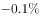

# 算术平均数（13个月涨跌幅序列求均值，正负抵消）

考点：[[20-考点/资料分析/平均数/算术平均数（13个月涨跌幅序列求均值，正负抵消）|平均数 / 算术平均数（13个月涨跌幅序列求均值，正负抵消）]]
材料：[[15-材料/资料分析/199306 国家统计局发布的2016年2月全国工|199306 国家统计局发布的2016年2月全国工]]

**问法模型**：题干要求'2015年2月—2016年2月生活资料出厂价格平均环比'→ 对图3环比序列13个点求算术平均（Σx/13），先用正负对称性判断能否抵消

## 推理链
1. 第1步：题干限定2015年2月—2016年2月共13个月，对象为'生活资料出厂价格环比'，须取图3黄色环比线（图3图例为'同比/环比'，黄线在上才是环比，勿读蓝线同比）
2. 第2步：读出图3环比13个值：2015年2月0.0、3月0.0、4月-0.1、5月0.0、6月0.0、7月0.0、8月0.0、9月+0.1、10月-0.1、11月-0.1、12月0.0、2016年1月+0.1、2月+0.1
3. 第3步：平均环比=（3×(-0.1)+3×(+0.1)+7×0）÷13=（-0.3+0.3）÷13=0，正负恰好完全抵消
4. 第4步：平均为0即'保持不变'，对照选项选C；A/B的±0.1%只是单月涨跌幅，误当平均值即掉坑

**最快解法**：⚡ 正负抵消法——图3环比13个月中恰好3个-0.1（4月、10月、11月）与3个+0.1（9月、2016年1月、2月）对称抵消、其余7个月为0，无需逐项加总即可断定均值=0，秒选C

## 易错点
- ⚠ 图3图例顺序为'同比/环比'，与图1、2、4的'环比/同比'相反，极易把蓝色同比线（-0.1~-0.5）误当环比序列，从而得出'下降'的错误方向
- ⚠ 只看到三个-0.1（或只盯最近几个月为+0.1）就选'下降0.1%'/'上升0.1%'，漏数另一侧三个+0.1/-0.1恰好抵消
- ⚠ 平均值须对全部13个月求均值，不能只对6个非零月平均，也不能把极差（0.2）当平均值；'-0.1与+0.1的算术平均是0'而非绝对值平均0.1

## 母题抽象
> 🧩 当题干出现'某指标从X年X月到X年X月（13个月）平均涨/环比'特征时，取对应折线图整条序列，先数正、负、零三类的个数与数值是否对称，能完全抵消则均值=0，不必逐项加总

**同类特征**：2015年2月到2016年2月（13个月全序列）、平均环比、生活资料出厂价格、图3双折线取数、选项含'保持不变/不能确定'、涨跌幅有正有负可抵消

## 相关题
（暂无）

---

### 题干
2015年2月份到2016年2月份生活资料出厂价格平均环比是（  ）。

### 选项
- A. 
下降

- B. 
上升

- C. 
保持不变
　✅
- D. 
不能确定

### 官方解析

由题意“2015年2月份到2016年2月份生活资料出厂价格平均环比”判定此题为一般增长率问题，定位图形三可知2015年2月份到2016年2月份生活资料出厂价格各月的环比中有三个为，三个为，其余均为0，即平均数为0，所以2015年2月份到2016年2月份生活资料出厂价格平均环比保持不变。

故正确答案为C。

### 给定材料

        根据国家统计局最新发布的数据，2016年2月份，全国工业生产者出厂价格环比下降，同比下降。工业生产者购进价格环比下降，同比下降。1-2月平均，工业生产者出厂价格同比下降，工业生产者购进价格同比下降。

 

1.工业生产者价格同比变动情况 

        工业生产者出厂价格中，生产资料价格同比下降，影响全国工业生产者出厂价格总水平下降约4.8个百分点。其中，采掘工业价格下降，原材料工业价格下降，加工工业价格下降。生活资料价格同比下降，影响全国工业生产者出厂价格总水平下降约0.1个百分点。其中，食品价格上涨，衣着价格上涨，一般日用品价格下降，耐用消费品价格下降。

        据测算，在2月份-的全国工业生产者出厂价格总水平同比降幅中，去年价格变动的翘尾因素约为-4.1个百分点，新涨价因素约为-0.8个百分点。

        工业生产者购进价格中，黑色金属材料类价格同比下降，燃料动力类价格下降，有色金属材料及电线类价格下降，化工原料类价格下降。

2.工业生产者价格环比变动情况

        工业生产者出厂价格中，生产资料价格环比下降，影响全国工业生产者出厂价格总水平下降约0.3个百分点。其中，采掘工业价格下降，原材料工业价格下降，加工工业价格下降。生活资料价格环比上涨。其中，食品价格上涨，衣着价格持平，一般日用品价格上涨，耐用消费品价格下降。

        工业生产者购进价格中，燃料动力类价格环比下降，黑色金属材料类价格下降，有色金属材料及电线类价格上涨，农副产品类价格上涨。

