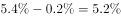
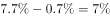

# 平均数增长率（平均运距=周转量÷客运量，'提高X个百分点'还原前三季度增速后代入(a−b)-(1+b)）

考点：[[20-考点/资料分析/平均数/平均数增长率（平均运距=周转量÷客运量，'提高X个百分点'还原前三季度增速后代入(a−b)-(1+b)）|平均数 / 平均数增长率（平均运距=周转量÷客运量，'提高X个百分点'还原前三季度增速后代入(a−b)/(1+b)）]]
材料：[[15-材料/资料分析/199338 2017年A省邮电业务（电信-邮政-|199338 2017年A省邮电业务（电信-邮政-]]

**问法模型**：题干问'前三季度平均每人次运输距离同比上升/下降及幅度'→识别为两期平均数增长率模型：先由'增幅比前三季度提高0.2/0.7个百分点'用减法还原分子（周转量）与分母（客运量）的前三季度增速a、b，再代入(a−b)/(1+b)判断方向与幅度。

## 推理链
1. 第1步：口径确认——平均运距=旅客周转总量÷客运总量（2017年全年为4143.84亿人公里÷148339万人次≈279公里/人次），题目问该平均数2017年前三季度的同比变化。
2. 第2步：材料第4段给的是全年增速——客运总量同比增长g客且'增幅比前三季度提高0.2个百分点'，周转总量增长g周且'增幅比前三季度提高0.7个百分点'（具体百分比数值在所给文本中缺失）。
3. 第3步：按'提高X个百分点=两条增速之差'还原前三季度增速：分母（客运量）增速b=g客−0.2%，分子（周转量）增速a=g周−0.7%。
4. 第4步：套平均数增长率公式 r=(a−b)/(1+b)，代入得 r=[(g周−g客)−0.5%]/(1+b)，其中(a−b)=(g周−g客)−0.5个百分点。
5. 第5步：由官方解析知a>b（即g周−g客>0.5个百分点）且差值很小，故r>0——运距同比上升，先排除A、B两个'下降'选项。
6. 第6步：增速差a−b为不足1个百分点的小正数，再除以略大于1的(1+b)后更小，即上升幅度不到选项阈值（1%），对照选项锁定C（上升了不到1%）。

**最快解法**：⚡ 公式法+增速差秒杀：不必精算r，只看分子分母增速差——前三季度a−b=(g周−g客)−0.5个百分点；该差值为正且不足1个百分点，除以(1+b)后必更小，直接判定'上升且不到1%'，选C；'以上/不到'由增速差量级一步锁定，无需算出具体百分率。

## 易错点
- ⚠ '提高0.2/0.7个百分点'是全年增速与前三季度增速之差：还原前三季度增速须做减法（前三季度=全年−0.2/0.7个百分点），误做加法或直接拿全年增速当前三季度增速即错。
- ⚠ 分子分母增速别对调：运距=周转量÷客运量，a是分子（周转量）增速、b是分母（客运量）增速，公式(a−b)/(1+b)中a、b接反则正负号颠倒，会误选'下降'项。
- ⚠ 时间口径混淆：本题用'比前三季度提高0.2/0.7个百分点'这组数据；'比上年提高0.5/1.8个百分点'是兄弟题推2016→2015年用的另一组链条，两组百分数勿拿错。

## 母题抽象
> 🧩 当题干问'平均数（分子A÷分母B）同比上升还是下降、幅度多少'，而材料只给全年增速并附'比目标期提高X个百分点'时：先做减法把分子分母增速还原到目标期（a−b=全年增速差−百分点差），再套(a−b)/(1+b)——a>b即上升，且真实幅度比增速差更小，可秒选'上升了不到1%'类选项。

**同类特征**：平均每人次…运输距离（平均数=周转量÷客运量）、2017年前三季度（目标期≠材料现期'2017年全年'）、同比：上升/下降+幅度（不到/以上1%）、'增幅比前三季度提高0.2/0.7个百分点'、旅客周转总量÷客运总量、平均数增长率公式(a−b)/(1+b)

## 相关题
（暂无）

---

### 题干

2017年前三季度，A省平均每人次客运旅客运输距离（）同比：

### 选项
- A. 
下降了不到

- B. 
下降了以上

- C. 
上升了不到
　✅
- D. 
上升了以上

### 官方解析

根据“2017年前三季度，A省平均每人次客运旅客运输距离（）同比…”，结合选项上升/下降，可判断此题为平均数的增长率问题。定位文字材料第四段，“2017年，A省完成客运总量···，同比增长，增幅比前三季度提高0.2个百分点···；完成旅客周转总量···，增长，增幅比前三季度提高0.7个百分点···”，可知2017年前三季度，客运总量增长率（b）为，旅客周转量增长率（a）为。代入平均数的增长率公式：，且大于0，结合选项，C满足题意。

故正确答案为C。

### 给定材料

        2017年，A省完成邮电业务总量6065.71亿元。其中，电信业务总量3575.86亿元，同比增长；邮政业务总量2489.85亿元，增长。

        2017年，A省移动电话期末用户1.48亿户，比上年末增长。其中，4G期末用户达1.18亿户，比上年末增长。互联网宽带接入期末用户3128万户，比上年末增长。移动互联网期末用户1.31亿户，比上年末增长，移动互联网接入流量同比增长。

        2017年，全省全年完成快递业务量100.51亿件，同比增长。其中，同城快递业务量增长，异地快递业务量增长，国际和港澳台地区快递业务量增长。

        2017年，A省完成客运总量148339万人次，同比增长，增幅比前三季度提高0.2个百分点，比上年提高0.5个百分点；完成旅客周转总量4143.84亿人公里，增长，增幅比前三季度提高0.7个百分点，比上年提高1.8个百分点。

        2017年，A省完成高铁客运量17872万人次，旅客周转量474.64亿人公里，同比分别增长和。高铁客运量和旅客周转量分别占铁路旅客运输总量的和，比重比上年分别提高4.3个和3.9个百分点。

> [!warning] 疑点（官方解析可能有误，待人工复核）
> 所给文本中各处增速数值（g客、g周及快递/邮电等全部百分比）均因公式/图片丢失而缺失，选项中阈值公式图同样失效，官方解析中代入式亦留空（'代入平均数的增长率公式：，且大于0'）；方向判断（a>b、小幅上升）与答案C逻辑一致，但a、b具体数值与最终百分率无法从现有文本数值复现，须回原卷补齐后方可完整验算。

<!-- CODEX-ANSWER-REVIEW:BEGIN -->
### 本次独立复核

**复核状态：** `resolved`（答案与解析已核定）

**计分答案：** C（可计分）

**复核解析：**

2017全年客运量增5.4%，周转量增7.7%；前三季度相应增幅分别比全年低0.2与0.7个百分点，即5.2%、7.0%。平均运距同比=(1+7.0%)/(1+5.2%)−1≈1.71%，小于题图2%阈值，属上升不到2%，选C。

**相关信息：**

平均运距是周转量/客运量，增长率要做两增速相除；“提高若干个百分点”是加减百分点，不是按比例乘。

**题源依据：** [固定版本原题](https://github.com/Mentat-Uran/kaogongzhentizhengliu/blob/84ab93d4b64b61d897bece8a1c0a5bab06b4feb2/10-%E7%9C%9F%E9%A2%98/%E8%B5%84%E6%96%99%E5%88%86%E6%9E%90/%E5%B9%B3%E5%9D%87%E6%95%B0/2264435%20%E5%B9%B3%E5%9D%87%E6%95%B0%E5%A2%9E%E9%95%BF%E7%8E%87%EF%BC%88%E5%B9%B3%E5%9D%87%E8%BF%90%E8%B7%9D%3D%E5%91%A8%E8%BD%AC%E9%87%8F%C3%B7%E5%AE%A2%E8%BF%90%E9%87%8F%EF%BC%8C'%E6%8F%90%E9%AB%98X%E4%B8%AA%E7%99%BE%E5%88%86%E7%82%B9'%E8%BF%98%E5%8E%9F%E5%89%8D%E4%B8%89%E5%AD%A3%E5%BA%A6%E5%A2%9E%E9%80%9F%E5%90%8E%E4%BB%A3%E5%85%A5(a%E2%88%92b)-(1%2Bb)%EF%BC%89.md)；固定内容 commit `84ab93d4b64b61d897bece8a1c0a5bab06b4feb2`，Markdown blob `464148dd2ff21fe84e34dc08531c026796e05344`。
<!-- CODEX-ANSWER-REVIEW:END -->
